# jamb — a native GPU UI framework experiment in Go

jamb (formerly goui) is a small, declarative, GPU-rendered desktop UI framework written in
plain Go. There's no Electron, WebView, HTML/CSS, JavaScript, Node, Rust or
cgo. Windows is the first platform: pure-Go Win32 windowing plus a
Direct3D 11 renderer reached through COM vtables.

```go
func (v *ProjectsView) Render(ctx *ui.Context) ui.Element {
    t := ctx.Theme()
    return ui.Div().Row().Height(ui.Px(52)).Align(ui.Center).Justify(ui.SpaceBetween).PaddingX(16).
        Child(ui.Text("Projects").FontSize(22).Bold()).
        Child(ui.Button("New Project").Icon(icons.Plus).OnClick(v.createProject)).
        Background(t.Surface)
}
```

## Quick start

Windows 10+ and Go 1.27+. Nothing else.

```
go run ./examples/demo                         # run the demo
go run ./examples/notes                        # run the notes app
go run ./cmd/jamb dev ./examples/notes         # rebuild + restart on every save, window position preserved
go run ./cmd/jamb package --installer ./examples/demo   # Windows zip and setup.exe in examples/demo/dist (see Packaging)
go test ./... ./cmd/jamb/... ./examples/demo/... ./examples/notes/...   # headless tests (no window, no GPU)
go build -trimpath -ldflags "-s -w -H windowsgui" -o jamb-demo.exe ./examples/demo   # ~10 MB release build
```

Results against the performance targets are in [BENCHMARKS.md](BENCHMARKS.md):

- Builds take ~0.3–0.8 s after an edit.
- Startup to the first frame is ~200 ms.
- Idle CPU is zero.
- A full re-render costs ~0.3 ms of CPU per frame.

**Compared with GPUI:** [docs/comparison-gpui.md](docs/comparison-gpui.md) measures the same hello-world app built with jamb and with GPUI (Zed's Rust UI framework): project size, binary size, build times, startup, idle CPU and memory.

## Repository layout

```
go.work             workspace: the framework (.), cmd/jamb, examples/demo, examples/hello and examples/notes
go.mod             module "github.com/tyler-builds/jamb", the framework
app/               runs an app: window + renderer + ui runtime, dev hooks
ui/                declarative API: Div, Text, Button, TextInput, TextArea, Icon, Image,
                   Style, Theme, Signal, Component, FocusHandle, Animate; runtime (build → layout → paint, events)
keymap/            key bindings from JSON files (Parse, Load, File); uses only ui's exported API
actions/           the text fields' actions (Undo, Copy, MoveWordLeft...), for key bindings and menus
ease/              easing functions for animation (Linear, OutCubic, Bounce...); imports nothing
dialog/            native dialog types (file open, save and folder; message box), shared by ui and platform
icons/             built-in line icons defined in Go (no SVG)
input/             platform-neutral keys, buttons, modifiers, cursors
internal/          packages apps don't import, so they can change without breaking apps:
  layout/          flexbox-subset layout engine (no drawing, no text)
  scene/           GPU-friendly primitives (Quad/shadow, Glyph, Image, Clip, Transform)
  render/          Renderer interface; render/d3d11 = Direct3D 11 backend
  platform/        adapter contract; platform/windows (Win32), darwin + linux placeholders
  text/            fonts and fallback, shaping and line breaking (go-text/typesetting),
                   caret/selection geometry, glyph atlas
internal/win32/    minimal cgo-free Win32 bindings
internal/watch/    directory change notifications for live keymap reload (Win32 change
                   notifications; polling elsewhere)
cmd/jamb/          `jamb dev` runner and `jamb package`; module "github.com/tyler-builds/jamb/cmd/jamb"
                   (its own module, so packaging dependencies stay out of the framework's go.mod)
examples/demo/     module "github.com/tyler-builds/jamb/examples/demo", consumes the framework like any app
  views/           sidebar, header, Dashboard, Projects, Activity, Settings
  assets/          embedded images
  jamb.json, icon.png   packaging settings and icon (see Packaging)
examples/hello/    module "github.com/tyler-builds/jamb/examples/hello", the smallest complete app: one window, a Signal and a button
examples/notes/    module "github.com/tyler-builds/jamb/examples/notes", a note-taking app (see below)
  store/           notes as signals, ordering, JSON persistence on a background goroutine
  views/           sidebar, note list, editor pane, actions and the command palette
docs/              screenshots/ (PNG captures), benchmarks/ (bench-before.txt, bench-after.txt)
scripts/bench.sh   reproduces the build and footprint numbers
scripts/a11y-check.ps1  live UI Automation checks of the examples (see Tools)
scripts/compare-gpui.ps1  reproduces the jamb and GPUI hello-world comparison (docs/comparison-gpui.md)
```

## Architecture

```
app code ──► ui (elements, signals, components)
               │ build: run dirty components, resolve styles/state
               ▼
             layout (flexbox subset, measure cache)
               │
               ▼
             scene (retained: quads, glyphs, images, clips)
               │
               ▼
             render.Renderer ◄── internal/render/d3d11 (only package that knows Direct3D)
platform.Window/Handler ◄── internal/platform/windows (only package that knows Win32)
```

Package rule: a concept gets its own package when it stands on its own; it
stays in `ui` when it needs the runtime's internals. Keymap files and easing
functions stand on their own, so they are `keymap` and `ease`. Animation
timing and paint transitions need the runtime, so they are in `ui`.

Each concern is replaceable independently:

- The ui, layout, scene and text packages don't import any platform or
  GPU code. The ui runtime therefore runs headless in tests. File watching
  for keymap reload is in `internal/watch`, which `app` uses, not `ui`.
- `ui` only talks to `scene`. A new GPU backend implements the seven-method
  `render.Renderer` interface.
- A new OS adapter implements `platform.Window` and drives a
  `platform.Handler` (see `internal/platform/darwin`). Application code never
  branches on the OS. An adapter runs one UI thread and one event loop for all
  of an app's windows.
- `app` is the only package that wires the concrete adapter and backend
  together, via build tags.

### Frame pipeline

1. **State.** `ui.Signal[T]` values live on the Go heap. Reading one inside
   a component's render function subscribes that component. `Set` marks the
   component dirty and requests a frame. Any number of changes before the
   next frame produce a single wake-up. Signals are safe from any goroutine;
   rendering always happens on the one UI thread.
2. **Build.** The realized node tree is retained between frames. Only dirty
   components re-run, outermost first. Each rebuilds just its own subtree,
   which is spliced into the tree in place. Hover, press and focus changes
   restyle only the elements whose state flipped and re-run nothing.
3. **Layout.** Changed nodes invalidate themselves and their ancestors. The
   flex engine keeps its measurement cache across frames and skips any
   subtree that is unchanged and the same size, so a change re-lays out its
   path to the root rather than the whole tree. A full layout costs about
   0.5 µs per node and allocates nothing.
4. **Paint.** This stage rewrites a retained `scene.Scene` whose slices are
   reused, so repaint frames don't allocate. Color transitions and smooth
   scrolling animate here without re-running components or layout, and so do
   opacity, offset and scale transitions and enter and exit motion. Paint
   culls: layout gives every node its *ink*, the rectangle its drawing can
   reach (box, shadows, offsets, scale, glyph overshoot), and paint skips a
   subtree whose ink misses the clip. Hit testing visits only the nodes the
   last paint drew, and off-screen elements keep their layout rectangle for
   `Find`. Click-outside listeners are registered when built, so an
   off-screen one still hears clicks; an element removed while off screen
   has nothing visible to fade, so it gets no exit ghost.
5. **Render.** Every batch is one instanced draw. Rounded rects, borders and
   Gaussian shadows are analytic SDFs in the pixel shader. Glyphs and icons
   come from one alpha atlas, and images use a second pipeline. The swap
   chain is flip-model with no scaling. While a window edge is dragged, the
   previous frame stays pinned 1:1 instead of being stretched, and frames for
   a new size are presented without waiting for vsync.
6. **Idle.** If nothing changed, the loop blocks in `GetMessage` and uses
   0% CPU. Animations keep it rendering, paced by vsync, but only those drawn
   on screen. A covered window stops rendering until DXGI reports it visible
   again (`RegisterOcclusionStatusWindow`). A shown toast wakes the window when
   its time runs out, and a caret wakes it at each blink.

## API guide

Everything is plain, typed Go. Chained methods configure elements.

```go
ui.Div()                       // flex container; children stack vertically by default
  .Row() / .Column()           // main axis
  .Wrap()                      // flow children onto more lines (chips, tags, galleries)
  .Gap(8).Padding(16).PaddingX(12).PaddingY(6).Margin(4).MarginTop(8)
  .Width(ui.Px(240)).Height(ui.Full).Size(w, h).MinWidth(...).MaxWidth(ui.Px(1100))
  .Grow(1).Shrink(0).Basis(ui.Px(0))          // Basis(0)+Grow(1) = equal columns
  .Align(ui.Center).Justify(ui.SpaceBetween).Center().AlignSelf(ui.End)
  .Absolute().Top(8).Right(8)  /  .Inset(0)   // positioned relative to the parent
  .Display(false)              // hidden, state kept: no space, not drawn, not focusable (see below)
  .ZIndex(1).ClipContent().ScrollY().ScrollX()  // overflowing containers get scrollbars:
                               // drag the thumb, click the track to page by 90%;
                               // horizontal bars too; presses never click content below
                               // with a Radius, content is clipped to the rounded corners
  .Background(c).Border(1, c).Radius(8).RadiusCorners(ui.Corners{...})
  .BorderEdges(ui.Edges{Bottom: 2}, c)     // a width per side (top, right, bottom, left); see Borders
  .BackgroundGradient(ui.LinearGradient(135, from, to))   // replaces Background; see Gradients
  .Shadow(ui.ShadowMd).Opacity(0.5).Cursor(ui.CursorPointer)
  // Shadow{Spread: 2, Color: c} (no blur, no offset) is a crisp ring around the box
  .TextColor(c).FontSize(13).FontWeight(ui.FontMedium)   // inherited by descendants
  .Hover(ui.Style{...}).Pressed(ui.Style{...}).Focused(ui.Style{...})
  .FocusVisible(ui.Style{...}).FocusWithin(ui.Style{...})  // focus rings; see Focus and the keyboard
  .TabIndex(2).TabStop(false)                            // place in the Tab order
  .Transition(120 * time.Millisecond)                    // ease colors, Opacity, Offset and Scale
  .Offset(0, -4).Scale(1.02)                             // paint-only: moved or scaled after layout
  .Enter(ui.Fade().Slide(0, -6), ui.Animation{Duration: 140 * time.Millisecond}) // on first appearance
  .Exit(ui.Fade(), ui.Animation{Duration: 90 * time.Millisecond})               // ghost while leaving
  .When(cond, func(d *ui.DivElement) { ... })            // conditional styling
  .OnClick(fn).OnDoubleClick(fn).OnMouseEnter(fn).OnMouseLeave(fn)
  .OnMouseDown(func(e *ui.MouseEvent){}).OnScroll(...).OnKeyDown(...).OnTextInput(...)
  .Overlay(ui.BelowStart).OverlayGap(4)    // Below|Above Start|Center|End, Right|Left Start|Center|End, OverCenter;
                               // float next to the parent: never clipped, drawn on top,
                               // hit first; flips to the other side if it doesn't fit
  .OnClickOutside(fn)          // any button pressed outside (an Overlay's parent counts as inside);
                               // on an Overlay, Escape also runs fn (see Actions and key bindings)
  .Tooltip("Save")             // label below after 500 ms of hover; every control has .Tooltip too
  .Key("stable-id").Child(el).Children(els...)

ui.Text("hi").FontSize(15).Semibold().Italic().TextColor(c).Truncate().MaxLines(2).Align(ui.Center)
ui.Textf("Count: %d", n)
ui.Text("Total").Font("Inter")                    // a family registered with app.New().Font (below); .Mono() for code
ui.Icon(icons.Folder).Size(16).Color(c)          // color defaults to the inherited text color
                                                 // icons.All lists every icon; see the icon list below
ui.Image(src).Size(ui.Px(34), ui.Px(34)).Radius(17).Fit(ui.FitCover)
ui.Button("Save").Icon(icons.Check).Secondary().Small().OnClick(fn)   // Primary|Secondary|Ghost|Danger
ui.IconButton(icons.Bell)
ui.TextInput(signal).Placeholder("Search…").Icon(icons.Search).OnSubmit(fn).OnChange(fn)
ui.TextArea(signal).Placeholder("Start writing…").MinRows(10)    // multi-line editor
  // both: .Borderless() .AutoFocus() .FocusHandle(h) .Style(ui.Style{FontSize: 28})
  // both: .ReadOnly(true) (focusable, selectable, copyable; not editable) and .Disabled(true)
  // TextInput also: .Small() (28 px, like Button.Small); so do Select, Combobox, NumberInput,
  // DatePicker and TimePicker, so a toolbar of small controls lines up
  // Style on a field sizes and decorates its frame (Width, Height, Padding,
  // Radius, Background, Border...); font fields style the text inside.
  // Styles(ui.FieldStyle{...}) sets the frame's parts (Frame, FrameFocusWithin,
  // Text, Placeholder, Selection, Leading, Trailing), and Leading(el) and
  // Trailing(el) put an element inside the frame; see the text frame in Styling.
ui.Divider(), ui.Spacer(), ui.If(cond, el), ui.Map(items, fn)

// Focus from code (shortcuts, focusing a field you just created):
h := ui.NewFocusHandle()
ui.TextInput(query).FocusHandle(h) // every interactive control takes one: Button, Select, Tabs, DataGrid...
h.Focus()    // takes effect on the next frame, after the change that created the field
saved := ctx.FocusedHandle()  // whatever has focus now (or nothing), to restore later
saved.FocusNow()              // focuses it at once; does nothing and returns false if its element is gone
ui.Div().FocusWithin(ui.Style{BorderColor: c})  // style while focus is inside
ui.Div().CapturePointer()                       // keep getting moves while dragging
```

`Display(false)` hides an element as CSS `display: none` does, but keeps it in the
tree. Its component instances, Local state, signals, text and selection, scroll
positions and lists survive, and `Display(true)` shows it again as it was, without
a rebuild unless its inputs changed. While it is hidden, the element and its subtree
take no space in layout, are not painted or hit, are skipped by Tab and cannot take
focus, are absent from the accessibility tree, and run no repeating animation or
frame. A focused element that becomes hidden hands focus to its nearest focusable
ancestor, or to nothing when there is none. `AccessHidden()` is a different thing: it
only leaves the element out of the accessibility tree. The element is still drawn,
laid out and reachable with the mouse and keyboard. Use `Display` for content that
should not be seen or reached, and `Hidden` for content that is seen but not
announced.

The command palette restores focus this way. It takes `ctx.FocusedHandle()`
when it opens and calls `FocusNow()` when it closes, so a command it runs
acts on the field the user was typing in, not on the palette.

Text fields support selection with the mouse (drag, double-click a word,
triple-click a paragraph) and with Shift+arrows, plus Ctrl+arrow word
movement, clipboard (Ctrl+C/X/V), grouped undo/redo (Ctrl+Z/Y), Home/End,
PageUp/PageDown and a blinking caret. Word keys follow the platform. On
Windows, as in Notepad, Ctrl+Right and Ctrl+Delete go to the start of the next
word unit, and Ctrl+Left and Ctrl+Backspace to the start of the unit before the
caret. A unit is a word, or a run of punctuation, with the spaces after it, and a
line break is a unit of its own (`text.WordStarts`). Elsewhere, the keys stop at
the end of the next word and the start of the word before, as on macOS and Linux
(`text.NextWord` and `text.PrevWord`). Text areas keep the caret visible
inside the nearest scroll container. Text is shaped with HarfBuzz (via
`go-text/typesetting`), so ligatures, right-to-left scripts, complex scripts
and font fallback for other writing systems all work. Input-method windows
open at the caret.

App code reads and writes the clipboard's plain text with `ctx.Clipboard()`,
which returns the text and whether there is any, and `ctx.SetClipboard(s)`.
Text fields use the same clipboard. Only plain text is supported for now;
images and HTML are future work.

### Gradients

```go
ui.Div().BackgroundGradient(ui.LinearGradient(135, from, to))  // replaces Background
ui.LinearGradient(90, from, to).Stops(0.2, 0.8)  // the colors sit at 20% and 80% of the gradient line
ui.LinearGradient(135, from, to).InOklab()       // interpolate in Oklab
```

- The angle is CSS's: 0 points up (the gradient runs from bottom to top), 90
  points right, 180 points down, 135 points to the bottom right. The gradient
  line passes through the center of the box, and its length is the box
  projected onto it, so the corners get the end colors.
- Colors are mixed in sRGB by default, as in GPUI. `InOklab()` mixes in Oklab,
  which stays bright between saturated colors: blue to yellow passes through
  green rather than gray.
- Opacity fades both colors. Borders and shadows stay solid. A gradient is also
  a `Style` field, so `Hover`, `Pressed` and `Focused` may set one, and it
  replaces `Background` when both are set.
- Gradient colors do not animate. `Transition` does not ease them, so a hover
  that changes the gradient snaps to the new one.

### Borders and rounded clipping

```go
ui.Div().Border(1, c).Radius(12)                          // one width on every side
ui.Div().BorderEdges(ui.Edges{Bottom: 2}, accent)         // an underline: a width per side
ui.Div().BorderEdges(ui.Edges{Left: 3}, accent).Radius(8) // a left accent bar; its corners curve into the sides
ui.Div().Radius(14).ScrollY()                             // children are clipped to the rounded shape
```

- `BorderEdges(e, c)` takes the width of each side (top, right, bottom, left);
  a zero side has no border. One color serves every side. `Border` and
  `BorderEdges` replace each other: the one set last wins, which is also how
  `Style.Merge` treats the `BorderWidth` and `BorderEdges` fields.
- A border side takes up space like padding, so the content moves in by its
  width, and each corner's inner edge curves from one side into the next. The
  inner radius of a corner is its radius less the average of its two sides'
  widths: exact for a uniform border, as in CSS, and an approximation for
  mixed widths.
- Border widths are layout, so they do not ease with `Transition`. The color
  does.
- A container with a `Radius` that clips (`ClipContent`, `ScrollY`, `ScrollX`)
  clips its children to the rounded shape inside its border. Edges are
  anti-aliased, and text, images and gradients are clipped the same way.
- Only the innermost rounded clip keeps its corners. Where a rounded container
  sits inside another rounded one, the inner corners are applied and the outer
  ones are not, so content can show past the outer corners near them. Avoid
  nesting rounded clips closely, or leave the outer container square.
- Hit testing and scrolling still use the rectangle, so a press in a corner
  that the rounding hides reaches the content there.

### Focus and the keyboard

There are three kinds of focus style:

- `Focused(s)` applies whenever the element has keyboard focus, including
  after a click (as GPUI's `.focus()` does).
- `FocusVisible(s)` applies only while focus is keyboard-driven: it arrived by
  Tab or a key press, and no click has happened since. Use it for focus rings.
  A click on a focused element removes the ring; the next key press brings it
  back.
- `FocusWithin(s)` applies while the element or a descendant has focus, for a
  field's frame.

```go
ui.Div().Focusable().FocusVisible(ui.Style{Shadows: []ui.Shadow{{Spread: 2, Color: t.FocusRing}}})
```

Custom elements ask `ctx.KeyboardFocus()` (true when this element has focus and
focus is keyboard-driven) and draw their own ring; the component re-renders
when that changes.

- **Built-in rings.** `Button` and `IconButton` draw a 2 px ring in
  `theme.FocusRing` when keyboard-focused. The ring is a `Shadow` with spread
  and no blur or offset, which is drawn as a hollow border outside the box, so
  it adds no layout shift and shows over a transparent button. Text fields and
  text areas keep their `FocusWithin` frame: they always show focus.
- **Enter and Space** run the focused element's `OnClick`, with no modifiers
  and not for an auto-repeat. Text fields keep those keys. A binding for Enter
  or Space runs instead (see the dispatch order under "Actions and key
  bindings").
- **Tab order.** Elements with a positive `TabIndex` come first, in ascending
  order, with ties in tree order. The rest (index 0) follow in tree order, as in
  HTML, and Shift+Tab walks the order backwards. An element inside an `Overlay`
  takes its place from its anchor. `TabIndex` makes an element focusable. A
  negative index, or `TabStop(false)`, keeps an element focusable by click or
  `FocusHandle` while Tab skips it.
- **Tab reveals.** Tab scrolls the element it moves to into view, in its nearest
  vertically scrolling ancestor.
- **Focus moves in OnBlur.** An `OnBlur` handler may move focus to another
  element. The move takes effect, and the element it left is not blurred a
  second time.

### Styling

Every built-in widget with a look of its own has named parts. Each part is a typed
`ui.Style`, grouped in a style struct for its widget: `ui.TabsStyle`,
`ui.SelectStyle`, `ui.SliderStyle`, `ui.FieldStyle` (shared by `TextInput`,
`TextArea` and a number input), `ui.NumberInputStyle`, `ui.ButtonStyle`,
`ui.CheckboxStyle`, `ui.RadioGroupStyle`, `ui.SwitchStyle`, `ui.CollapsibleStyle`, `ui.SplitStyle`,
`ui.TreeStyle`, `ui.MenuStyle`, `ui.MenuBarStyle`, `ui.ModalStyle`,
`ui.ProgressBarStyle`, `ui.ProgressRingStyle`, `ui.BadgeStyle`, `ui.ToastStyle` and
`ui.TooltipStyle`. Set a part for every widget of its kind in the theme (for
example `Theme.Tabs`, `Theme.Button`, `Theme.Buttons.Danger` for one variant,
`Theme.Toast`, `Theme.Tooltip`), or for one widget with `.Styles(...)`. The instance
wins over the theme, and the theme over the built-in defaults, which follow the
theme's colors. States are parts too (`TabSelected`, `OptionHighlighted`,
`RootHover`; each struct's doc comment lists its parts). Some widgets have
variants (`Tabs.Variant(ui.TabsSegmented)`, `NumberInput.SpinButtons(ui.SpinStacked)`,
`Button.Variant(ui.ButtonDanger)`, `Badge.Variant(ui.BadgeSuccess)`, `Toaster.Placement`),
and render slots (`Tabs.RenderTab`, `Select.RenderValue`, `Select.RenderOption`,
`Collapsible.RenderHeader`, `Tree.RenderRow`, `Tree.RenderLabel`,
`TextInput.Leading`, `TextInput.Trailing`) draw one part with your own content while
the widget keeps its keyboard, focus, selection and accessible names. Under high
contrast the parts use the system colors, and text scale and reduced motion still
apply.

```go
ui.Tabs(view, tabs...).Variant(ui.TabsSegmented).Styles(ui.TabsStyle{
	TabSelected: ui.Style{Background: t.Success},
})
```

To turn a default off (no fill, no border, square corners, no padding, no
shadow), set the part's `Clear` field, for example `ui.Style{Clear: ui.ClearBorder}`.
The parts, the precedence, the states, the guardrails, and how to add styling to a
new widget are in [docs/styling.md](docs/styling.md).

### Form controls

Checkboxes, switches, radio groups, selects, sliders and number inputs are bound
to signals, as `TextInput` is. Each reads its signal when it renders and writes
it when the user changes it. They use the theme's colors, follow high contrast
and the Text size, and show their state by a shape as well as a color: a check,
a dash, a dot, or the place of the knob. Their looks are `ui.CheckboxStyle`,
`ui.RadioGroupStyle` and `ui.SwitchStyle`, set with `Theme.Checkbox`, `Theme.RadioGroup`,
`Theme.Switch` or `.Styles(...)`, and a button's look is `ui.ButtonStyle` (see Styling).

```go
ui.Checkbox("Email alerts", email)                // *ui.Signal[bool]
ui.CheckboxTri("All alerts", all)                 // *ui.Signal[ui.CheckState]: CheckOff, CheckOn or CheckMixed
ui.Switch("Dark mode", dark).OnChange(func(on bool) { ... })
ui.RadioGroup(freq,                               // *ui.Signal[T], for any comparable T
	ui.Option[string]{Value: "daily", Label: "Daily digest"},
	ui.Option[string]{Value: "weekly", Label: "Weekly digest", Disabled: true},
).Label("Frequency").OnChange(func(v string) { ... })
ui.Select(channel, ui.Option[string]{Value: "email", Label: "Email"}).Label("Channel").Placeholder("Choose").Width(ui.Px(240)).OnChange(func(v string) { ... })
ui.Slider(volume, 0, 100, 5).Label("Volume").Format(percent).OnChange(fn).Width(ui.Full)
ui.NumberInput(hour, 0, 23, 1).Label("Quiet hours from").SpinButtons(ui.SpinStacked).Precision(2) // int or float64
// every control also takes .Key("id") and .Disabled(true), and every control with a value takes
// .OnChange(fn), which runs after the user changes it (the signal is already set);
// select, slider, number input, text input and text area
// take .Styles(...); a number input's frame takes a FieldStyle, and its spin buttons and message their own parts.
// Select takes RenderOption and RenderValue. See the Styling section.
// The controls take the sizing methods (Width, MinWidth, MaxWidth and Grow, and Height where it
// applies) with a ui.Length; a progress ring keeps Size, and a form field (`Field`) takes them on its outer box. The defaults and the precedence are in
// the Sizing section of docs/styling.md.
```

- A check box toggles with Space, or with a click on the box or its label. A
  tri-state box goes from mixed to on, as Windows check boxes do. Enter does not
  toggle it: Enter goes on to the modal's default button or the form, as on Windows.
- A switch is drawn as a track and a knob, with no text: its label is its
  accessible name, so put the title beside it. Space toggles it; Enter does not.
- A radio group is one Tab stop, at the selected option. Up and Left go to the
  previous option, and Down and Right to the next. The arrows select the option
  they reach and move the focus to it. They wrap around and skip disabled options.
  Space chooses the focused option; Enter goes on to the modal's default button or
  the form, as for a check box.
  `OnChange` runs with the new value when the user selects an option, by a click,
  Space or the arrows.
- A select opens with a click, Enter, Space, Alt+Down or F4, and its list opens
  below the field, or above it when there is no room. While the list is closed,
  Up and Down choose the previous and next option, Home and End the first and
  last, and a typed letter the first option that starts with what has been typed.
  In the list, Up and Down move the highlight without wrapping, Home and End go
  to the ends, and typing moves to a matching option. Enter or Space chooses the
  highlighted option and closes the list.
  `OnChange` runs with the new value whenever the user changes the selection, by the
  keys or by the list. Escape and a press outside the list change nothing, so they
  do not run it. Escape, Tab and a press outside the list
  close it without a change. Focus returns to the field.
- A slider moves by one `step` with the arrows, by a tenth of the range with Page
  Up and Page Down, and to the ends with Home and End. A click or drag sets the
  value to the nearest step. `OnChange` runs when the value changes.
- A number input takes typed text, or steps with Up and Down (and its spin buttons,
  added with `SpinButtons(ui.SpinInline)`, a - button at its left edge and a + button at
  its right, inside the frame, or `SpinButtons(ui.SpinStacked)`, an up arrow above a down
  arrow at its right). Enter, or
  leaving the field, checks the text. A number
  outside the range is clamped to the nearest bound. Text that is not a number (or
  not a whole number, for an `int`) is not applied: Enter shows the field as
  invalid, with a message that gives the range, and keeps the text so it can be
  corrected. Leaving the field then reverts the text to the value that is set.
  `Precision` sets the decimals of a float; the default is the decimals of the step.
  The value is centered in the field by default. `Align(ui.Start)` or `Align(ui.End)`
  sets it to the left or the right, such as `End` for figures in a column. The spin
  buttons' hover and pressed fills are inset from the border by a small gap, so they
  never touch or cover it.

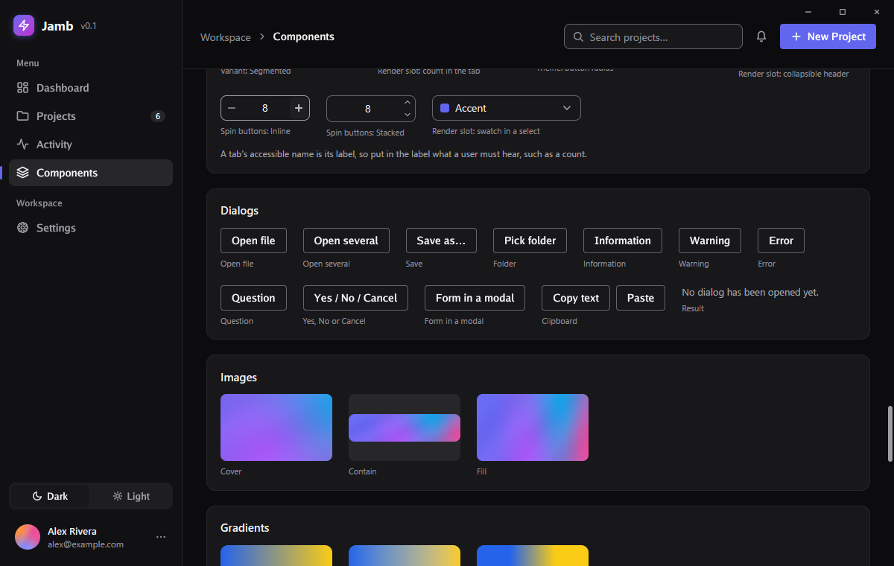

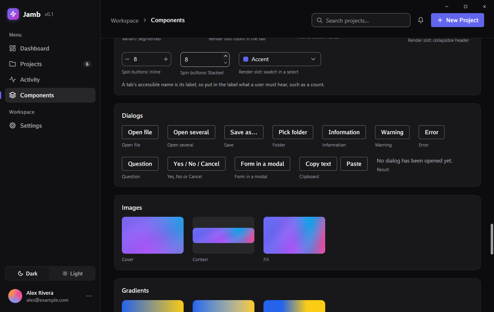

Assistive technology reads a check box with a mixed state as mixed, a switch as a
check box with the Toggle pattern (as Phase B chose), a radio group as a selection
container named by its label, and a select as a combo box whose Value is the
chosen label. A slider and a number input report their range (RangeValue). A
number input is a spin box that holds its text field, as Microsoft's Spinner
control type describes
([Spinner control type](https://learn.microsoft.com/en-us/windows/win32/winauto/uiauto-supportspinnercontroltype)).

### Combobox

A combo box is an editable text field with a list of suggestions below it: `ui.Combobox`.
As the user types, the list opens with the suggestions for the text. The text is the
signal the field reads and writes, as `TextInput` does. The suggestions come from a
function of the query, or from a background function with `SuggestAsync`.

```go
// Suggestions for the text, computed on the UI thread at each change.
ui.Combobox(city, func(q string) []ui.Option[string] { return citiesMatching(q) }).
	Label("City").Placeholder("Type a city").
	OnPick(func(v string) { ... }) // v is the value of the suggestion chosen

// Only the suggestions can be chosen: the text reverts on blur (see AllowFree).
ui.Combobox(fruit, fruits).Label("Fruit").AllowFree(false).Validate(ui.Required[string]())

// A background search with a debounce, and the spinner while it runs.
ui.Combobox[string](q, nil).Label("Address").
	SuggestAsync(func(ctx context.Context, q string) ([]ui.Option[string], error) { ... }).
	Debounce(150 * time.Millisecond).MinChars(2)

// The header search of the demo: values are project IDs, and each row is a render slot.
ui.Combobox(s.Query, searchOptions(s)).Label("Search projects").
	RenderOption(searchOption(s, t)).OnChange(...).OnPick(func(id int) { ... })
```

The options are `ui.Option[T]`, as they are for a select: the value is what `OnPick`
receives, the label is what the text shows and what the suggestions match. The methods:

| Method | What it does |
| --- | --- |
| `OnPick(fn func(T))` | runs with the value of the suggestion chosen by a click or by Enter; the text is set to its label first |
| `OnChange(fn func(string))` | runs with the text after each change the user makes (not for a chosen suggestion) |
| `AllowFree(bool)` | free text is allowed (the default); `AllowFree(false)` chooses only from the suggestions (see below) |
| `MinChars(n)` | the list stays closed until the text has n characters (default 0) |
| `Debounce(d)` | waits for the user to stop typing before asking for suggestions (default: at once) |
| `SuggestAsync(fn)` | finds the suggestions in the background; see below |
| `MaxVisible(n)` | the list is at most n rows high (default 8) and scrolls to the rest; the highlighted row is scrolled into view |
| `ErrorText(s)` | the text of the row shown when an async suggest function fails (default "Couldn't load suggestions") |
| `EmptyText(s)` | the text of the empty slot (default "No results") |
| `RenderOption(fn)` | replaces the label of each suggestion; the label stays the accessible name, and the content is hidden from assistive technology |
| `Validate(rules...)` | the validators of the text, as TextInput has them; see Forms |
| `Placeholder`, `Icon`, `Label`, `LabelledBy`, `Key`, `Disabled`, `FocusHandle` | as for TextInput |
| `Width`, `Height`, `MinWidth`, `MinHeight`, `MaxWidth`, `MaxHeight`, `Grow`, `Styles` | the sizing methods and the look of the parts (see Sizing and Styling) |

The match of the query in each label is highlighted (`HighlightMatches`), so the
label shows which part matched. Its look is the `Match` part of `ui.ComboboxStyle`.
A suggestion that is disabled (`Disabled: true`) is shown and cannot be chosen.

**Keys.** The field follows the combo box pattern of the WAI-ARIA Authoring Practices
(https://www.w3.org/WAI/ARIA/apg/patterns/combobox/). Focus stays in the text while
the list is open, and the highlighted suggestion is the one the keys have reached.

- Typing filters the suggestions and opens the list, with nothing highlighted.
- Down opens the list when it is closed, and moves the highlight to the next suggestion,
  without wrapping. Up moves it back, and from the first suggestion returns to the text.
- Enter chooses the highlighted suggestion and closes the list. With no suggestion
  highlighted, Enter keeps the text as it is and closes the list. When the list is
  closed, Enter is the field's own Enter (in a Form, it submits).
- Escape closes the list. When the list is closed and the text is not empty, Escape
  clears the text (the APG permits this as an option); when the text is empty, Escape
  leaves the field, as it does in a text field.
- Tab closes the list and does not choose the highlighted suggestion. The APG does not
  define Tab while the list is open; the choice here is that Enter is the only key that
  chooses, so a Tab through the field never changes the text.
- Alt+Down opens the list without moving the highlight, and Alt+Up closes it.
- Home and End move in the text.
- A click on a suggestion chooses it and keeps focus in the text. A click in the text opens
  the list when it is closed, and never closes it: the press places the caret.
- Home and End are not keys of the combo box in the APG, so they edit the text. Page Up and
  Page Down are not defined for the combo box either, and are not bound. The list scrolls
  with the highlight, and with the mouse wheel.

The keys are actions of the field (see Actions and key bindings). Up and Down are the
field's while it is enabled, since they open the list. Enter is the field's only while
the list is open, and Escape while the list is open or the text is not empty; otherwise
they are the text field's own keys.

**Free text and choices.** With free text (the default), the text stays as the user
leaves it, and `OnPick` runs only for a suggestion that is chosen. With `AllowFree(false)`,
the field chooses only from its suggestions: when the text loses focus, a text that is
not the label of the suggestion last chosen is reverted to that label, or cleared when
nothing was chosen. A suggestion whose label matches the text exactly (ignoring case) is
chosen in its place. The revert happens when the field loses focus, so a Form submitted
from another control checks the reverted text, and `Required` makes an unchosen
restricted field an error. The change is announced politely and shown under the field, as
"Not in the list; cleared" or "Not in the list; reverted to Apple"; the same text is the
field's description. A text that is empty when the field is left is reverted without a message. A Form submitted by Enter in the field checks the text as it
is at that moment.

**Background suggestions.** `SuggestAsync` runs the function on its own goroutine, with
a context that is canceled when a newer query starts. Its results are shown only when
they are for the latest query; an older result is dropped, so a slow answer cannot
replace a newer one. While a request runs, the list shows a `ProgressRing`. An error
shows the error row (`ErrorText`), and the text is announced politely. The field stays
usable: its text is still free, and editing it asks again. There is no retry button in the
list, since the keys do not reach it. Return promptly when the context is canceled.

**Accessibility.** The field is a ComboBox with ExpandCollapse, its text is an Edit with
the Value pattern, and the suggestions are a List of ListItems with SelectionItem. Expand and
Collapse from assistive technology run the field's own handlers, not its click. Every
suggestion is in the list and in the accessibility tree: the rows are not virtualized, so a
suggest function should narrow its results to a few dozen. The
highlighted suggestion is reported as the focused element, so a screen reader announces
it while the focus stays in the text (the active descendant of APG; see
docs/accessibility.md, Phase L). When the suggestions change, their count is announced
politely, after the changes settle: "5 suggestions", "1 suggestion", or "No results".
Microsoft's AutoSuggestBox guidance (https://learn.microsoft.com/windows/apps/develop/ui/controls/auto-suggest-box)
describes keyboard navigation through the suggestion list, with the text box updated
from the highlighted item. It does not describe the APG's model, in which DOM focus
stays in the combobox; the APG model is the one used here.

### Date and time

`ui.DatePicker` is a text field for a day, with a calendar below it, and `ui.TimePicker` is a
text field for a time of day, with a list of times below it. Both read and write a
`*ui.Signal[time.Time]`. The text is in the short date and clock format of the user's
locale, and the value is set when the text is a date or a time that can be chosen.

```go
var due = ui.NewSignal(time.Time{}) // a zero time is no date

ui.DatePicker(due).Label("Due date").Placeholder("MM/DD/YYYY").
	Min(today).Max(today.AddDate(0, 0, 90)).   // the days that can be chosen
	DisableDays(func(d time.Time) bool { return d.Weekday() == time.Saturday || d.Weekday() == time.Sunday })

var start = ui.NewSignal(time.Time{}) // a zero time is no time; only the clock is read
ui.TimePicker(start).Label("Start time").MinuteStep(15). // the list has a time every 15 minutes
	Min(eight).Max(eighteen)

// A date and a time on one value: each picker keeps the part it does not set.
ui.DatePicker(when).Label("Meeting date")
ui.TimePicker(when).Label("Meeting time")
```

The value of a date picker is a `time.Time` whose day is the chosen day. Its time of day is
kept when the day changes, and a date picker set from the signal shows only the day. The value
of a time picker is a `time.Time` whose clock is the chosen time. Its day is kept when the time
changes, and a new time takes today's day when the value has none. So a date picker and a time
picker on one signal are a date and time picker, with no third widget. Set the value with
`Signal.Set`; `OnChange` runs only for a change the user makes.

| Method | What it does |
| --- | --- |
| `DatePicker`: `Min(t)`, `Max(t)` | the earliest and the latest day that can be chosen; the time of day is ignored (a zero time is no limit) |
| `DatePicker`: `DisableDays(fn)` | rules out the days for which `fn` returns true; they are drawn dimmed, marked unavailable, and refused when typed |
| `DatePicker`: `FirstDay(d)` | the first day of the week in the calendar (default: the locale's) |
| `TimePicker`: `MinuteStep(n)` | the minutes between the times of the list, and the step of Up and Down (default 15) |
| `TimePicker`: `Min(t)`, `Max(t)` | the earliest and the latest time that can be chosen; only the clock is used |
| both: `Validate(rules...)` | validators of the value, such as `ui.Required[time.Time]()`; a zero time is no date or time |
| both: `OnChange(fn)`, `Placeholder(s)`, `Label(s)`, `LabelledBy(keys...)`, `Disabled(bool)`, `Key(k)`, `Styles(st)` | as for the other fields |
| both: `Width`, `Height`, `MinWidth`, `MinHeight`, `MaxWidth`, `MaxHeight`, `Grow` | the sizing methods (see Sizing in docs/styling.md); a date picker is 180 px and a time picker 140 px at the Text size of 100 percent |

`DisableDays` is the name of the rule because `Disabled(bool)` disables the whole field,
as it does for every control.

**Typing.** A date is read in the order of the locale's short date (month, day and year in
the US, day, month and year in most of Europe, year first in some), with any punctuation
between the numbers. A year of two digits is read in the century of the current year, or the
one before when the result would be more than 20 years ahead. A date with no year is in the
current year. Eight digits, such as `10132026`, are read in the same order. Month names are not
read. A time is read with its hour and minute separated by punctuation or a space, or with the
digits run together, such as `930` or `1430`; `AM` and `PM` (or `a` and `p`) make the hour a
12 hour one, and without one the hour is on the 24 hour clock. Enter applies a text that is
valid; a text that is not is kept with a message that gives an example, and the value does not
change. Leaving the field applies a valid text and otherwise shows the value again, as a number
field does, so a form never submits a text the field does not hold. An empty text is no date
or time.

**The calendar and the list.** Alt+Down and F4 open the calendar of a date picker, with the
keys on the chosen day, or on today when there is none. Its keys follow the WAI-ARIA date
picker dialog pattern (https://www.w3.org/WAI/ARIA/apg/patterns/dialog-modal/examples/datepicker-dialog/):

| Key | Moves or does |
| --- | --- |
| Left, Right | one day back or forward |
| Up, Down | one week back or forward |
| Home, End | the first and the last day of the week (the week starts on the locale's first day) |
| Page Up, Page Down | one month back or forward; the day stays, or is the last day of a shorter month |
| Shift+Page Up, Shift+Page Down | one year back or forward |
| Enter, Space | choose the day, and close the calendar; focus returns to the field |
| Escape | close the calendar without a change; focus returns to the field |
| Tab | close the calendar without a change, and move on from the field |

A day that cannot be chosen is still reached by the keys, so the screen reader can say it is
unavailable, but Enter does not choose it. The month changes with the keys, and its name is
announced politely. The navigation buttons of the calendar are for the pointer; the keys above
move a month and a year.

For a time picker, Up and Down step the time by the minute step while the list is closed, and
move the highlight through the list while it is open (Down to the next row, as the rows show).
Alt+Down and F4 open the list with the time the field holds highlighted. Enter chooses the
highlighted time, or applies the typed text when no time is highlighted. Escape and Tab close
the list. Focus stays in the text, as it does in a combo box.

**Locale.** On Windows, the short date pattern, the first day of the week, whether the clock is
12 or 24 hours, the AM and PM designators, the time separator, and the names of the days and the
months come from the user's locale settings, read with `GetLocaleInfoEx` and `GetDateFormatEx`.
Elsewhere, and where those settings cannot be read, the formats are those of en-US. The locale is
read once. The month and day names of the calendar and of the accessible names follow it.

**Accessibility.** A date picker and a time picker are ComboBoxes for assistive technology, with
Expand and Collapse for the calendar or the list, and a Value that is the text. The calendar is a
Calendar (`RoleCalendar`, UI Automation's Calendar control type, with the Grid and Table
patterns). Its weekday names are header items, each day is a data item in a grid of six week
rows and seven columns, named by its long date (such as "Tuesday, October 13, 2026"), and the
chosen day is selected. A day that cannot be chosen is disabled, and today has the description
"Today". See docs/accessibility.md, Phase M.

**Styling.** `DatePickerStyle` and `TimePickerStyle` are the looks of the parts, as the other
widgets' styles are, and `Theme.DatePicker` and `Theme.TimePicker` are the defaults of every
picker in the app. The parts are in docs/styling.md. Under high contrast the selected day is
drawn in the system Highlight colors, today and the focused day are outlined, and no state is
shown by a change of weight.

**Limits.** Months are not read from names in the text. Only the calendar's month and year
buttons are for the pointer, and the calendar closes on Tab rather than keeping focus. The
date picker has no time of day of its own, so a time is set with a time picker on the same
signal. The Today description is in English. Text areas for dates and times are not provided.

### Shrinking and minimum sizes

When a row is narrower than its content, its items shrink in proportion to their
`Basis` and `Shrink`. An item that shrinks is held to an automatic minimum, which
follows CSS Flexbox's automatic minimum size of flex items
([CSS Flexbox, 4.5](https://www.w3.org/TR/css-flexbox-1/#min-size-auto)):

- **Text keeps its widest word.** The minimum is the min-content width of the text:
  the width of its longest unbreakable run, which is a word, or a part of a hyphenated
  word. A text in a shrinking row therefore wraps between words, and never between letters.
- **Containers keep their children's min-content widths.** A column or a wrapping row
  takes the largest of its children's, and a row takes their sum, with the gaps and the padding.
- **Opt-outs.** `Truncate()` sets the minimum to zero, so the text stays on one line
  and shrinks with an ellipsis. `NoWrap()` keeps the full width of the text, since it
  is one line. Any explicit `MinWidth` replaces the automatic minimum. An item that
  clips its overflow (`ScrollX`, `ScrollY`, `ClipContent`) has no automatic minimum.
- **A fixed `Width` is the item's floor**, as it was before this rule: the item does
  not shrink below it. CSS takes the smaller of the width and the content instead, and
  jamb does not. The exception is a text field (`TextInput`, `TextArea` and the frame of
  a `NumberInput`): its fixed width is a ceiling, and in a shrinking row it keeps the
  room for six digits and no more, so it does not collapse to a letter's width. A
  `MinWidth` replaces that minimum.
- **Bars and sliders** (`ProgressBar`, also when indeterminate, and `Slider`) keep a
  default minimum of 160 px, so they stay visible in a container that has no width of
  its own. `MinWidth` replaces it.
- **A word longer than its container breaks inside the word**, so a URL stays within
  its row or column. A word that fits its container does not break, even when a fixed
  item beside it takes the room. The row then overflows, as in CSS, so give such items room.
- The minimums of text grow with the Text size (`JAMB_TEXT_SCALE`). A control whose label
  is wider than a fixed `Width` should use `MinWidth` instead, so the control grows with
  its label.

### Navigation and layout

Tabs, collapsible sections, an accordion and a tree view. Each is bound to
signals or to a node key, as the form controls are, and follows high contrast,
the Text size and reduced motion. Their looks are `ui.CollapsibleStyle` (with an
`Accordion`'s sections) and `ui.TreeStyle`, and a section's header or a tree row can
be drawn with `RenderHeader`, `RenderRow` or `RenderLabel`.

```go
ui.Tabs(section,                                  // *ui.Signal[T], for any comparable T
	ui.Tab[string]{Value: "general", Label: "General", Icon: icons.Settings,
		Panel: func() ui.Element { return generalPanel() }},   // built only while selected (or kept: KeepMounted)
	ui.Tab[string]{Value: "usage", Label: "Usage", Disabled: true, Panel: usagePanel},
).Key("settings-tabs").Label("Settings sections").KeepMounted().OnChange(func(v string) { ... })
ui.Tabs(filter, tabs...).Variant(ui.TabsSegmented)   // one row of segments, the selected one filled
ui.Tabs(view, tabs...).Styles(ui.TabsStyle{Indicator: ui.Style{Height: ui.Px(3)}}) // parts: see Styling
ui.Tabs(count, tabs...).RenderTab(func(tab ui.Tab[int], s ui.PartState) ui.Element { ... }) // your content in each tab

ui.Collapsible("Advanced options", open, content).Key("advanced") // *ui.Signal[bool]
ui.Accordion(sectionA, sectionB, sectionC).SingleOpen()          // one section open at a time

ui.Tree(nodes, selected).Key("files").Label("Project files"). // *ui.Signal[string]: the selected node's key
	Style(ui.Style{MaxHeight: ui.Px(320)}).OnChange(func(key string) { ... })
// ui.TreeNode{Key: "src", Label: "src", Icon: icons.Folder,
//	Children: func() []ui.TreeNode { return loadSrc() }}   // nil Children: a leaf
```

- **Tabs.** The tab list is one Tab stop, at the selected tab, as Microsoft's
  TabView guidance describes: Tab enters the strip at the selected tab and Tab
  again goes to the panel. Left and Right select the previous and next enabled
  tab at once (automatic activation, as the design chose; WinUI's TabView moves
  focus on the arrows and selects with Space or Enter). They do not wrap. Home
  and End go to the first and last enabled tab. Space and Enter select the
  focused tab. A disabled tab is shown but skipped, and it is GrayText under
  high contrast. Ctrl+Tab and Ctrl+Shift+Tab select the next and previous
  enabled tab and wrap around, as TabView does
  ([Tab view keyboard navigation](https://learn.microsoft.com/en-us/windows/apps/develop/ui/controls/tab-view)).
  They work from the tab list and from the panel. Inside a tab group, Ctrl+Tab
  is therefore bound, and focus moves to the selected tab. Only the selected
  panel is built, so the state of the other panels is discarded when the
  selection moves. `KeepMounted()` keeps them: each panel is built the first time
  its tab is selected, and then stays in the tree, hidden with `Display` while
  other tabs are selected. Its component instances, Local state, text, selection
  and scroll positions survive switching tabs, and switching does not render it.
  It renders again when the code that makes the tabs runs again, and when its own
  state changes. A hidden panel is not in the tree, the Tab order or the hit test.
  The project window keeps its Overview and Comments tabs this way, so a draft
  comment and the scroll position survive. Without `KeepMounted()`, keep the data in
  signals, as the other demo samples do.
  The selected tab has a line under it, in Accent (Highlight under high contrast),
  so the selection is not carried by color alone. No state makes the text bold.
  Tabs take the height their parent gives them, so a panel can fill a window.
  `Variant(ui.TabsSegmented)` draws the tabs as one row of segments instead, with
  the selected segment filled in Accent (Highlight under high contrast). Both
  variants keep the same keys, keyboard behavior and accessible names. The parts
  of a tab list (`List`, `Tab`, `TabSelected`, `TabHover`, `TabDisabled`,
  `TabFocusVisible`, `Indicator`, `Panel`) are set with `Styles` or the theme, and
  `RenderTab` draws each tab's content yourself. A tab's accessible name stays its
  `Label`, so a count the user must hear belongs in the label.
- **Collapsible.** The header is a button with the Expanded state. Space and
  Enter open and close it, as a click does, and its chevron points right when closed
  and down when open. The content is not built while the section is closed. With
  `KeepMounted()` it is built on the first opening and then kept hidden while the
  section is closed, so its state survives closing and opening.
  Assistive technology reads the header as expandable and expanded, and the
  content as a group named by the header.
- **Accordion.** Sections open and close on their own. `SingleOpen` makes
  opening one section close the others, as the Expander guidance describes for a
  group ([Expander](https://learn.microsoft.com/en-us/windows/apps/develop/ui/controls/expander)).
  A section's `OnChange` runs when it is closed by the accordion too.
- **Tree view.** Only the rows in view are built, so a tree of tens of thousands
  of nodes costs what its visible part costs. A node's children are asked for only
  while it is open. Size the tree with `Style`: a tree with no bounded height
  shows every row. The tree is one focusable element. Its keys act on the
  selected node, which follows the keyboard (single selection). Down and Up move
  to the next and previous visible node, without wrapping. Home and End go to the
  first and last visible node. Right opens a closed node, and on an open node
  moves to its first child. Left closes an open node, and otherwise moves to the
  parent. Enter and Space open and close a node with children. `*` opens the
  closed siblings of the selected node, and typing letters selects the next node
  whose label starts with them. These follow the WAI-ARIA tree view pattern
  ([Tree View Pattern](https://www.w3.org/WAI/ARIA/apg/patterns/treeview/)). A click
  selects a node, and a click on its chevron opens or closes it without selecting.
  A double-click opens or closes it. Keys are kept by node key, so focus and the
  selection stay with their node as the rows scroll.

### Split panes

`ui.Split(first, second)` lays out two panes with a divider between them that the
user drags, or moves with the keys, to give one pane more of the space. The panes
are any elements, so a split can hold another split. Its look is
`ui.SplitStyle` (the divider, its hover, drag and focus states, the grip and the
panes; see the Styling section), and its sizing methods are the same as the other
widgets'.

```go
pos := ui.NewSignal(0.35)            // the first pane's share of the split, from 0 to 1
ui.Split(list, details).Position(pos).Label("Resize list").
	FirstLabel("List").SecondLabel("Details").
	MinFirst(ui.Px(120)).MinSecond(ui.Px(160)).OnChange(func(v float64) { save(v) })

width := ui.NewSignal(300.0)         // the first pane's width in logical pixels
ui.Split(sidebar, editor).PixelPosition(width).MinFirst(ui.Px(200)).MaxFirst(ui.Px(480))

ui.Split(top, bottom).Orientation(ui.SplitVertical).Position(split)    // stacked
ui.Split(files, editor).Collapsible(ui.SplitFirst).Collapsed(collapsed) // Enter collapses
```

**The position is a signal the app owns**, so it can be saved and restored. The
default is a fraction: the first pane's share of the split's length, from 0 to 1.
The panes keep their proportions when the window is resized. `PixelPosition` holds
the first pane's size in logical pixels instead, and the second pane takes the rest
of the space when the window is resized. The limits (`MinFirst`, `MaxFirst`,
`MinSecond`, `MaxSecond`) take `ui.Px` lengths only, since they are compared with the
split's size in pixels; a percentage panics. The divider keeps to the limits while
it moves, and a fraction split keeps the limits as the layout does.

With no `Position` the split keeps its position itself, starting at one half. An app
that wants the position kept across runs passes a signal, as the notes app does.

The divider is 1 px wide by default (`Divider`, its `Width` in a horizontal split
and its `Height` in a vertical one), in a 9 px hit area, so it is easy to grab. The
grip is a short pill over its middle.

- **Pointer.** Dragging the divider moves it. The pointer is captured while the
  button is held, so a drag that leaves the divider still moves it. The cursor is the
  horizontal or vertical resize cursor. A double-click collapses or restores a
  collapsible pane.
- **Keyboard.** The divider is one Tab stop. Left and Right move it in a horizontal
  split, and Up and Down in a vertical one, by 5 percent of the split or 10 logical
  pixels. Shift with an arrow moves it by 10 percent or 50 logical pixels. Home and
  End go to its limits. Enter collapses or restores the collapsible pane. A
  collapsed split does not move with the keys or the pointer until it is restored.
  The keys follow the window splitter pattern of the WAI-ARIA Authoring Practices
  (https://www.w3.org/WAI/ARIA/apg/patterns/windowsplitter/), which makes Enter the
  toggle of the primary pane; the Home and End keys are the pattern's optional ones.
  Shift and the Page keys are not part of the pattern, so Shift with an arrow is the
  larger step.
- **Collapse.** `Collapsible(p)` names the pane that collapses, and `Collapsed`
  holds the state. A collapsed pane is hidden, with its content kept in the tree, so
  its state survives the collapse. The other pane takes the whole split. The position
  is not changed by a collapse, so restoring the pane brings back its previous size.
- **Accessibility.** The divider is a focusable element with the Separator role, a
  name (`Label`, by default "Resize panes") and the RangeValue pattern: the value is
  the position in the units of the signal, and the minimum and maximum are the limits
  the divider can move between. A change of the position is a change of the Range
  value, which the accessibility tree publishes as a property change. Assistive
  technology can set the value. Each pane is a group named by `FirstLabel` and
  `SecondLabel`, when they are given. Microsoft has no splitter control type, so the
  divider uses Separator, which the Windows Separator control type defines
  (https://technet.microsoft.com/en-us/ee671643(v=vs.71)).
  The control type that a splitter exposes in other frameworks was not verified
  for this release.
- **Layout.** A split fills its container by default, in both directions. In a
  column with other children, give it a `Height` or a `Grow` so it has room. The
  split learns its length from the layout of the frame before, so its range is
  correct from the frame after its first layout. A window resize does not render
  the split, so its range minimum and maximum follow its next render. The value does
  not change with the resize in either mode.

The demo's Components page has a "Split panes" section with a fraction split, a
stacked one, a nested one, a collapsible pane and a pixel split with limits. The
notes app's sidebar is a pixel split, and its width is kept in `settings.json`.

### Feedback

Progress bars, busy rings, toasts and badges. They use the theme's colors, follow
high contrast, the Text size and reduced motion, and show their state by a shape or
a word as well as by a color. Their looks are `ui.ProgressBarStyle`, `ui.ProgressRingStyle`,
`ui.BadgeStyle` (per variant in `Theme.Badges`), `ui.ToastStyle` (per kind in
`Theme.Toasts`, and per toast with `Toast.Styles`) and `ui.TooltipStyle`.

```go
ui.ProgressBar(0.45).Label("Upload").Color(accent)    // 0 to 1, or set .Min(lo).Max(hi); Color is the fill
ui.BadgeText("Active").Variant(ui.BadgeAccent).StatusDot() // a word with a dot in front
ui.ProgressBar(3).Min(0).Max(8).Label("Setup steps").
	Format(func(v float64) string { return fmt.Sprintf("%.0f of 8", v) })
ui.ProgressBar(0).Indeterminate().Label("Searching")      // work of unknown length
ui.ProgressRing().Size(ui.RingSmall).Label("Sending reply") // busy: RingSmall, RingMedium, RingLarge
ui.Badge(6).Noun("items").Variant(ui.BadgeAccent)     // a count; above Max (99) it shows 99+
ui.BadgeText("New").Variant(ui.BadgeSuccess)          // a word
ui.BadgeDot().Variant(ui.BadgeDanger)                 // a dot only
ui.Div().Label("Projects").Badged(ui.Badge(6).Noun("items")) // a badge on an element
ui.Toaster().Key("toaster")                           // once, as the last child of the window's root
ctx.Toast(ui.ToastSuccess, "Project created").Action("Undo", undo) // in a handler
```

- **Progress bar.** A determinate bar is a read-only range: its value is clamped to
  its range, and its readout is the percentage of the range, or what `Format` returns.
  An indeterminate bar slides across its track and repeats. With reduced motion it
  stays in the middle, and it never asks for frames.
  `Color` sets the fill for an app that has a color of its own; the default is the
  theme's accent. The default fill is 3:1 or more against the track in both themes.
  An app color is the app's responsibility: the fill is a graphical object and needs
  3:1 against the track (WCAG 1.4.11). Under high contrast the fill is Highlight, and
  `Color` is not used.
- **Busy ring.** Eight dots, four of them lit, turn around the ring. It has no value,
  so it has no range. With reduced motion it is drawn still: dimmed dots, or solid ones
  under high contrast. Its name is "Loading…" unless `Label` gives another. Its sizes
  (`RingSmall`, `RingMedium`, `RingLarge`) are fixed in pixels, as icon sizes are, so
  they do not grow with the Text size; an app that needs a larger ring passes a larger
  size.
- **Badge.** A count of zero draws nothing, so a badge can stay in place while its
  count is empty. `Variant` sets the color: `BadgeNeutral`, `BadgeAccent`,
  `BadgeSuccess`, `BadgeWarning` or `BadgeDanger`. Under high contrast a badge is
  outlined, and its text carries the meaning. A badge's text is dark on the bright
  Success and Warning fills, and light on the others, in both themes. Every variant's
  text is 4.5:1 or more against its fill in both themes, and under both high contrast
  schemes. `StatusDot()` puts a dot in front of a text badge, as a status chip has one; the dot
  is hidden from assistive technology.
- **Badge on an element.** `Badged` adds the badge to the end of the element and adds
  its text to the element's accessible name, as in "Projects, 6 items". The badge is
  then hidden from assistive technology, so the element is read once, with its count.
  A badge that stands alone is a group named by its text, such as "3 unread".
- **Toasts.** `ctx.Toast` shows a notification in the window's `Toaster`. It takes a
  variant: `ToastInfo`, `ToastSuccess`, `ToastWarning` or `ToastError`, each with its
  icon. The toast can add an `Action` button (running it dismisses the toast), set its
  own time with `Duration`, stay until dismissed with `Sticky`, or go with `Dismiss`.
  By default an info toast stays 5 seconds, a success toast 4, a warning toast 8, and an
  error toast until it is dismissed. Its time does not run while the pointer is over it
  or keyboard focus is in it. A shown toast asks for no frames while its time
  runs: the window is woken when the toast runs out. The stack shows 3 toasts at most (`Toaster().Max(n)`).
  When a new toast would pass the limit, the oldest toast that is neither hovered nor
  holding keyboard focus goes. A toast a user is reading or using is kept, and if every
  toast is in use the stack grows for the time being. The stack sits in the window's
  bottom-right corner over the content, so put the `Toaster` last in the root element.
  Its enter and exit motion jumps to its end under reduced motion.
- **Toasts and focus.** A toast does not take focus. F6 moves focus into the toast
  region, named "Notifications", and F6 again returns it to the element that had it,
  as Windows moves between the regions of a window
  ([Keyboard accessibility](https://learn.microsoft.com/en-us/windows/apps/design/accessibility/keyboard-accessibility)).
  Shift+F6 does the same. Tab reaches the actions and close buttons of the toasts.
  Escape on a toast dismisses it, and focus moves to the next toast or back to the
  element it had. Escape in the region returns focus. F6 toggling is what the framework
  does for now: full cycling through several regions (the sidebar, the header, the
  content, the toasts), as Microsoft's guidance describes, is future work.
- **Toast announcements.** Each toast is announced through `Announce`: politely for
  info and success, and assertively for warning and error, as the existing
  announcements are. Its group is named by its text.

### Rich text

`ui.Rich` joins segments into one text element. It wraps, truncates and
aligns like `ui.Text`, and it is one node, so a row of mixed styles stays one
line when it is `Truncate()`d.

```go
ui.Rich(
    ui.Seg("Alex").Style(ui.Highlight{Weight: ui.FontSemibold}), // or .Bold()
    ui.Seg(" pushed to ").Color(t.TextMuted),
    ui.Link("Project Beta", openProject),   // accent color; underlined on hover; a click runs openProject
    ui.Seg(" main").Mono().Background(t.Surface),
).Truncate()

// Ranges of an existing text, by byte offset (use strings.Index on the same string):
ui.Text(body).Highlight(start, end, ui.Highlight{Background: t.AccentSoft, Color: t.Text})
// Every case-insensitive match of a search query (a blank query does nothing):
ui.Text(body).HighlightMatches(query, ui.Highlight{Background: t.AccentSoft, Color: t.Text})
```

- `Highlight` has `Color`, `Background`, `Weight`, `Italic`, `Underline`,
  `Strikethrough` and `Mono`. Zero fields keep the text's own style. Later
  highlights win field by field over earlier ones and over segments.
  Offsets outside the text, or inside a UTF-8 sequence, panic and name the
  offset and the text.
- `HighlightMatches(query, h)` applies `h` to every case-insensitive match of
  `query`, found by rune comparison so the offsets stay valid for text whose
  lowercase form differs in length (İ, the Kelvin sign). A blank query leaves
  the text as it is. On a Rich text it searches the joined text.
- `Segment.Hover(h)` applies `h` while the pointer is over the segment. Only
  the paint fields (`Color`, `Background`, `Underline`, `Strikethrough`) apply;
  weight, italic and mono in a hover are ignored, so hovering never re-lays
  out the text.
- `OnClick` (and `Link`) make a segment clickable: the pointer becomes a hand
  over it. A link inside a clickable row gets the click; the row's `OnClick`
  runs only for the rest of the row.
- `ui.Text(...).Italic()` and segment `Italic()` use the family's italic face.
  A family without an italic face for that weight uses its upright face: there
  is no synthetic slant. Segoe UI and Consolas have italics on Windows; the
  embedded Go fonts are the fallback elsewhere.
- An app ships its own fonts with `app.New().Font(family, weight, data)`, once per
  face, and uses them with `Font(family)` on a `Text` or `FontFamily` in a `Style`:

  ```go
  //go:embed fonts/Inter-Regular.ttf
  var interRegular []byte

  app.New().Font("Inter", ui.FontRegular, interRegular).Run(app.Window{...})
  ```

  The fonts are parsed while the first window opens; data that is not a font makes
  `RunE` return an error. A registered family has upright faces only, so italic text
  in it uses the upright face.
- A weight the family has no face for uses the nearest face, and the heavier
  one on a tie, as Windows' DirectWrite does. Medium (500) in Segoe UI, which
  has Regular and Semibold faces, is drawn Semibold. The family's own faces
  always come before the embedded Go fonts, so text never switches typeface
  because of its weight.
- Rich text is display-only. `TextArea` stays single-style.

### Drag and drop

Drag and drop is typed, as in GPUI: a drag carries a Go value, and a target
receives it only when the value's type matches the target's.

```go
// A source. The drag starts after the pointer moves 4 px with the button held;
// a press that does not move is still a click.
ui.Div().OnDrag(ui.Drag(note).
    Preview(func() ui.Element { return notePill(note) }). // drawn centered on the pointer; optional
    End(func(dropped bool) { ... })).                     // after a drop, a cancel, or a release over nothing
    Dragging(ui.Style{Opacity: 0.5})                      // the source's style while it is dragged

// A target for *store.Note. Each OnDrop takes one payload type; a target may
// have several, and the first on the deepest element that accepts wins.
ui.Div().OnDrop(ui.Drop(func(n *store.Note, e *ui.DropEvent) { ... }).
    Accept(func(n *store.Note) bool { return true }). // like GPUI's can_drop
    Over(ui.Style{BorderColor: accent}).              // merged while an accepted drag is over it
    Move(func(n *store.Note, e *ui.DropEvent) { ... }). // pointer moved over it: e.LocalX, e.LocalY
    Leave(func() { ... }))                            // the drag left it, or ended

// Files dropped from the desktop arrive as ui.Files (their paths).
ui.Div().OnDrop(ui.Drop(func(files ui.Files, e *ui.DropEvent) { ... }))
```

- Matching is by type assertion, so `ui.Drop[fmt.Stringer]` takes any payload
  that implements it, and a `ui.Drop[string]` never takes a `type label string`.
- `DropEvent` has logical pixels: `X`, `Y` in the window, `LocalX`,
  `LocalY` relative to the target, and the target's size `W`, `H`, so a row
  can insert before or after itself with `e.LocalY > e.H/2`.
- Escape, or the window losing focus, cancels a drag; `End` then runs with
  `false`. The source may leave the tree mid-drag; the drop still delivers its
  payload.
- While a drag runs, nothing is hovered or pressed, and the cursor shows
  not-allowed unless the pointer is over a target that accepts the payload.
- A `Preview` is not hit-tested: targets under it are found as if it were
  not there. It starts exactly over the source and follows the pointer.
- Within 32 px of the top or bottom edge of a scroll container (left or
  right for a horizontal one), a drag scrolls it. Nothing animates outside
  that zone, so an idle drag costs no CPU.
- A file drop calls only the `Drop[ui.Files]` target under the pointer. Its
  `Over`, `Move` and `Leave` never run: Windows does not report the pointer
  during a drag from outside the app.

### Animation

Paint-only properties ease with `.Transition`. When `Opacity`, `Offset` or
`Scale` (or a color) changes, it eases over the duration, without re-running
components or re-laying out. The first paint shows the current value at once.

```go
ui.Div().Transition(160 * time.Millisecond).Offset(0, -4).Scale(1.02).Opacity(0.9)
```

`ui.Animate` re-renders a function every frame with eased progress, so any
property can animate, layout included:

```go
ui.Animate("bar", ui.Animation{Duration: 600 * time.Millisecond, Easing: ease.OutCubic},
	func(t float32) ui.Element {
		return ui.Div().Height(ui.Percent(v * 100 * t)).Background(accent)
	})
```

- `ui.Animation{Duration, Easing, Repeat}`. `Easing` maps progress 0..1 to
  0..1; nil is ease-out cubic. `Repeat` loops forever (for `Animate`). An
  `Animate` restarts from 0 when its key changes, and stops asking for frames
  when it ends: after the end its function runs once more with t = 1.
- An animation whose element is out of view asks for no frames either: clipped
  or scrolled out of the viewport, hidden by `Display(false)`, or in a window
  that is minimized or covered by another window. The progress is time based,
  so when the element is drawn again the animation shows the progress of that
  moment and runs on from there, with no jump.
- `github.com/tyler-builds/jamb/ease` has `Linear`, `In`, `Out`, `InOut` (quadratic), `InCubic`,
  `OutCubic`, `InOutCubic`, `Bounce(f)` (out and back) and `Reverse(f)`.
- `.Offset(x, y)` moves an element after layout: its place in the flow does
  not change, and hit testing and `Find` follow the element. `.Scale(s)` draws
  the element and its children about their center. Hit testing ignores scale.
- `.Enter(m, a)` plays when the element first appears: it starts with the look
  of the `Motion` `m` and settles into its normal look over `a`.
  `.Exit(m, a)` keeps the element drawn after it is removed while it moves to
  `m`. The helpers are `ui.Fade()`, `ui.Slide(x, y)` and `ui.Grow(s)`, which
  combine by chaining: `ui.Fade().Slide(0, -6).Grow(0.98)`.

```go
ui.Div().Key("palette").Overlay(ui.BelowCenter).
	Enter(ui.Fade().Slide(0, -6).Grow(0.98), ui.Animation{Duration: 140 * time.Millisecond}).
	Exit(ui.Fade().Grow(0.98), ui.Animation{Duration: 90 * time.Millisecond})
```

Cost: `Opacity`, `Offset`, `Scale`, transitions and enter and exit are paint-only,
so they cost no layout. A property that changes the layout (`Width`,
`Padding`, ...) costs a re-layout of the path to the root on each frame of its
animation. An exiting element leaves the layout at once, so its siblings move
straight away. It is drawn above its former siblings while it exits. It is a
ghost: it cannot be hit, focused or found, and it disappears when its exit ends.
Showing it again during its exit drops the ghost.

With Windows' Animation effects turned off (Settings, Accessibility, Visual
effects), jamb asks for reduced motion (`ctx.ReducedMotion()`). Then `Transition`,
`Enter` and `Exit` jump to their end, and smooth scrolling jumps to its target. An
`Animate` that is finite jumps to its last frame, and a repeating one stops at its
first frame, so nothing asks for more frames. Apps should check `ctx.ReducedMotion()`
before they run their own motion.

### Actions and key bindings

An action is a named command. Elements handle it with `OnAction`, key
bindings run it, and `ctx.Dispatch` runs it from code. Create actions once,
as package variables:

```go
var (
	NewNote = ui.NewAction("notes.new", "New note")
	Palette = ui.NewAction("notes.palette", "Command palette")
)

ui.Div().OnAction(NewNote, a.newNote)                // runs while focus is on or inside this element
ui.Div().KeyContext("Palette").Child(ui.TextInput(q)) // names a key context for BindIn
app.Window{Bindings: []ui.Binding{                   // or rt.AddBindings(...)
	ui.Bind("ctrl+n", NewNote),                      // global; strokes are "ctrl+shift+p", "alt+up", "f2"
	ui.Bind("ctrl+k ctrl+t", ToggleTheme),           // a chord: the first stroke waits up to a second
	ui.BindIn("Palette > Editor", "up", PaletteUp),  // only inside a Palette that holds a field
	ui.BindIn("Editor", "ctrl+a", ui.NoAction),      // turns Ctrl+A off in text fields
	ui.BindIn("Editor", "ctrl+z", ui.Unbind(actions.Undo)), // Ctrl+Z is no longer Undo in fields
}}
ctx.Dispatch(NewNote)                                // runs along the focus path; false if unhandled
ctx.KeysFor(NewNote)                                 // "Ctrl+N", for tooltips
ctx.AvailableActions()                               // actions handled on the focus path, deepest first
```

`action.Hide()` marks an action for menus and command palettes to leave out;
`action.Hidden()` tells them. Hidden actions still run and still appear in
`AvailableActions`.

**Turning keys off.** `ui.NoAction` disables keys. `BindIn("Editor", "ctrl+a",
ui.NoAction)` makes Ctrl+A do nothing in a text field: the key goes on to
`OnKeyDown` and text input, as if nothing had bound it. `ui.Unbind(a)` removes
`a`'s bindings for the same keys, and only those. `BindIn("Editor", "ctrl+z",
ui.Unbind(actions.Undo))` frees Ctrl+Z from Undo in fields, and a global binding for
Ctrl+Z still runs. A `NoAction` or `Unbind` affects only the bindings ranked
below it, so one added earlier, or one in a shallower context, does nothing.
`KeysFor` skips the bindings they turn off.

**Key contexts.** `KeyContext` takes whitespace-separated entries, each an
identifier (`Editor`) or an attribute (`mode=full`), as in GPUI. Identifiers
use letters, digits, `_` and `-`. A malformed spec panics, naming the problem:
`ui.KeyContext("Editor mode="): "mode=" has no value`.

**Expressions.** `ui.BindIn` takes a GPUI context expression. It is parsed when
the binding is made, and a malformed one panics. The operators, from loosest to
tightest, are `>`, `||`, `&&`, `==` and `!=`, and `!`; parentheses group.

| Syntax | Matches when | Example |
|---|---|---|
| `Editor` | some context on the focus path has the identifier | `BindIn("Editor", "ctrl+d", actions.DeleteForward)` |
| `mode == full`, `mode != full` | the attribute is, or is not, `full` (`!=` also matches when it is absent) | `BindIn("mode == full", "f2", rename)` |
| `!Terminal` | no context on the focus path has the identifier | `BindIn("!Terminal", "ctrl+s", save)` |
| `a && b`, `a \|\| b` | both, or either, match | `BindIn("Editor && mode == single_line", "enter", actions.Confirm)` |
| `a > b` | `b` matches inside a context that matches `a` | `BindIn("Palette > Editor", "up", PaletteUp)` |
| `(a \|\| b) > c` | grouping | `BindIn("Pane > (Editor \|\| Terminal)", "ctrl+w", close)` |

**Precedence.** A contextual binding's depth is the depth at which its
expression matches, counting contexts from the root; a global `Bind` has depth
0. Bindings run deepest first, and at equal depth the one added last runs
first. So a binding for the field's own context beats one for its parent, and
any contextual match beats a global binding.

This differs from GPUI on purpose. There, a global binding ranks at the
deepest level, so a later one can take a key that a field uses. In jamb a
global `Bind` ranks below every contextual binding, so a global shortcut never
takes a key that a focused field uses. To override a field's key, bind it in
the field's context, as `BindIn("Editor", ...)` does.

**Escape and overlays.** Escape closes the topmost open overlay that has an
`OnClickOutside`, one overlay per press, and otherwise hides a visible
tooltip. It runs after the bindings and the `OnKeyDown` handlers, so an app's
binding or handler for Escape takes it first; the notes palette binds Escape
to close itself and return focus to the note. While an overlay or tooltip
would take Escape, the field's built-in Cancel (which blurs a text field) does
not run, so one Escape closes an overlay even when its text field has focus.
With nothing open, Escape does what it did before. An overlay without
`OnClickOutside` is not closed by Escape. Holding Escape closes one overlay:
the auto-repeats of the press that closed it are ignored, so they neither close
the next overlay nor blur a field; press again to close the next one.

A menu takes Escape itself: the first press closes its open submenu, and the
next closes the menu (see [Menus](#menus)).

Key presses are handled in this order:

1. the rest of a chord in progress;
2. all bindings, contextual and global, in precedence order: the first whose
   action has a handler on the focus path runs;
3. `OnKeyDown` on the focused element, then its ancestors up to the root;
4. Enter or Space, without modifiers and not an auto-repeat, runs the focused
   element's `OnClick` (text fields are not clickable, so they keep these keys);
5. Tab, which also reveals the element it moves to, and the zoom keys.

A key that is both a binding and the start of a longer chord waits up to one
second for the chord's next stroke. If the next key completes a binding, that
binding runs. If the next key matches nothing, the waiting keys are replayed as
if the chord had never started: the longest run that matches a binding runs as
that binding, and any other key goes through steps 3 and 4 and types its text.
Then the new key is handled from step 1. Moving focus while a chord waits drops
it, without replaying it.

So a chord that begins with a printable key, such as `g g`, delays typing that
key in a field by up to a second. Prefer a modifier (`ctrl+k ctrl+t`) or a
context such as `!Editor`. A key press that a single-stroke binding consumes
types no text when it is printable (letters, digits, space, `=` and `-`). A key
that waits for a chord keeps its text, which is typed if the chord is replayed.

**Keymap files.** Key bindings can also come from a JSON file, so users can
change them without code. `app.Window` takes the file and the actions it may
name:

```go
app.New().Run(app.Window{
	Bindings:   views.Bindings(),
	KeymapFile: "keymap.json", // a missing file is fine; changes are applied while the app runs
	Actions:    views.Actions(), // the actions the file may name
	OnKeymapLoad: func(err error) { // optional: nil on success, else the problems
		// show err in the UI
	},
	// ...
})
```

The file is a JSON array of sections. A section has an optional `context`
(the same expression `BindIn` takes; none means global) and its `bindings`,
which map keys to actions:

```json
[
  {"bindings": {"ctrl+shift+n": "notes.new"}},
  {"context": "Editor", "bindings": {
    "ctrl+d": "editor.delete-forward",
    "ctrl+a": null,
    "ctrl+z": {"unbind": "editor.undo"}
  }}
]
```

A value is an action name, `null` for `NoAction`, or `{"unbind": name}` for
`Unbind`. Later sections and later keys win, as code order does. The file's
bindings come after `Bindings`, so they override the defaults. The text-field
actions (`ui.EditorActions()`) and `NoAction` can always be named.

`keymap.Parse(data, actions)` parses the bytes of a file, and
`keymap.Load(path, actions)` reads one. Both return the valid bindings and
an error that lists every problem, naming its section (counted from 1), its
context and its keys, for example `keymap section 2 (context "Editor"): "ctrl+d":
unknown action "editor.delet-forward"`. `app.Window` prints the problems to
stderr with a `jamb:` prefix and still applies the valid bindings, so one bad
entry costs only itself.

The file is watched, and saving it applies the change while the app runs. A
file that does not parse at all (for example, a save caught half-written)
keeps the previous bindings and reports the error through `OnKeymapLoad`. On
Windows the watch uses the OS's change notifications, so nothing is polled
and an idle app uses no CPU for it. `app.Window` does this for you;
apps that wire it themselves can use a `keymap.File{Path, Actions}` and call
its `Apply(rt)`, which reads the file and replaces its bindings as one layer.
`rt.SetBindings(layer, bindings)` sets other layers. `ui.ParseBinding` makes a
single binding from a keys string and an optional context, returning an error
rather than panicking.

**Text fields.** A `TextInput` has the context `Editor mode=single_line`, and a
`TextArea` has `Editor mode=full`. Their keys are actions, bound by
`ui.DefaultBindings()`, which `ui.NewRuntime` adds first, so a binding of the
app's at the same depth wins. The actions are in the `actions` package:
`actions.MoveLeft`, `MoveRight`,
`MoveWordLeft`, `MoveWordRight`, `SelectLeft`, `SelectRight`, `SelectWordLeft`,
`SelectWordRight`, `MoveUp`, `MoveDown`, `SelectUp`, `SelectDown`, `PageUp`,
`PageDown`, `SelectPageUp`, `SelectPageDown`, `MoveLineStart`, `MoveLineEnd`,
`SelectLineStart`, `SelectLineEnd`, `MoveToStart`, `MoveToEnd`,
`SelectToStart`, `SelectToEnd`, `DeleteBack`, `DeleteForward`,
`DeleteWordBack`, `DeleteWordForward`, `Newline`, `Indent`, `Confirm`,
`SelectAll`, `Copy`, `Cut`, `Paste`, `Undo`, `Redo` and `Cancel`. They are
hidden, so a palette does not list them. Rebind them like any action:

```go
rt.AddBindings(ui.BindIn("Editor", "ctrl+d", actions.DeleteForward))      // a new key
rt.AddBindings(ui.BindIn("Editor", "ctrl+backspace", actions.DeleteBack)) // replaces the default word delete
```

Behavior changes from earlier versions: a key the defaults don't list (Ctrl+Up,
Alt+Left, Shift+Delete, Shift+Enter in a single-line field, Ctrl+Shift+Backspace)
is no longer handled by a field, so it bubbles on. Shift+Tab and Ctrl+Tab are
unbound in fields, so they move focus as before. A `Tabs` group binds Ctrl+Tab and
Ctrl+Shift+Tab to its tabs (see Navigation and layout).

**Palettes.** A command palette's search field is an `Editor` inside a
`KeyContext("Palette")`. Its keys therefore belong to `"Palette > Editor"`:
`BindIn("Palette", "up", ...)` would lose to the field's own Up, because the
field's context is deeper, and the caret would move instead. This is GPUI's
rule; Zed writes `Picker > Editor` for the same reason.

Reusable styles are ordinary values. Zero-valued fields mean "unset":

```go
var Card = ui.Style{Padding: ui.All(16), Radius: 12, Background: ui.Hex("#18181b")}
ui.Div().Style(Card)
```

State and re-render boundaries:

```go
count := ui.NewSignal(0)
ui.Component(func(ctx *ui.Context) ui.Element {      // re-runs only when count changes
    return ui.Button(fmt.Sprintf("Count: %d", count.Get())).
        OnClick(func() { count.Set(count.Peek() + 1) })
})

// State that belongs to one component (a draft, an open/closed flag):
ui.Component(func(ctx *ui.Context) ui.Element {
    open := ui.Local(ctx, "open", false)            // *ui.Signal[bool], lives with the component
    ...
})
```

`ui.Local` finds state by name, not by call order, so it is safe inside
conditions and loops. It lives as long as the component and starts fresh if
the component is removed and added again.

A value derived from signals is a `ui.Computed`. It remembers its result and
runs its function again only when it is read after a signal it read changed;
`Get` subscribes the rendering component, as a signal's does, and `Peek` does
not. Create it once, like a signal, and read it on the UI thread (in a render,
an event handler or a `Post` function):

```go
total := ui.NewComputed(func() int {           // *ui.Computed[int]
    sum := 0
    for _, item := range cart.Get() {
        sum += item.Price
    }
    return sum
})
ui.Textf("Total: %d", total.Get())             // re-renders when cart changes
```

Long lists build only the rows on screen. Every row must share one height;
the list measures the first row and positions the rest from it:

```go
h := ui.NewListHandle()
ui.UniformList(len(events), func(i int) ui.Element { return eventRow(events[i]) }).
    Style(ui.Style{Grow: 1}).Handle(h)  // Style sizes the scroll container
h.ScrollToItem(5000)                    // scrolls the least amount that shows row 5000
```

Treat a signal's value as immutable. To change a slice or map, build a new
one and `Set` it. Changing it in place notifies nobody.

### Menus

jamb draws its own menus, so they match the theme, work with a custom title
bar, and need no platform code. A menu's look is `ui.MenuStyle` (`Theme.Menu`, or
`.Styles(...)` on a `DropdownMenu`), and a menu bar's labels are `ui.MenuBarStyle`
(`Theme.MenuBar`, or `.Styles(...)` on the bar). A menu is a list of `ui.MenuItem`s:

```go
ui.MenuItem{Label: "Open in window", Icon: icons.ArrowUpRight, OnClick: openWindow}
ui.MenuItem{Action: NewNote}                       // label, shortcut and run come from the action
ui.MenuItem{Label: "Star", Check: ui.MenuCheckBox, Checked: starred, OnClick: toggleStar}
ui.MenuItem{Label: "Paused", Check: ui.MenuCheckRadio, Checked: status == paused, OnClick: setPaused}
ui.MenuItem{Label: "Status", Submenu: []ui.MenuItem{...}} // opens to the right
ui.MenuItem{Label: "Archive", Disabled: true}      // shown, but cannot be chosen
ui.MenuSeparator()
ui.MenuSection("Status")                           // a group label; runs nothing
```

Three elements open a menu. Each takes a function that builds the items when
the menu opens:

```go
// Right-click, or Shift+F10 or the Menu key while the element has focus.
ui.Div().Focusable().ContextMenu(func() []ui.MenuItem { return rowMenu(p) })

// A click, or Enter, Space or Down while the trigger has focus, opens a menu below it.
ui.DropdownMenu(ui.Button("Actions").Secondary(), func() []ui.MenuItem { return actions() })

// A row of top-level menus. Pressing and releasing Alt by itself focuses the bar.
ui.MenuBar(
	ui.TopMenu{Label: "File", Items: fileMenu},
	ui.TopMenu{Label: "Edit", Items: editMenu},
)
```

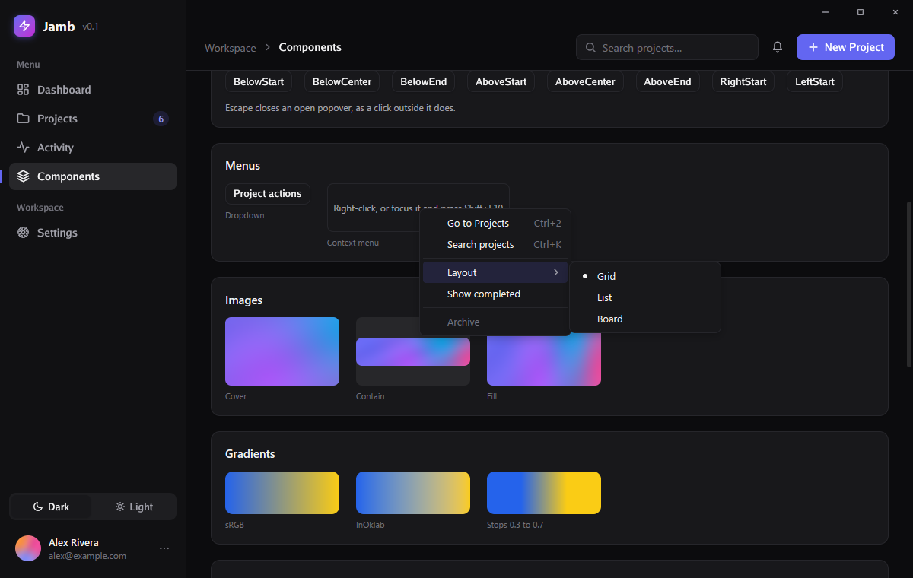

- **Actions.** An item with an `Action` shows the action's binding through
  `KeysFor`, so a keymap change shows at once. Choosing it closes the menu, returns
  focus to where it was, and then runs the action through `Dispatch`, so the
  handler on that focus path runs. An item with `OnClick` runs the function the
  same way. If an item has both, the action runs.
- **Keyboard in a menu.** Up and Down wrap and skip separators and disabled
  items. Home and End go to the first and last items. Right opens a submenu and
  Left closes it. Enter and Space choose. Escape closes one level. Tab closes the
  menu and moves focus on. A letter or digit jumps to the next item whose label
  starts with it.
- **Submenus and the pointer.** A submenu opens after the pointer rests on its
  item for 150 ms, and it stays open for the same delay after the pointer leaves
  for a neighboring item. That lets the pointer move diagonally into the submenu.
  This is a timed delay, not a triangle.
- **Placement.** A menu is an `Overlay` below its anchor. It flips above and
  shifts to stay inside the window, as other overlays do. A submenu opens to the
  right of its row and flips to the left when there is no room.
- **Focus.** A menu takes keyboard focus when it opens. Closing it (Escape,
  choosing an item, or a press outside) returns focus to the element that had it
  before the press, or to the focused element for a keyboard open. A press
  outside closes the whole chain. A press on the trigger toggles a dropdown.
- **Menu bar.** A click opens a top-level menu, and while one is open, the pointer
  over another label opens that one. Left and Right move between the top-level
  menus, also from inside an open menu. Down, Enter or Space open the highlighted
  menu from the focused bar. Escape or Tab leaves the bar. The labels are not in
  the Tab order. A window without a menu bar keeps Windows' own Alt behavior,
  which opens the system menu; with one, a lone Alt press is taken by the bar.
  F10 by itself activates the bar the same way, as Windows does for its menu bars:
  the first label takes focus. Without a menu bar F10 does nothing. Shift+F10 is the
  context-menu key, not the bar's. The application takes F10 from Windows, so that
  Windows' menu mode does not swallow the keys that follow.
- **Look.** Menus use the theme's surface, border, shadow and highlight colors.
  They enter and leave with the same motion as the command palette.
- **Roles.** Entries take the WAI-ARIA menu roles in the access tree: menu item,
  check and radio menu items (with their checked state), and separator.
- **Not implemented.** Alt+letter mnemonics. The labels take no `&` marks, and
  Alt followed by another key does not open a menu.

The behavior is covered by tests in `ui/menu_test.go`, and by the demo and notes
packages. Those tests drive the framework's input methods directly. The
Windows keyboard path (the Menu key, and an Alt press and release that the
system would otherwise turn into its own menu) is not covered by them, so
check it by hand.

### Variable-height lists

When rows differ in height, use `ui.ListOf`. It takes the items, a key for each
item and a function that builds a row:

```go
h := ui.NewListHandle()
ui.ListOf(notes, func(n *store.Note) string { return n.ID }, func(_ int, n *store.Note) ui.Element {
    return noteRow(n)
}).Style(ui.Style{Grow: 1}).Handle(h)
h.ScrollToItem(i)  // the least scroll that shows item i completely
h.ScrollToEnd()    // the last item
h.AtEnd()          // within a pixel of the end; false before the first paint
```

`AtEnd` reads the scroll position without tracking it, so a component that
shows a control only while the list is away from its end should read the state
through `OnAtEnd` instead. It is called on the first paint and then on each
change, from the paint that makes the change:

```go
atEnd := ui.Local(ctx, "atEnd", false)
ui.ListOf(...).Bottom().Handle(h).OnAtEnd(atEnd.Set) // then: if !atEnd.Get() { show "Jump to latest" }
```

Only the rows near the viewport are built. A row's height is measured once it
is built and remembered by its key while the item stays in the list. A row not yet seen is estimated from the
mean of the measured heights (32 px before any is measured). The scroll position
stays on the item at the top of the viewport, so measuring rows above it, or
inserting and removing items above it, does not make the view jump. Items are
compared by slice identity: a new slice means the items changed, and a slice
changed in place is not detected. Keys must be unique among the items; a
duplicate gets a warning once and falls back to its position.

`Bottom()` is for chat-like lists. Rows shorter than the viewport sit at its
bottom, and a list that is at its end stays there when items are appended or a
row grows.

`ScrollToItem` eases toward its item when the item is within a viewport of the
current position. Further away, the list jumps there at once and builds only
the rows at the destination.

Prefer `UniformList` when every row has the same height. Its scroll step is
cheaper and its scrollbar thumb is exact from the start.

Identity: every element's state (hover, focus, scroll position, the text
input's caret, a component's subtree) is tied to its position in the tree.
That position is the element's key if it has one, otherwise its index among
its siblings, combined with its element type.

- Give items in dynamic lists a `.Key(...)` derived from a stable ID. Then
  reordering, inserting or removing items keeps each item's state with that
  item.
- Without keys, state stays at the position. Inserting at the front shifts
  state to the next item.
- Replacing an element with one of a different type always starts fresh.
- Duplicate keys among siblings print a warning and are kept apart.

`ui/incremental_test.go` pins all of this down.

A dropdown is an Overlay child of its anchor:

```go
ui.Component(func(ctx *ui.Context) ui.Element {
    open := ui.Local(ctx, "open", false)
    t := ctx.Theme()
    btn := ui.Div().Padding(8).OnClick(func() { open.Set(!open.Peek()) }).Child(ui.Text("Menu"))
    if open.Get() {
        btn.Child(ui.Div().Overlay(ui.BelowStart).Padding(4).Background(t.Surface).
            OnClickOutside(func() { open.Set(false) }).
            Child(ui.Text("Item")))
    }
    return btn
})
```

Some event semantics to know:

- `OnClick` fires on the deepest clicked element only. Clicks inside an
  overlay never reach its anchor.
- Events on an overlay bubble through its anchor and the anchor's ancestors.
- Other mouse and key events bubble until `StopPropagation`.
- Key presses go to the bindings (deepest context first, global last), then
  to the focused element and its ancestors (`OnKeyDown`), then to Tab and the
  zoom keys. With nothing focused, the root comes first. See the dispatch order
  under "Actions and key bindings".
- Tab cycles focus in tab order, and Enter or Space clicks the focused
  element (see "Focus and the keyboard").

Theming: `ctx.Theme()` returns semantic colors, and `ctx.SetTheme(ui.LightTheme())`
re-renders everything. `ui.DarkTheme()` and `ui.LightTheme()` return a new copy of
a built-in theme on each call.

High contrast is automatic. When Windows high contrast is on (Settings, Accessibility,
Contrast themes), the runtime uses `ui.HighContrastTheme`, a theme built from the
system colors (`GetSysColor`): window and text colors for surfaces and text,
Highlight and HighlightText for selection and the primary action, and no tints,
gradients or shadows. Icons take the text color, and a focus ring stays. The app
keeps its own theme: `ctx.AppTheme()` (or `rt.AppTheme()`) is what `SetTheme` set,
and `ctx.Theme().HighContrast` or `ctx.HighContrast()` tells the app that the
high contrast theme is in use, for content that picks its own colors. There is no
opt-out. Details are in [docs/accessibility.md](docs/accessibility.md#phase-d-what-changed-from-this-design).

Contrast of the built-in tokens is checked by `ui/contrast_test.go` against the
WCAG 2 ratios of each pair the built-in widgets use, in both themes.

Zoom: Ctrl+= (or Ctrl++, numpad +) zooms in, Ctrl+- zooms out, Ctrl+0
resets, and Ctrl+mouse wheel zooms. Levels run 50% to 300% (`ui.ZoomLevels`).
In code: `rt.Zoom()`, `rt.SetZoom(z)`, `rt.ZoomIn()`, `rt.ZoomOut()`,
`rt.ResetZoom()` and `rt.SetZoomShortcuts(false)` to turn the keys off;
components use `ctx.Zoom()` and `ctx.SetZoom(z)`, and `app.Window.OnZoom` runs
when the zoom changes.
`rt.Post(fn)` runs fn on the UI thread at the next frame; call it from
background goroutines to hand them their results. A component that holds its
`ui.Context` can call `ctx.Post(fn)` for the same thing.
`app.Window{Zoom: 1.25, OnZoom: func(z float32) {...}}` sets the initial
level and observes changes. Zoom multiplies the device scale, so text is
shaped and rasterized at the zoomed pixel size and stays sharp at every
level. Layout sees a smaller logical window (window size / zoom).

Errors explain what failed and how to fix it. For example, `ui.Hex("#12")`
panics with `ui.Hex("#12"): expected #rgb, #rrggbb or #rrggbbaa`, and a
missing Root says to set `app.Window.Root`.

### Data grids

`ui.DataGrid` shows rows and columns of business data. Like `UniformList`, it builds only the rows in view, so a grid of 100,000 rows costs what its visible rows cost. Its header stays at the top as the rows scroll, and the header scrolls with the rows when the columns are wider than the grid.

```go
type run struct {
	ID, Service, Status string
	Cost                float32
}

picked := ui.NewSignal([]string(nil)) // the keys of the selected rows
order := ui.NewSignal(ui.SortState{}) // the column and direction of the sort

ui.DataGrid(runs, func(r run) string { return r.ID },
	ui.DataColumn[run]{Header: "Run", Text: func(r run) string { return r.ID },
		Compare: func(a, b run) int { return strings.Compare(a.ID, b.ID) }, Width: 130, Resizable: true},
	ui.DataColumn[run]{Header: "Service", Text: func(r run) string { return r.Service },
		Compare: func(a, b run) int { return strings.Compare(a.Service, b.Service) }, Grow: 1, Resizable: true},
	ui.DataColumn[run]{Header: "Cost", Text: func(r run) string { return fmt.Sprintf("$%.2f", r.Cost) },
		Compare: func(a, b run) int { return cmp.Compare(a.Cost, b.Cost) }, Align: ui.End, Width: 100, Resizable: true},
).Label("Deploy runs").
	Selection(ui.SelectionMultiple, picked).
	Sort(order).
	Density(ui.DataGridCompact).Striped().
	OnActivate(func(r run) { openRun(r.ID) }).
	Style(ui.Style{Height: ui.Px(420)})
```

`ui.DataColumn[T]` is the column type. The name is `DataColumn` because `ui.Column` is the layout direction (`Div().Column()`).

| Field | Meaning |
| --- | --- |
| `Header` | The header text, and the column's name for assistive technology |
| `Key` | Identifies the column in a `SortState` and in the widths the user sets. `Header` when empty |
| `Text` | The text of each cell, and the cell's accessible name |
| `Cell` | A render slot: replaces the text of each cell (hidden from assistive technology, so set `Text` too) |
| `RenderHeader` | A render slot: replaces the header text. `PartState.Selected` is set while the column is sorted |
| `Compare` | Orders two rows for sorting, as `strings.Compare` does. Nil means the column cannot be sorted. A sort is stable |
| `Width`, `MinWidth`, `MaxWidth` | The width at the 100 percent Text size (120 when zero), and the limits for resizing (40 and no limit when zero). Columns grow with the Text size, as the rows do |
| `Grow` | The share of the grid's spare width the column takes when the columns are narrower than the grid |
| `Resizable` | Lets the user resize the column (see the keyboard and mouse below) |
| `Align` | `ui.Start` (the zero value), `ui.Center` or `ui.End` for the cells and the header |
| `Interactive` | The `Cell` holds controls, such as buttons. Its content is not hidden from assistive technology (see Interactive and editable cells below) |
| `Edit` | Makes the cells editable: `Edit(row, value) error` saves the value, or returns the error that keeps the editor open. Set Value (assistive technology) runs it too |
| `Editor` | Replaces the text field of an edit with a custom editor, such as a `ui.Select` (see Custom editors below) |
| `Value` | The text an edit starts with, when it differs from `Text` (a raw number for a formatted one). Nil means `Text` |

The `Compare` of a column is easier to write with `ui.SortBy(key)`, which orders by any `cmp.Ordered` key, and `ui.SortByText(key)`, which orders text without regard to case. `SortState.Desc` reverses the order, so there is no descending helper.

The grid's methods:

- `Selection(mode, keys)`: `ui.SelectionNone`, `ui.SelectionSingle` or `ui.SelectionMultiple`. The keys of the selected rows are kept in `keys`, so the app reads the selection and can set it. A nil `keys` keeps the selection in the grid.
- `Sort(s)`: the `ui.SortState` (`Key` and `Desc`) in `s`. A click on a header cycles the column through ascending, descending and not sorted. A nil `s` keeps the sort in the grid.
- `OnActivate(fn)`: runs `fn` with the row, on Enter or a double-click.
- The look of the states is a fill or a line, not a change of weight: a selected row has the `RowSelected` fill, a sorted column has its arrow (`SortIndicator`), and the text keeps its weight.
- `Density(d)`: `ui.DataGridComfortable` (36 logical pixels a row, the default) or `ui.DataGridCompact` (26). `Striped()` draws every other row in `RowAlternate`.
- `Loading(on)`: shows a progress ring over the rows. The rows, the focus and the selection stay.
- `Empty(el)`: what the grid shows with no rows. The default is "No rows".
- `Label(name)`, `Key(k)`, `Style(s)` and `Styles(st)`: as for the other widgets. `Styles` takes a `ui.DataGridStyle`; see [docs/styling.md](docs/styling.md).

Rows are identified by their keys, which must be unique and stable. The focus, the selection and the sort follow the key, so a sort, a scroll or new rows keep the focused cell and the selected rows on the same data.

**Keyboard.** The grid is one Tab stop. Its keys act on the focused cell, and they follow the WAI-ARIA grid pattern (https://www.w3.org/WAI/ARIA/apg/patterns/grid/) and the Windows keyboard conventions for selection (https://learn.microsoft.com/en-us/windows/apps/develop/input/keyboard-interactions):

| Key | Action |
| --- | --- |
| Left, Right | Previous and next column |
| Home, End | First and last column of the row |
| Ctrl+Home, Ctrl+End | First and last cell of the grid |
| Down, Up | Next and previous row. Up from the first row moves to the header; Down from the header moves to the first row |
| PageDown, PageUp | By a viewport of rows |
| Space | Toggles the row (multiple), or selects it (single). On a header cell, sorts by the column |
| Shift+Space | Selects the rows from the anchor row to the focused row (multiple) |
| Shift+Down, Up, PageDown, PageUp | Extends the selection from the anchor (multiple). A single selection follows the move |
| Ctrl+Down, Up and the others | Moves the focus without selecting (multiple). The anchor stays |
| Ctrl+A | Selects every row (multiple) |
| Enter | Activates the row (`OnActivate`). On a header cell, sorts by the column. On an editable cell, starts an edit. On an interactive cell, moves focus to its first control |
| F2 | On an editable cell, starts an edit. On an interactive cell, moves focus to its first control; in a control, returns to the grid |
| Tab, Shift+Tab | In an interactive cell, moves through its controls and wraps inside the cell. In an edit, saves and starts an edit of the next (previous) editable cell of the row; at the last one the edit ends and focus stays in the grid |
| Escape | In a control of an interactive cell, returns to the grid. In an edit, cancels it |
| A printable character | On an editable cell with the text field, starts an edit with the character, which replaces the text as in a spreadsheet |
| Ctrl+Left, Ctrl+Right | On a resizable header cell, narrows or widens the column by 8 logical pixels |

**Interactive and editable cells.** A cell that holds controls, or an editor, is still the grid's one Tab stop: the controls and the editor are not in the Tab order, and the grid's keys reach them through the focus. The model follows the WAI-ARIA grid pattern (https://www.w3.org/WAI/ARIA/apg/patterns/grid/), which describes two states without naming them: grid navigation, in which the grid holds focus, and the cell's own widgets, which Enter or F2 move focus into. In the second state Tab and Shift+Tab move to the next and previous widget, which the pattern lets wrap inside the cell or leave the grid; this grid wraps inside the cell. Escape (the pattern's "restores grid navigation") or F2 returns to grid navigation on the same cell. The keys a control uses (the arrows of a text field, Enter on a button) belong to the control. An edit saves on Enter and on Tab, and when focus leaves its editor (a click elsewhere in the grid), as a spreadsheet does. Escape is the only cancel. This blur save is a choice of this grid, not a rule of the pattern.

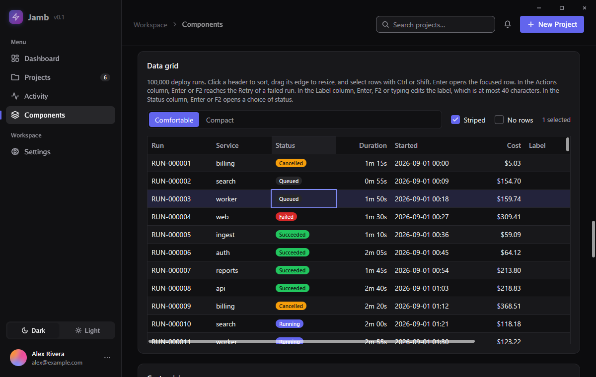

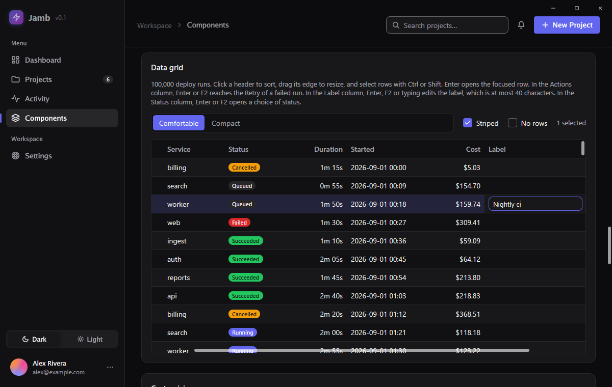

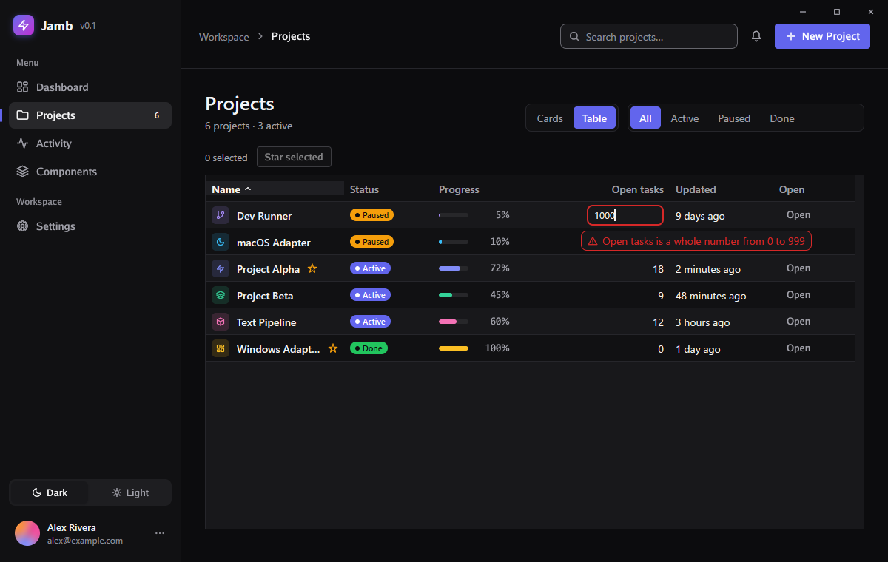

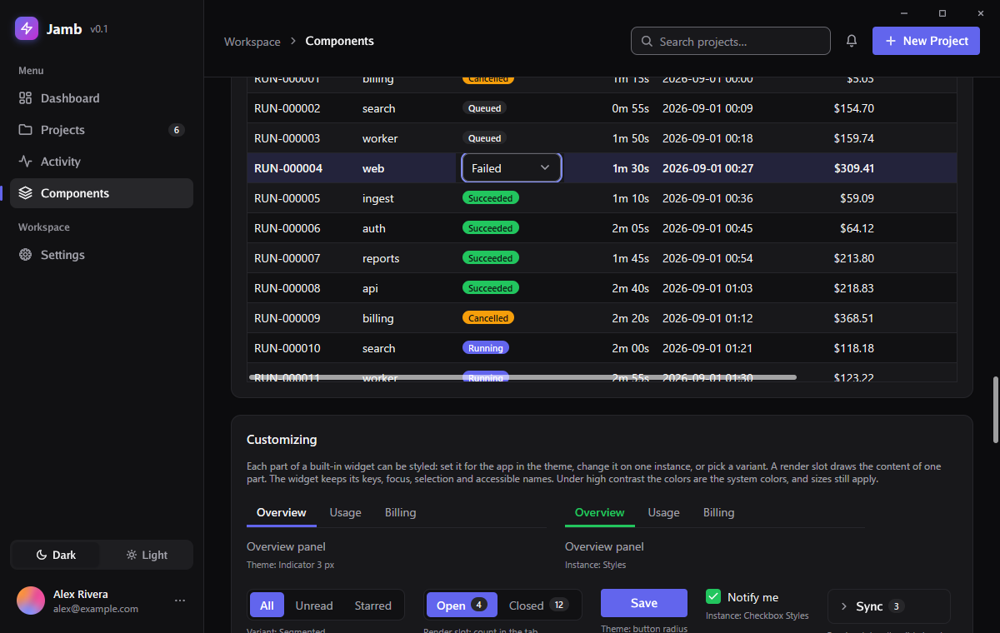

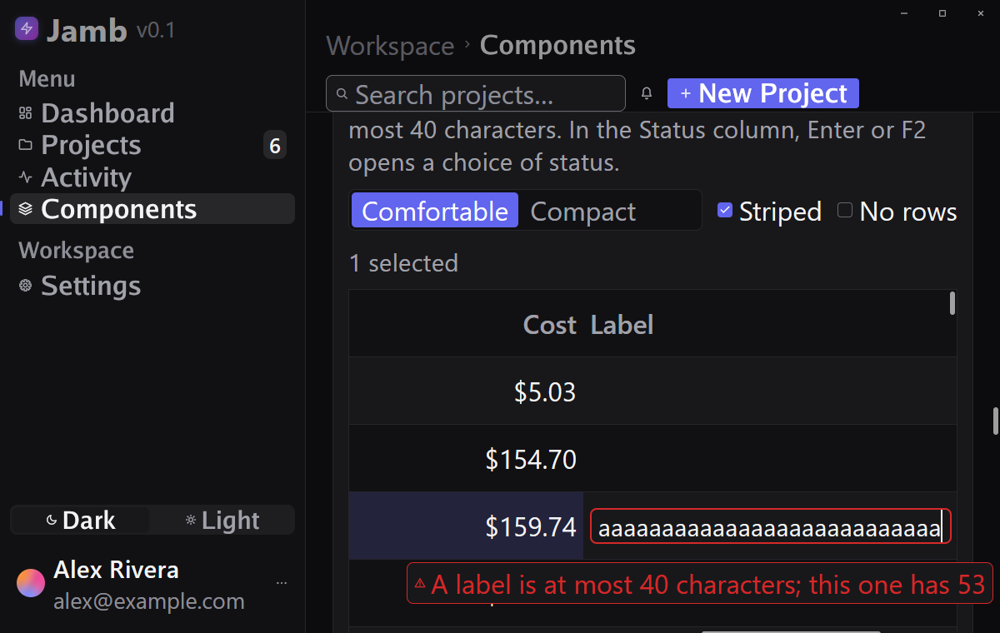

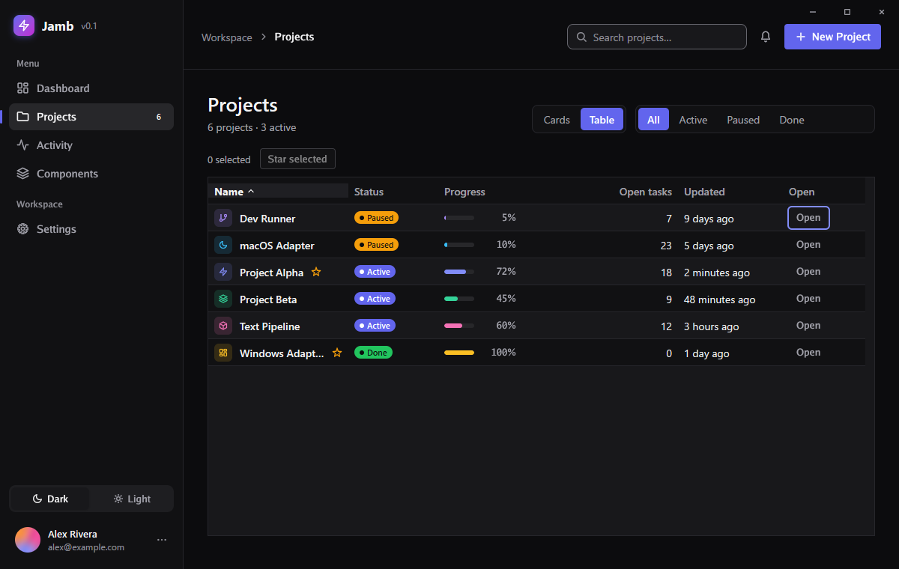

A pointer press on a control focuses it and operates it, and moves the cursor to the cell; it does not select or activate the row. A double-click on an editable cell starts an edit and does not activate the row; elsewhere a double-click activates the row, as before.

An editing cell's editor is a text field named for its column, so assistive technology announces it as an edit field and reports its value. A save that fails keeps the editor open with the invalid frame of its `Editor` style. The message of the failure is a popover under the cell (`EditorMessage`, which flips above at the bottom edge of the window and is not clipped by the grid); it is the editor's description for assistive technology, and it is announced assertively.

**Custom editors.** `DataColumn.Editor` replaces the text field of an edit with what it returns, such as a `ui.Select`: `Editor(row, value, change, commit, cancel) ui.Element`. `value` is the pending value (it starts as `Value`, or `Text`); `change(v)` sets it; `commit()` saves it through `Edit`; `cancel()` ends the edit. The editor needs a focusable control, which takes focus when the editor is first painted. Keys go to the editor's controls first: a control that takes Enter or Escape keeps it (an open list closes with Escape). What the controls do not take is the grid's: Enter and Tab save the pending value, Escape cancels, and a blur saves it. Typing does not start a custom editor; Enter and F2 do.

**Set Value.** An editable cell has the Value pattern, whose value is the cell's text (or `Value`). Its SetValue runs `Edit` on the UI thread, without an edit: a value that `Edit` refuses is announced assertively and does not change the cell. A cell that is not editable has no Value pattern, since Microsoft's DataItem guidance requires it only for an editable primary text (https://learn.microsoft.com/en-us/windows/win32/winauto/uiauto-supportdataitemcontroltype). Focus stays in the editor, which takes the place of the cell's content until the edit ends. The data is the app's: `Edit` updates the app's rows, and the grid draws them again, keeping the focus and the selection on their keys.

An editing row is laid out only while it is in view, as the other rows are. If its row scrolls out of view, the edit, its text and its focus are kept, and the editor is laid out again when the row comes back. While it is out of view the focus stays in the editor, so keys typed then go to that editor; a grid with an edit open should be scrolled back to its row before typing.

The cell's `Text`, when it is set, is still the cell's accessible name in an interactive or editable column; the controls are listed under the cell.

Alt is not used by the grid, so the host keeps its menu and navigation keys.

**Mouse.** A click selects a row: Ctrl toggles it and Shift extends the selection from the anchor. A double-click activates the row. A click on a header cell sorts. Dragging the edge of a resizable header cell resizes its column, and the cursor is the east-west resize cursor over the edge. A double-click on the edge fits the column to the text of the rows in view.

**Sorting.** A sort of 100,000 rows takes about 8 ms in the benchmark (`BenchmarkDataGridSort100k`), which is under the 50 ms at which a sort would move to a worker thread, so the sort runs on the UI thread. Only one column sorts at a time: Shift+click does not add a second sort (see `docs/accessibility.md`, Phase I).

**Accessibility.** The grid is a `DataGrid` control with the Grid and Table patterns. Its `RowCount` is every row of the data, built or not, and its `ColumnCount` is the number of columns. Each cell is a `DataItem` with the GridItem and TableItem patterns, and each row is a `ListItem` with the SelectionItem pattern. Each header cell is a `HeaderItem` that Invoke sorts, with its sort state in its name ("Duration, sorted descending") and in its ItemStatus. Selection uses the Selection pattern, which says whether it takes many items. See `docs/accessibility.md`, Phase I.

### Windows

`app.Run` opens the first window and runs until the app quits. More windows
open with `app.Open`, from event handlers or from goroutines (the window is
created on the UI thread):

```go
app.New().Run(app.Window{
    Title: "Projects", Width: 1200, Height: 760,
    QuitWhenClosed: true, // quit when this window closes, even with others open
    Root:           root,
})

// Later, from a click handler or a goroutine:
h := app.Open(app.Window{
    Title: "Project Beta", Width: 640, Height: 420,
    OnClose:  func() bool { return saved() }, // false keeps the window open
    OnClosed: func() { ... },                 // after the window has closed
    Root:     detailRoot,
})
h.Focus()          // bring it to the front; h is a ui.Window
h.SetTitle("...")  // also Close(); h.Closed() reports whether it is gone
```

`app.Open` returns a `ui.Window`, the same type as `ctx.Window()` inside a
component, so either one can be moved, resized, made fullscreen, focused or
closed (see below). Its methods may be called from any goroutine. An action
runs on the UI thread, at once when it is called there and in call order
otherwise, so an action right after `Open` runs once the window exists. A read
from another goroutine waits for the UI thread to answer it.

- The app quits when its last window closes. A `QuitWhenClosed` window quits
  the app when it closes, even with others open. Before it closes, it asks the
  `OnClose` of every other open window, and then its own. If any returns
  false, the whole close is cancelled and every window stays open. Otherwise
  the other windows close too, each without being asked again, and their
  `OnClosed` runs.
- `X` and `Y` place a window in logical screen pixels. Left at zero, the
  first window is centered and a later one is cascaded 32 px from the last.
- Each window has its own runtime, so its own theme, zoom, focus, key
  bindings and keymap file. The windows share the UI thread, the text system
  and the GPU device. A second window creates a swap chain, not a device.
- Signals are shared across windows. A component that reads a signal
  re-renders in every window that shows it:

```go
// The projects page and the project window both read s.Projects.
ui.Component(func(ctx *ui.Context) ui.Element {
    p, _ := s.Project(id) // reads the signal
    return ui.Button("Star").OnClick(func() { s.ToggleStar(id) })
})
```

Inside a component, `ctx.Window()` controls its window: `Focus()`, `Minimize()`,
`ToggleMaximize()`, `Close()`, `SetTitle(s)`, and the reactive reads
`Maximized()` and `Focused()`, which re-render the component when they change.
`Position()`, `Size()`, `SetPosition(x, y)` and `SetSize(w, h)` read and change
the window's place and content size in logical pixels, as `app.Window` takes them
(a maximized or fullscreen window is restored first). `SetFullscreen(on)` makes the
window cover its monitor without a frame, and puts it back where it was;
`Fullscreen()` reports which. A headless runtime (in tests) has no window, so the
actions do nothing, and `Size()` is the viewport's.

### Custom title bars

`app.Window{Chrome: app.ChromeCustom}` removes the operating system's title
bar, and the app draws its own. The window keeps everything native: resize
borders and cursors, Aero Snap, Win+arrows, the drop shadow, the minimize and
maximize animations, the rounded corners of Windows 11, and the maximized
geometry (content stops at the work area, above the taskbar).

Mark the title bar's areas with `WindowArea`:

```go
ui.Div().Row().Height(ui.Px(32)).WindowArea(ui.WindowAreaDrag).Justify(ui.End).
    Child(search).             // interactive children keep working
    Child(ui.TitleBarButtons()) // minimize, maximize or restore, and close
```

- `ui.WindowAreaDrag` moves the window when dragged, and double-clicking maximizes
  it. A point in a drag area is a drag unless an element on top of it takes
  input (`OnClick`, `OnMouseDown`, focus or `OnDrag`), so a search field or
  a button inside the title bar still works. `ui.WindowAreaMinimize`,
  `ui.WindowAreaMaximize` and `ui.WindowAreaClose` act when the mouse is released over
  them.
- `ui.TitleBarButtons()` is the usual set: 46×32 buttons like Windows 11's,
  with hover and pressed styles, a red close button and the restore icon
  while the window is maximized. The buttons are native hit-test areas, which is what
  lets Windows 11 show Snap Layouts over the maximize button.
- Windows with the operating system's title bar ignore areas.

### Native dialogs

`ctx.Window()` opens the system's own dialogs, each owned by the window: a file
open dialog, a file save dialog, a folder picker and a message box. A dialog
returns at once. Its result goes to a callback on the UI thread when the dialog
closes, so a handler does not wait inside the dialog's message loop:

```go
ctx.Window().OpenFiles(dialog.FileOptions{
	Title:    "Import notes",
	Filters:  []dialog.Filter{{Name: "Notes", Patterns: []string{"*.md", "*.txt"}}},
	Multiple: true, // several files; Folder and Name also apply (see the dialog package)
}, func(r dialog.FileResult) {
	switch {
	case r.Err != nil: // the dialog could not open
	case r.Canceled:   // the user closed it without choosing: a result, not an error
	default:           // r.Paths, as the dialog returns them
	}
})

ctx.Window().SaveFile(dialog.FileOptions{Name: "Untitled.md", Extension: "md", Filters: filters}, done)
ctx.Window().PickFolder(dialog.FileOptions{Title: "Choose a folder"}, done)
ctx.Window().MessageBox(dialog.MessageOptions{
	Title: "Delete note", Text: "Delete this note?", Icon: dialog.IconQuestion,
	Buttons: dialog.ButtonsYesNo, Default: dialog.No, // Enter chooses No
}, func(b dialog.Button) { /* dialog.Yes, dialog.No, dialog.OK or dialog.Cancel */ })
```

- Icons are `IconInfo`, `IconWarning`, `IconError` and `IconQuestion`. Button
  sets are `ButtonsOK`, `ButtonsOKCancel`, `ButtonsYesNo` and
  `ButtonsYesNoCancel`. `Default` is the button Enter chooses; zero means the
  first button of the set.
- A callback is not run on a headless runtime, which has no window.
- The owner window is disabled while its dialog is open, as Windows does for
  any modal dialog, so it takes no input. Its frames, and those of the app's
  other windows, keep drawing: a timer on the owner renders them while the
  dialog's own message loop runs. The same timer runs while the window's system
  menu (F10, or Alt alone in a window without a menu bar) or a move or size is in
  progress, so posted work still runs during those loops.
- The callbacks are asynchronous on purpose. A blocking call would run the
  dialog's loop inside the event that opened it, while the runtime is still
  handling that event. The callback shape also matches a macOS sheet, which
  reports its result the same way.
- Calls go from `ui` through the app to `platform.Window`. `ui` does not import
  `platform`.
- File dialogs use `IFileOpenDialog` and `IFileSaveDialog`, called through
  their vtables from pure Go. Message boxes use `MessageBoxW`: `TaskDialog`
  shows richer boxes, but it needs a common-controls version 6 manifest, which
  `jamb package` adds to a packaged app. A `go run` build does not have that
  manifest. Message boxes can move to `TaskDialog`, with `MessageBoxW` as the
  fallback, without changing the API.
- The notes and demo apps use these dialogs. The Components page of the demo
  shows each one.

### Modal dialogs

`ui.Modal` is a dialog in the app's own look: a dimmed backdrop, and a panel
centered on it with a title, a body and footer buttons. Its look is `ui.ModalStyle`
(`Theme.Modal` or `.Styles(...)`). Build it only while it
is open, and place it last in the window's root element, which must fill the
window:

```go
ui.If(open.Get(), ui.Modal("New project", form).
	Footer(cancel, create).
	Default(create).             // Enter runs it; it takes focus if the body has no field
	InitialFocus(h).             // optional: the element that takes focus when it opens
	CloseOnBackdrop().           // optional: a press on the backdrop closes it
	OnClose(closeFn))            // Escape, or a backdrop press when CloseOnBackdrop is set
```

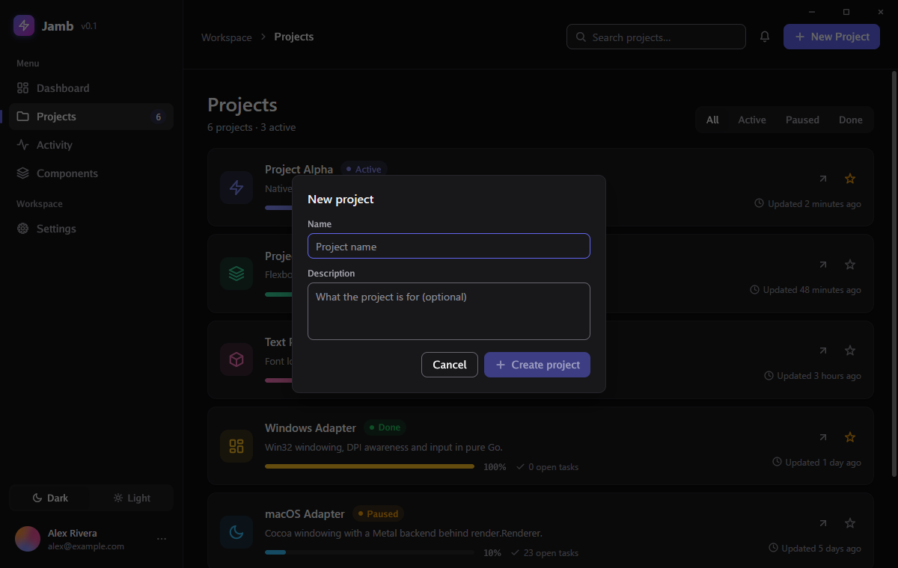

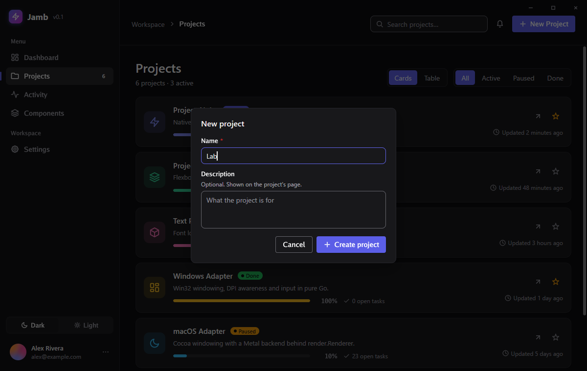

- Focus moves into the modal when it opens: to the first field of the body that
  Tab reaches, else to the default button. Tab and Shift+Tab cycle through the
  modal only. When the modal closes, focus returns to the element that had it,
  unless focus has moved elsewhere.
- Escape closes the modal through the overlay rules (see
  [Escape and overlays](#actions-and-key-bindings)). Enter presses a focused
  button as usual, and otherwise runs the default button. A multi-line field
  takes Enter as a newline. A single-line field with no `OnSubmit` passes Enter
  on to the default button.
- The panel is at most the window's height less 24 px, as the window is when the modal
  opens (a window resized while a modal is open keeps its size until the modal is built
  again). The title and the footer stay on screen, and a body that does not fit scrolls.
  The footer's buttons wrap when they do not fit the panel's width. A focus the code asks
  for (`FocusHandle.Focus`) scrolls the element into view, as Tab does.
- Its placement is `ui.OverCenter`, a new overlay placement that centers the
  panel over its anchor. Colors come from `Theme.Scrim` and the surface colors,
  and the modal enters and leaves with the same motion as the command palette.
- While a modal is open, keys stop at it: the app's bindings, `OnKeyDown`
  handlers and typed text outside the modal don't reach anything behind it, and
  Alt doesn't activate a menu bar. Keys handled inside the modal (a field's
  editing keys, the modal's own bindings) work as usual.

### Forms

A form is a set of fields. `ui.Field` gives a control a label, an optional help
text, an optional required marker and an error, and wires them to the control for
assistive technology. `ui.NewForm` checks the fields on submit and runs the submit.
Build the form once and keep it across renders (in a `Local`, or in the app's
state), since it holds the submit state:

```go
f := ui.NewForm().OnSubmit(func() error { return save(name.Peek()) })
ui.Div().Column().Gap(12).
	Child(f.Summary()).
	Child(f.Field("name", "Name", ui.TextInput(name).Placeholder("Project name").
		Validate(ui.Required[string](), ui.MaxLength(80))).
		Description("Shown in the project list.").Required()).
	Child(f.Field("email", "Email", ui.TextInput(email).Validate(ui.Pattern(emailRE, "Enter an email address."))).Inline()).
	Child(ui.Button("Save").Primary().OnClick(f.Submit))
```

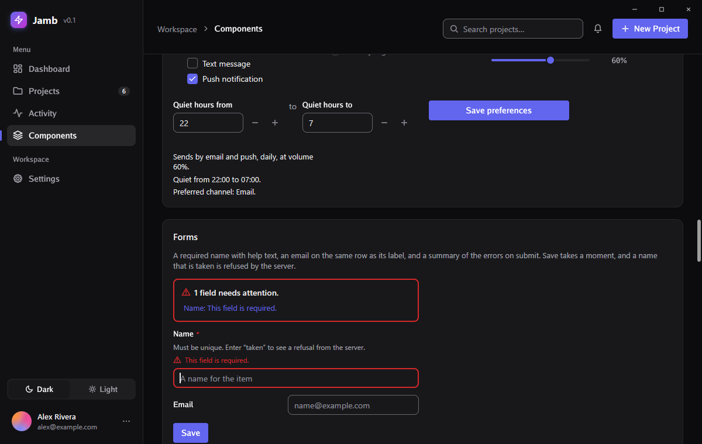

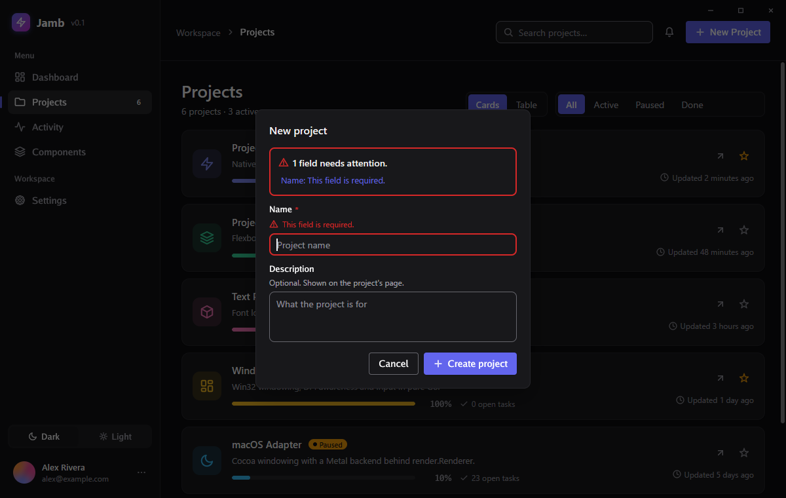

**Field.** `ui.Field(label, control)` puts the label above the control, or beside
it with `Inline()`, which suits settings rows. `Description(s)` is the help text,
`Required()` adds an asterisk after the label, `Error(msg)` shows an error the app
found (such as one from a server), and `Check(fn)` checks a whole field, such as a
group of check boxes, with `fn() error` (it reads its signals with `Get`). `Focus(h)`
gives the element that takes focus for a field whose control is a group; a
`Checkbox` (like every other control) takes a handle with its `FocusHandle` method for that. A field
outside a form (`ui.Field(...)` on its own) is checked the same way, but only as the
user works with it.

- The control is named by the label (`Label` and `LabelledBy`), and it is described
  by the help text and the error (`DescribedBy` and `HelpText`). A required control
  reports `IsRequiredForForm`; a control with a shown error reports `StateInvalid`,
  which the Windows adapter answers as `IsDataValidForForm` false.
- The asterisk is drawn and hidden from assistive technology. The state is the
  announcement, so the asterisk carries no meaning that a screen reader misses.
- The error is drawn above the control, under the help text, with the alert icon and
  the same look as a number input's message. The control's frame is the invalid
  frame, and it stays invalid while the control has focus.

**Validators.** A control takes validators with `Validate`: `TextInput`, `TextArea`,
`NumberInput`, `Select`, `RadioGroup` and `Checkbox` (a `Checkbox` with `Required[bool]()`
is "must accept"). They are generic over the control's value type:

- `ui.Required[T]()`: rejects the zero value (blank text after trimming, zero, `false`,
  or the placeholder option of a `Select` or `RadioGroup`). A number input does not
  need it, since it always holds a number.
- `ui.MinLength(n)`, `ui.MaxLength(n)`, `ui.Pattern(re, msg)` for text, counted in runes.
  The empty text passes `MinLength` and `Pattern`, so `Required` decides whether a field
  must be filled in, and an optional field can use them.
- `ui.Range(lo, hi)` for numbers, inclusive.
- `ui.Custom(func(v T) error)` for anything else.

A validator returns an error whose text is the message the field shows. The first
failing validator of a control is its message.

**When errors show.** These follow the guidance cited below: no error before the user
has acted, errors that are found on leaving a field, and every error on submit.

- A field shows nothing until the user changes its value and then leaves it, or until
  the form is submitted. A field that the user only visits shows nothing.
- Once an error is shown, it updates with each change, so it clears as soon as the
  value is valid.
- `Error(msg)` is shown at once, since the app found it.
- On submit, every field is checked and every field's message is shown.

**Submit.** `f.Submit` checks every field. When one needs attention, focus moves to the
first such field, the form announces the number assertively ("2 fields need attention.")
and the summary lists each error as a link that moves focus to its field. When every
field is valid, the submit function runs. `OnSubmit(fn)` returns an error for the
form's own message, such as a refusal from a server; the message is shown in the
summary and announced. `OnSubmitAsync(fn)` runs work in the background: `fn` starts the
work and returns a channel that receives the result (nil, or the error for the message).
While it runs, `f.Submitting()` is true, `Submit` does nothing, and the button can be
disabled, with a `ProgressRing` beside it.

```go
f := ui.NewForm().OnSubmitAsync(func() <-chan error {
	done := make(chan error, 1)
	go func() { done <- saveToServer(name) }()
	return done
})
ui.Button("Save").Disabled(f.Submitting()).OnClick(f.Submit)
```

- Enter in a single-line field of a form submits the form. A check box, switch or
  radio button keeps Enter for the modal's default button, as it does outside a form.
- `f.Reset()` clears the submitted state and the form's message, and forgets its
  fields, which are added again when they are built. Call it when the form's modal
  closes, so the next opening starts clean.
- `f.Summary()` is empty until a submit has an error. Place it above the fields.
- A field's key is the key given to `f.Field` (unique in the form). Keys are the
  window's, so two forms can use the same field keys.

**Styling.** A field's parts are `ui.FormFieldStyle` (`Root`, `Label`, `InlineLabel`,
`Required`, `Description`, `Error`), set with `Theme.FormField` or `Field.Styles`. A
form's summary parts are `ui.FormStyle` (`Summary`, `SummaryTitle`, `SummaryItem`, with
its hover and focus states), set with `Theme.Form` or `Summary().Styles`. The invalid
looks of the controls are the parts `FrameInvalid`, `TriggerInvalid`, `BoxInvalid` and
`RingInvalid`. See docs/styling.md.

**Sources.** The timing and the summary follow the WCAG 2.2 success criteria for
error identification and error suggestion
(https://www.w3.org/WAI/WCAG22/Understanding/error-identification.html and
https://www.w3.org/WAI/WCAG22/Understanding/error-suggestion.html), and the W3C WAI
forms guidance on labels, instructions and errors (https://www.w3.org/WAI/tutorials/forms/).
The error summary with links to the fields, the error message above the input, and
the help text under the label follow the GOV.UK Design System
(https://design-system.service.gov.uk/components/error-summary/ and
https://design-system.service.gov.uk/components/error-message/). The UI Automation
properties are Microsoft's (https://learn.microsoft.com/en-us/windows/win32/winauto/uiauto-automation-element-propids):
`IsRequiredForForm` (30025), `IsDataValidForForm` (30103), `HelpText` (30013),
`DescribedBy` (30105) and `FullDescription` (30159, not yet answered).

### Accessibility

On Windows, jamb exposes its UI to screen readers and other assistive
technology through UI Automation. The design is in
[docs/accessibility.md](docs/accessibility.md). Nothing is built until an
assistive technology asks for the window's UI, so an app run without one pays
nothing extra. The exception is a development run with warnings on (see below),
which builds the tree to check it.

What is automatic, with no app code:

- Buttons, including icon-only buttons, are named by their text. A clickable
  element with no role is a button too.
- Text fields and text areas have the role. Give them a name with `Label`.
- Plain text is the name of its container, or a static text node when it stands
  alone. Decorative icons and layout containers with no role or name are left
  out, so their children sit in the parent.
- Menus, menu bars and menu items carry their roles, checked and disabled
  states, and nesting level. A `Modal` is a dialog named by its title.
- A `UniformList` or `ListOf` exposes its built rows as list items, each with
  its position in the full list ("40 of 10,000"). Only the rows that are built
  are in the tree.
- Tooltips are nodes under the element they hang from, so an overlay reads in
  place rather than at the end of the window.

The controls, with no app code, once their roles and states are set:

- A check box, switch or radio button has its check state. A `Checked` element
  is a toggle, so Toggle works, and a `ui.IconButton(...).AccessChecked(on)` is a
  toggle button with its state.
- A `DropdownMenu` trigger, a menu item with a submenu, and a menu bar label
  expand and collapse. A menu of radio items is a selection group.
- A `Tabs` group is a Tab control: its tabs are tab items with SelectionItem, and
  its panel is a pane named by its tab. Tabs have no Invoke pattern, since they are
  selected. A `Collapsible` header is a button that expands and collapses, and its
  content is a group named by the header. A `Tree` is a tree whose items expand
  and collapse, with their level and position in their set. Every tree item has
  ExpandCollapse, and a leaf reports that it has no children. Only the rows in view
  are in the tree.
- A `TextInput` or `TextArea` has its text as its value, which assistive
  technology can read and set. It also has the UI Automation Text pattern: a
  screen reader reads and moves by character, word, line and paragraph, reads
  the selection and the caret, selects and finds text, and gets the bounds of
  each visual line. Text and selection changes raise events. The system caret
  follows the insertion point, so screen magnifiers track typing. The points
  and the word rules are described in
  [docs/accessibility.md](docs/accessibility.md#phase-c-what-changed-from-this-design).
- A scroll container reports its position and its visible part, and can be
  scrolled and scrolled to a percent. A row or control inside one can be
  scrolled into view.
- A `ProgressBar` is a progress bar whose range is read-only: assistive technology
  reads its value and cannot set it. An indeterminate bar and a `ProgressRing` are
  progress bars with no range. The Toaster's region is a group named "Notifications",
  and each toast is a group named by its text. A badge attached to an element is
  part of that element's name (see Feedback above).

The API, on the elements that already exist:

```go
ui.Div().Role(access.RoleCheckBox).Label("Notifications").AccessChecked(on)
ui.Div().AccessExpanded(open)                    // a row that opens and closes; its click toggles it
ui.Div().Role(access.RoleButton).AccessSelected(on).OnClick(choose) // one item of a selection
ui.Div().Label("Status").SelectionContainer() // the group that holds the items
ui.Div().Heading(2).Child(ui.Text("Appearance"))
ui.Text("Name").Key("name-label")          // a label, named by key
ui.TextInput(name).Label("Name").LabelledBy("name-label").DescribedBy("name-help")
ui.ListOf(items, key, row).SelectionContainer() // also UniformList
ui.Div().Description("Saves the file to disk")
ui.Div().AccessHidden() // leaves the element and its children out of the tree
ui.Div().Display(false) // hidden: not drawn, not focusable, out of the tree, state kept (see the API guide)
ui.IconButton(icons.Bell).Label("Notifications")
ui.TextInput(query).Label("Search projects") // also TextArea
ui.Image(avatar).Alt("Account avatar")
ui.Announce("Saved", access.Polite) // spoken as a notification; Assertive interrupts
ui.CheckboxTri("All", all)            // a check box in the mixed state is set by its CheckState
ui.Slider(v, 0, 100, 5).Label("Volume") // a slider: RangeValue, with the Range of the value
ui.ProgressBar(0.45).Label("Upload")    // a progress bar: read-only RangeValue
ui.ProgressRing().Label("Sending reply") // a busy indicator: no range, named "Loading…" by default
ui.Div().Label("Projects").Badged(ui.Badge(6).Noun("items")) // named "Projects, 6 items"
```

`Expanded` and `Selected` declare the state; the element's click handler makes
the change, so a click on an expandable row must toggle it. Expand and select
run that handler only when the state is not already the one asked for.
`SelectionContainer` marks the group that holds the selected items, and a tab
list, or a menu with radio items, is one without a call. `Heading` takes a level
from 1 to 6. `LabelledBy` and `DescribedBy` name an element by the `Key` of
other elements, such as a visible label above a field.

Announcements are spoken as notifications. A polite one waits its turn, in
order, after the speech in progress; an assertive one is spoken as soon as
possible, and a newer assertive one replaces it. Announce
the result of an action or a status change that has no focus to carry it, such
as "Saved" or "3 results", and keep repeated messages to one per change: a burst
of keystrokes should be announced once it pauses.

A name comes from the first of these that is set: the `Label`, then the text
inside a control, then its tooltip. `Description` (or the tooltip, when it is
not the name) is the help text read after the name. Set `Label` where an
element has no visible text, and on every text field, since a field has no
name of its own. The placeholder is not used as a name.

`access.Role` and the other names in `access` (states, actions, the tree and
its updates) are the platform-neutral model; `access/accesstest` has helpers
that find a node by its role and name in a unit test.

Development warnings report what a user cannot identify: an interactive element
with no accessible name, an image without `Alt`, a check box, switch or radio
button with no `Checked` call, a selection item outside a selection container,
and a `LabelledBy` or `DescribedBy` key that matches no element. Each element is
reported once, to stderr, in runs with `JAMB_TRACE=1`, under `jamb dev`, or with
`JAMB_A11Y_WARN=1`.

To see the tree as text, use the `a11ydump PATH` script step, or call
`rt.AccessTree().Dump()` in a test. Each line is a role, its name and states,
its bounds in physical pixels, and its ID.

The automated checks, the Accessibility Insights scans and the live UI Automation
check are in [Tools](#tools-for-humans-and-coding-agents). The manual pass with
Narrator and NVDA, with the expected results for each task in the demo and the
notes app, is in [docs/accessibility-testing.md](docs/accessibility-testing.md).

#### System settings

jamb reads four Windows settings and applies them to every window (the app needs
no code):

- **Text size** (Settings, Accessibility, Text size, 100 to 225%, read from
  `HKCU\Software\Microsoft\Accessibility\TextScaleFactor`). It scales text only:
  font sizes and line heights. The zoom and the display scale work as before.
  Heights of controls are minimums that grow with their content. Apps with fixed
  sizes read `ctx.TextScale()` (percent) to scale them. See
  [Microsoft's guidance on text scaling](https://learn.microsoft.com/en-us/windows/apps/design/accessibility/text-size).
- **High contrast** (`SystemParametersInfo` with `SPI_GETHIGHCONTRAST`). See
  Themes above.
- **Reduced motion** (`SPI_GETCLIENTAREAANIMATION`, Animation effects). See
  Animation above.
- **Text cursor.** The caret of a text field blinks at the system's blink time
  (`GetCaretBlinkTime`; a blink time of infinity keeps it solid) and is as thick as
  the system's cursor thickness (`SPI_GETCARETWIDTH`) times 1.5 logical pixels.
  In a window that is not the active window the caret is hidden and does not
  blink, as a native text field does; it returns when the window is activated.

The settings are read at start and again on `WM_SETTINGCHANGE` and
`WM_SYSCOLORCHANGE`, so a change shows without a restart. jamb reads them and
never writes them.

For testing, three variables simulate the settings for one run, and change no system
setting. Real settings are used in normal use; a variable replaces its setting only
when it is set:

```
set JAMB_HIGH_CONTRAST=1        (or "white" for the white scheme, 0 for off)
set JAMB_TEXT_SCALE=225         (100 to 225)
set JAMB_REDUCED_MOTION=1       (0 for off)
go run ./examples/demo
```

The black and white schemes are representative values
(`ui.HighContrastBlack`, `ui.HighContrastWhite`), not read from a system.

### GPU device loss

When the GPU device is removed or reset (a driver update or crash, a remote
desktop switch, a hybrid-GPU switch, sleep and resume), jamb rebuilds it. The app
needs no code for this, and the ui state of every window is kept.

- A frame detects the loss from `Present`, `ResizeBuffers`, `Map`, resource
  creation, or the device's removal reason, and reports it as
  `render.ErrDeviceLost`.
- The first window to draw afterwards recreates the shared device (hardware
  first, then WARP, as at startup), its pipelines and states, and then each
  window's swap chain. The windows draw again. One loss causes one rebuild, however
  many windows are open.
- The recovery log line names the adapter the device runs on, `hardware` or
  `WARP software rasterizer`, so a fallback to WARP shows in the log.
- Textures are uploaded again from memory, and nothing is decoded or rasterized
  twice. Each image and glyph atlas keeps its CPU pixels for its whole life, so
  this needs no extra memory: width × height × 4 bytes per image, and each glyph
  atlas at its current size (up to 16 MB for grayscale and 64 MB for ClearType).
  The atlases are not reset, so glyphs stay cached.
- While the device is unavailable, a failed rebuild is retried after 250 ms, and
  the delay doubles up to 5 s. Each distinct failure is printed once per loss.
  Windows do not draw in between, and they stay responsive, so closing one still
  works.

Known limits:

- A window opened while the device is lost does not open; it fails with a message
  and can be opened again once the device is back.
- If the hardware device cannot be created, the WARP software fallback may succeed.
  The app then keeps drawing on WARP until it restarts.
- A device lost while every window is minimized is noticed when a window is
  restored.
- The rebuild has been checked with the simulation below, which releases the
  device itself. A real removal from the driver has not been checked automatically.

`JAMB_SCRIPT` step `devicelost` simulates a loss. It releases the device and its
objects, then handles the loss as if the next `Present` had reported
`DXGI_ERROR_DEVICE_REMOVED`. The next frame rebuilds the device and redraws every
window. It is the only way to exercise this path without a real driver reset, and
it does not reset the driver.

## Tools for humans and coding agents

The `jamb` command in `cmd/jamb` has two commands: `jamb dev`, the watch-and-restart
runner, and `jamb package`, which builds the Windows release (see [Packaging](#packaging)).

These environment variables work with any jamb app, with no code changes:

| Variable | Effect |
|---|---|
| `JAMB_TRACE=1` | Prints startup timings, per-frame build/layout/paint cost, and frames per second of activity, so you can confirm the app is idle. Also turns on the accessibility warnings (see [Accessibility](#accessibility)). |
| `JAMB_A11Y_WARN=1` | Prints accessibility warnings: an interactive element with no name, and an image without `Alt`. Each is reported once. On by default under `jamb dev`. |
| `JAMB_SCRIPT="idle; shot a.png; click 600 400; type hi; key enter; idle; shot b.png; exit"` | Drives the app with synthetic input and saves screenshots. This is how the demo was verified. Besides `click`, the steps include `rclick X Y` (the right button, which opens a context menu), `down X Y`, `move X Y` and `up X Y` for drags, and `drop X Y PATH...` for files dropped from the desktop. The `drop` step goes through the same handler as a real drop, but the Windows message handling itself is only exercised by a real drop. `window N` makes the following steps, and the `shot`s, target the Nth window opened (1-based); the first window is the default. `type TEXT` types everything after the one space that follows `type`, spaces included. `devicelost` simulates a GPU device loss; see [GPU device loss](#gpu-device-loss). `a11ydump PATH` writes the accessibility tree as text (see [Accessibility](#accessibility)). |
| `JAMB_STRESS=rebuild\|paint` | Measures sustained frame cost, allocation and GC, prints the results, then exits. |
| `JAMB_VSYNC=0` | Turns off vsync, for throughput tests. |
| `JAMB_D3D_DEBUG=1` | Enables the Direct3D debug layer. |
| `JAMB_TEXT_AA=gray` | Forces grayscale text anti-aliasing instead of ClearType (Windows). |

`JAMB_SCRIPT` keys are `enter`, `escape` (or `esc`), `tab`, `backspace`,
`delete`, `insert`, `space`, the arrows, `home`, `end`, `pageup`, `pagedown`,
`menu` (the Apps key), `f1` to `f12`, `a` to `z`, `0` to `9`, `=` and `-`, with the modifiers `ctrl`,
`shift`, `alt` and `super`. An unknown key or modifier stops the script with an
error when the script is loaded. `idle` waits for `rt.Settled()`, which ignores
repeating animations, so a screen with a spinner does not hold the script.

The headless tools are:

- `ui.NewRuntime(root, theme, nil)` plus `rt.Frame(time.Now())` runs the
  whole pipeline without a window.
- Scripted actions, each followed by a frame:
  - `rt.ClickKey("save")` clicks the element keyed `save`.
  - `rt.Type("text")` types into the focused element.
  - `rt.Press(input.KeyN, input.ModCtrl)` presses a key.
- `rt.Find(key)` returns an element's rectangle. A component's or text
  field's key belongs to what it renders.
- `rt.Dump(os.Stdout, depth)` prints the laid-out tree, with keys and text
  field contents. It found layout bugs during development.
- `rt.ContentWidth()` checks that nothing overflows at the minimum window size.
- `rt.Settled()` reports whether nothing changed since the last frame and
  nothing animates toward an end. Repeating animations never end, so they do
  not count; `rt.NeedsFrame()` still reports them.
- `go run ./internal/iconsheet icons.png` renders every icon.

See `ui/runtime_test.go`, `ui/editor_test.go`,
`examples/demo/views/dump_test.go` and `examples/notes/views/views_test.go` (the notes app
driven headlessly: Ctrl+N, typing, search, saving).

### Accessibility checks

`scripts/a11y-check.ps1` checks the demo and notes apps through Windows UI
Automation. It uses Windows PowerShell and the .NET UI Automation client that
come with Windows, and the Go toolchain to build the examples. Run it from the
repository root:

```
powershell -NoProfile -ExecutionPolicy Bypass -File scripts\a11y-check.ps1
```

The script builds both examples into a temporary folder and starts them. The
notes app runs with a temporary notes file, never your own. It runs 42 checks:
names and roles, Invoke, Toggle, ExpandCollapse, Selection, Value, Scroll,
focus with its event, and the Text pattern on the word "small". The demo's form
controls are checked too: a check box's Toggle, including its indeterminate
state; a radio button's SelectionItem; a select's ExpandCollapse and Value, and
its open list; a slider's and a number input's RangeValue with SetValue. The
navigation samples are checked too: a tab list's Tab, TabItem and
SelectionItem, and Select moves the panel; a collapsible header's
ExpandCollapse; a tree's items expanding, with their level and position in
their set; and Down, Right, Left and Up moving the focus through the tree by
keys, with focus events. Axe scans cover the Settings page, the Components page
scrolled to the navigation section, to the form controls, and the same page
with a select open. Each check prints PASS or FAIL, and the script exits 1 if
any fails. Options: `-TimeoutSeconds N` (default 30), `-SkipAxe`,
`-HighContrast` (run the apps with `JAMB_HIGH_CONTRAST=1`) and `-TextScale N`
(run them with `JAMB_TEXT_SCALE=N`, 100 to 225). The overrides are described
under System settings in the Accessibility section. The processes and temporary
files are removed on exit, after a failure too.

When AxeWindowsCLI is installed, the script also scans each app with it, and a scan
that finds errors is a failure. The script looks for it at
`%LOCALAPPDATA%\Programs\AxeWindowsCLI\AxeWindowsCLI.exe` and then on PATH.
AxeWindowsCLI runs the Axe.Windows rules, the engine of Accessibility Insights for
Windows, from the command line. Get it from the official
[axe-windows releases](https://github.com/microsoft/axe-windows/releases) (the
zip needs no elevation). To scan an app by hand while it runs:
`AxeWindowsCLI.exe --processid <pid> --verbosity verbose`. Accessibility Insights
for Windows is the interactive form of the same rules:
[github.com/microsoft/accessibility-insights-windows](https://github.com/microsoft/accessibility-insights-windows).

The manual pass with NVDA and Narrator is not automated. Its steps and expected
results are in [docs/accessibility-testing.md](docs/accessibility-testing.md).

## Packaging

`jamb package` builds a Windows release of an app from its `jamb.json` (below).
It always writes a zip. Flags add an installer and an MSIX.

```
go run ./cmd/jamb package ./examples/demo                 # zip
go run ./cmd/jamb package --installer ./examples/demo     # zip and setup.exe (needs NSIS)
go run ./cmd/jamb package --msix ./examples/demo          # zip and an unsigned MSIX (needs the Windows SDK)
```

Outputs go to `<app>/dist/`, which git ignores. Each run builds its files in a
temporary folder inside `dist` and moves them there only after every step has
succeeded, so a failed signature leaves no partly signed set.

- `<name>-<version>-windows-<arch>.zip`: the executable at the root, and any
  `LICENSE*` and `NOTICE*` files of the app directory beside it. Always built.
- `<name>-<version>-windows-<arch>-setup.exe`: an installer, built with
  `--installer`. See [Installer](#installer).
- `<name>-<version>-windows-<arch>.msix`: an MSIX package, built with `--msix`.
  It is unsigned unless a sign command signs it. See [Signing](#signing).

`<arch>` is `amd64` or `arm64`.

### jamb.json

Every field is required except `copyright`. An unknown field is an error, so a
misspelled name stops the build, and every problem is reported in one message.

| Field | Meaning |
|---|---|
| `name` | The executable's name without `.exe`: starts with a letter, then letters, digits, `-` and `_`, at most 64 characters. |
| `displayName` | The name users see: Start, the taskbar, the installer and the package. It also names the install folder, so it cannot contain `\ / : * ? " < > \|`. |
| `description` | A short description, shown in file properties, the installer and the package. |
| `version` | A semantic version, `MAJOR.MINOR.PATCH`. Each part is 0 to 65535, and Windows stores it as `MAJOR.MINOR.PATCH.0`. Pre-release and build suffixes have no Windows form and are rejected. |
| `publisher` | The publisher's display name, shown as the company in file properties, the installer and the package. |
| `publisherSubject` | The subject of the signing certificate, starting with `CN=`, such as `CN=Example`. The MSIX publisher must equal the certificate's subject exactly, so for a certificate from a certificate authority copy the whole subject. For the Store, use the publisher value that Partner Center shows for the app. |
| `identityName` | The package identity: 3 to 50 characters of letters, digits, `.` and `-`, starting and ending with a letter or digit. Windows uses it to identify the app, and the installer uses it as its registry key, so it must stay the same across versions that should upgrade one another. For the Store, use the identity name that Partner Center shows for the app. |
| `copyright` | Optional. Shown as the legal copyright in file properties and the installer. |
| `icon` | A square PNG, at least 48 px, relative to the app directory. 256 px or larger is recommended, and packaging warns below that. It becomes the executable's icon, the installer's icon and the MSIX logos. |

File associations and extra capabilities are not supported yet. The manifest
requests only `runFullTrust`.

### Commands and flags

`jamb package [flags] [package dir]`. The directory defaults to `.`, and flags may
come before or after it.

| Flag | Effect |
|---|---|
| `--arch amd64\|arm64` | The target architecture. Default `amd64`. |
| `--installer` | Build the `setup.exe` installer with NSIS. |
| `--makensis PATH` | The `makensis` program to use. Needs `--installer`. Default: found on PATH or in the NSIS install directory. |
| `--msix` | Build the MSIX package. It is unsigned unless `--sign-command` signs it. |
| `--sign-command CMD` | Run this command once for each file that is built, with `{file}` replaced by the file's path. Default: the `JAMB_SIGN_COMMAND` environment variable. See [Signing](#signing). |
| `--sdk-bin DIR` | The directory with `makeappx.exe`. Default: the newest SDK under `C:\Program Files (x86)\Windows Kits\10\bin`. |

`--cert`, `--test-cert`, `--timestamp` and `--no-msix` were removed. Each one is
refused with the replacement to use.

### What the executable contains

- The icon, in 16, 24, 32, 48, 64, 128 and 256 px.
- Version information: file and product version (`version` with `.0`), company,
  product name, description, original and internal file names, and copyright.
- An application manifest with per-monitor v2 DPI awareness, which matches what
  the framework sets at run time; Common Controls version 6, which `TaskDialog`
  needs; Windows 10 and 11 as the supported OS; long path names; and `asInvoker`,
  so the app never asks for elevation.
- A build with `-trimpath -ldflags "-s -w -H=windowsgui"`, `GOOS=windows`,
  `CGO_ENABLED=0`. The GUI subsystem means no console window opens.

The manifest does not set `activeCodePage` to UTF-8. The framework calls only the
wide-character Win32 functions, so the active code page does not affect it, and
leaving the system's code page alone is the safer default for any ANSI call.

While it builds, `jamb package` writes a resource object,
`jamb_package_windows_<arch>.syso`, into the app's directory and removes it when
packaging ends, on failure and on Ctrl+C too. If a file with that name already
exists, packaging stops rather than overwrite it.

### Installer

`--installer` compiles `<name>-<version>-windows-<arch>-setup.exe` with NSIS,
from a script that jamb generates from `jamb.json`. The installer:

- installs for the current user only, to `%LOCALAPPDATA%\Programs\<displayName>`.
  It needs no administrator rights, and it writes only to `HKCU` and the user's
  Start menu and desktop. This is the default because it works on managed PCs
  where standard users cannot write to Program Files, and because each user can
  update the app without elevation. A machine-wide Program Files installer is not
  generated; that would need its own script and an administrator prompt.
- adds a Start menu folder with the app and an uninstaller shortcut;
- offers a desktop shortcut as an optional component, off by default;
- registers the app in Apps & features under `identityName`, with the display
  name, version, publisher, description, icon and estimated size;
- uninstalls cleanly: it removes the installed files, the shortcuts and the
  registry entry. It leaves data the app wrote elsewhere, such as under AppData,
  in place.

Close the app before installing or uninstalling it. Silent installs use `/S`, and
`/D=PATH` (last on the command line) chooses another folder.

### Signing

jamb never needs a signing certificate, and it never reads one or a password. It
is a library shipped as source, so it is not signed. Each app's author chooses how
the app's binaries are signed:

- **Unsigned.** Works. Windows SmartScreen may warn people when they first run the
  app. An unsigned MSIX cannot be installed on a PC.
- **Microsoft Store.** Free for individual developers since September 2025. The
  Store signs the MSIX packages it accepts, so an MSIX can be uploaded unsigned:
  <https://blogs.windows.com/windowsdeveloper/2025/09/10/free-developer-registration-for-individual-developers-on-microsoft-store/>
- **SignPath Foundation.** Free signing for open-source apps with OSI-licensed
  source and automated public builds. Eligibility and setup are at
  <https://signpath.org/>.
- **Azure Artifact Signing, or a purchased certificate.** Paid. Azure Artifact
  Signing is documented at
  <https://learn.microsoft.com/en-us/azure/artifact-signing/overview>.

#### The sign command

Set the command with `--sign-command "<command>"`, or with the `JAMB_SIGN_COMMAND`
environment variable. The flag wins when both are set. The environment variable is
used rather than `jamb.json` because the certificate differs between machines and
CI runners, and a committed file should not hold a thumbprint or a path.

jamb runs the command once for each file it builds, and `{file}` is replaced by
that file's path:

1. the executable, before it goes into the zip, the installer or the MSIX;
2. the installer, after it is compiled;
3. the MSIX, after it is packed.

Rules:

- The command runs directly, with no shell. Put a program path with spaces in
  double quotes. Pipes, `&&` and `%VAR%` expansion do not work. For those, call a
  script: `powershell -NoProfile -ExecutionPolicy Bypass -File C:\sign\sign.ps1 {file}`.
  Do not use a `.cmd` or `.bat` file as the program, since cmd.exe reads `&` and
  `%` in the path.
- If the command exits with an error, packaging stops and nothing is written to
  `dist`. The error does not repeat the command, which may name secrets.
- Keep passwords out of the command. Use the Windows certificate store, or a script
  that reads a secret from the environment.
- The command's output is shown in the console, so a signer that asks for a PIN
  can be answered.

Examples, in PowerShell. Replace the placeholders.

Certificate in the Windows certificate store, found by thumbprint, with signtool
from the Windows SDK:

```
$env:JAMB_SIGN_COMMAND = '"C:\Program Files (x86)\Windows Kits\10\bin\<sdk version>\x64\signtool.exe" sign /fd SHA256 /sha1 <THUMBPRINT> /tr http://timestamp.digicert.com /td SHA256 {file}'
go run ./cmd/jamb package --installer --msix ./examples/demo
```

PFX file with its password in an environment variable. signtool accepts a PFX
password only as its `/p` argument, so the password is visible to other processes
of the same user while signtool runs. The certificate store avoids that. Where a
PFX is required, use a script such as `C:\sign\sign.ps1`:

```
param([string]$File)
& "C:\Program Files (x86)\Windows Kits\10\bin\<sdk version>\x64\signtool.exe" sign /fd SHA256 /f "C:\certs\release.pfx" /p $env:CERT_PASSWORD /tr http://timestamp.digicert.com /td SHA256 $File
exit $LASTEXITCODE
```

```
$env:JAMB_SIGN_COMMAND = 'powershell -NoProfile -ExecutionPolicy Bypass -File C:\sign\sign.ps1 {file}'
```

Azure Artifact Signing uses signtool with the Artifact Signing client's `dlib`
and a metadata file. Take the timestamp URL, the DLL path and the metadata file
from the documentation linked above:

```
$env:JAMB_SIGN_COMMAND = '"<signtool.exe>" sign /fd SHA256 /tr <timestamp URL> /td SHA256 /dlib "<Artifact Signing dlib>" /dmdf "<metadata.json>" {file}'
```

SignPath signs through its own service and build integration. Use the command its
documentation gives, as the sign command. See <https://signpath.org/>.

### Testing the MSIX on this PC

An unsigned MSIX cannot be installed, and jamb does not create certificates. For a
local install test, sign the MSIX with a self-signed certificate whose subject is
`publisherSubject`, and trust that certificate on the PC. Microsoft's steps for
creating and trusting a certificate for package signing are at
<https://learn.microsoft.com/en-us/windows/msix/package/create-certificate-package-signing>.
They use `New-SelfSignedCertificate`, and they import the certificate into the
`LocalMachine\TrustedPeople` store from an administrator session.

Trusting a certificate changes what every user of the PC will accept, so remove it
when the test is done.

### Requirements

- **Zip.** Windows 10 or 11 and Go 1.27 or later. Nothing else.
- **`--installer`.** NSIS 3.x, which provides `makensis`. Install it with
  `winget install NSIS.NSIS`, with `scoop install nsis`, or from
  <https://nsis.sourceforge.io/Download>. jamb looks for `makensis` on PATH, in
  `Program Files (x86)\NSIS` and `Program Files\NSIS`, and at the `--makensis`
  path. If it is missing, jamb prints these instructions, skips the installer with
  a warning, and still writes the zip.
- **`--msix`.** The Windows SDK, with its **Windows SDK Signing Tools for Desktop
  Apps** feature, which provides `makeappx.exe`. Get it from
  <https://developer.microsoft.com/windows/downloads/windows-sdk/>. Use
  `--sdk-bin` if the tool is somewhere else. If it is missing, jamb skips the MSIX
  with a warning and still writes the zip.
- **`--sign-command`.** Whatever the command runs.

NSIS also runs on Linux and macOS, so a host other than Windows can compile the
installer. That path has not been tested.

### Packaging dependencies

`cmd/jamb` is its own Go module, listed in `go.work`, so the framework's `go.mod`
and the modules that import it gain nothing from packaging. Its dependencies are
`github.com/tc-hib/winres` (writes the resource object and the icon; ISC-style
license), `golang.org/x/image` (resizes the icon; BSD-3-Clause) and
`github.com/nfnt/resize` (used by winres; ISC-style license). The Windows SDK
tools and NSIS are external programs and are not redistributed. NSIS is under a
zlib-style license.

## Icons

`icons.All` lists all of them:

> activity, alert, archive, arrow-left, arrow-right, arrow-up-right, bell,
> bookmark, box, calendar, check, chevron-down, chevron-left, chevron-right,
> chevron-up, circle, clock, copy, dashboard, download, eye, file, filter,
> folder, git-branch, hash, heart, home, inbox, info, layers, link, lock,
> maximize, menu, minimize, minus, moon, more-horizontal, pencil, pin, plus,
> refresh, restore, search, settings, star, sun, tag, trash, upload, users, x, zap

The Go names are the CamelCase forms: `icons.ArrowLeft`, `icons.GitBranch`,
and so on.

## The demo app

`examples/demo/` shows the widgets, the layout and the paint features on sample pages.
On the Projects page:

- Drag a project card to reorder projects. Drop it on the upper or lower half
  of another card to place it before or after that card; a 2 px line shows
  where. The order is kept even while a status filter hides some projects.
- The status filter on the Projects page is a segmented tab list (All, Active,
  Paused, Done). Drop a project on Active, Paused or Done to set its status; the
  drop target is the tab's content, drawn by `RenderTab`.

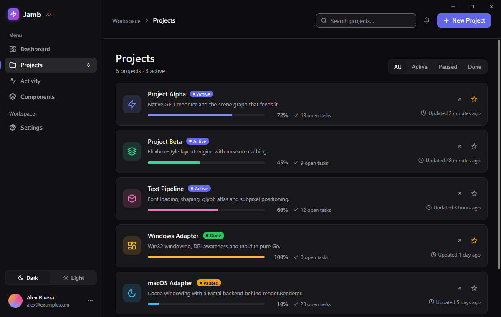
- On the Activity page, the project name in each row is a link: clicking it
  opens the Projects page with that project selected.
- Tab walks the sidebar navigation (each item shows a focus ring), and Enter
  or Space opens the focused page.
- The Projects page header uses an Oklab gradient on the logo tile.
- Clicking the "Open in window" button on a project card opens the project in
  its own window, which has an Overview tab and a Comments tab. A card whose
  window is open shows an "Open in window" badge until that window closes.
- The Activity page has a filter field (matches are highlighted in each row),
  rows of different heights in a `ListOf`, and build rows that expand on a
  click, or on Enter or Space when focused.
- Right-click a project card for its menu: Open, Open in window, Star (a check
  mark), a Status submenu with radio items, and a disabled Archive item.
- The Components page (Ctrl+4) shows the controls, overlays, gradients, rounded
  clipping, per-side borders, motion and focus styles, one section each. Its
  Menus section has a dropdown and a context menu with a submenu; their shortcuts
  come from the demo's bindings.
- The Components page's **Form controls** section shows each form control in its
  normal and disabled states, with a readout of its value, and a notification
  preferences form that uses several of them together. Its "All alerts" check box
  is the parent of the three alerts, and is mixed when only some are on.
- The Components page's **Feedback** section shows progress bars (determinate, with
  a range, and indeterminate), busy rings in three sizes, a toast button for each
  variant, a toast with an Undo action, and the badges. Its toasts appear bottom-right.
- Creating a project shows a "Project created" toast with an Undo action, which
  removes the project. The bell in the header counts the unread notifications; it
  lists the recent ones, and "Mark all read" clears the count. Every toast the app
  shows is also in the list.
- The sidebar's Projects item shows the project count as a badge. The project cards
  and the project window show each project's progress as a progress bar, and each
  status as a badge. A teammate's reply in a project's comments shows a "typing"
  busy ring until it arrives.

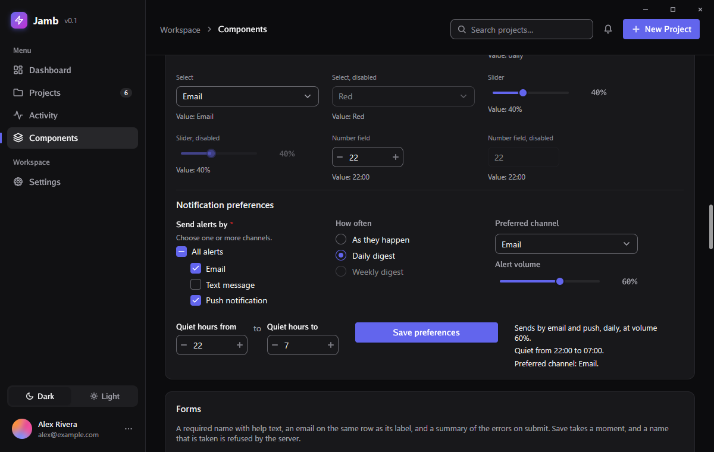

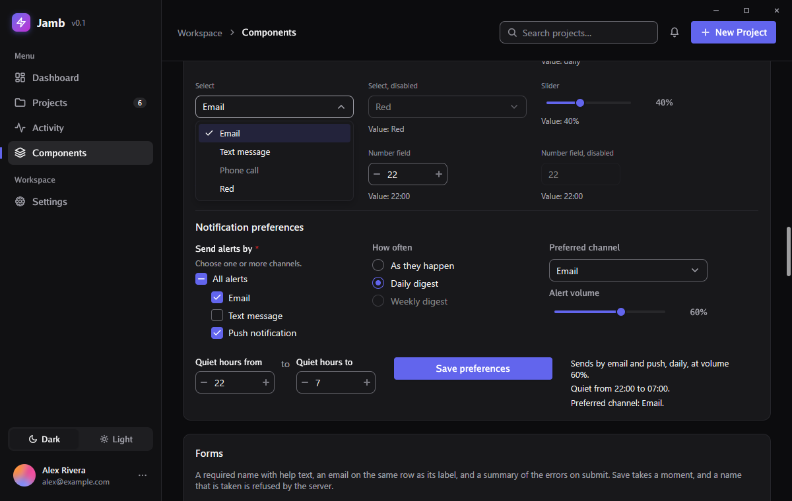

- The Components page's **Navigation and layout** section shows tabs (plain, one
  with a disabled tab, and one with icons), a collapsible section, an accordion
  with one section open at a time, a small project file tree and a tree of 10,000
  generated folders. The large tree builds only the rows in view.

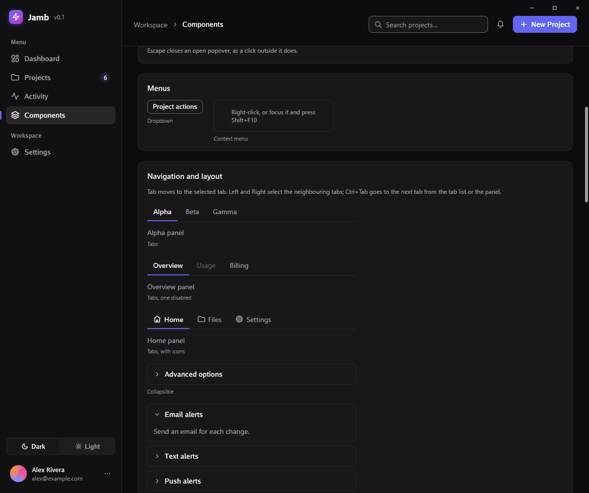

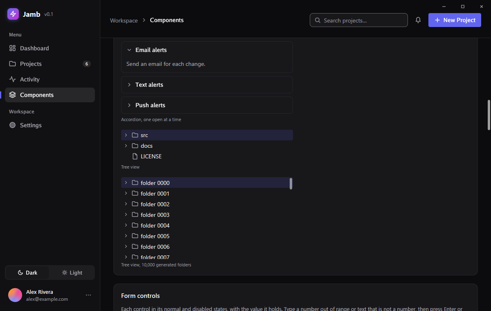

- The project window has its details on an **Overview** tab and its thread on a
  **Comments** tab.

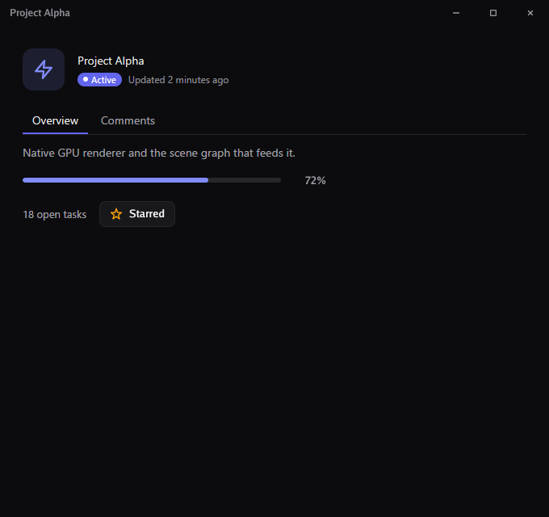

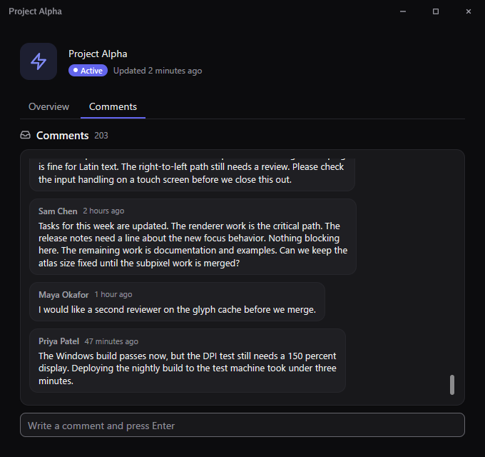

- The Components page's **Customizing** section shows how a built-in widget is
  styled without rebuilding it: the demo's theme is a copy of the built-in theme, with a
  3 px line under every underline tab, one tab list has an instance override in
  Success, and the segmented and stacked variants and two render slots (a count
  in a tab, and a color swatch in a select) are next to them. See
  [docs/styling.md](docs/styling.md).

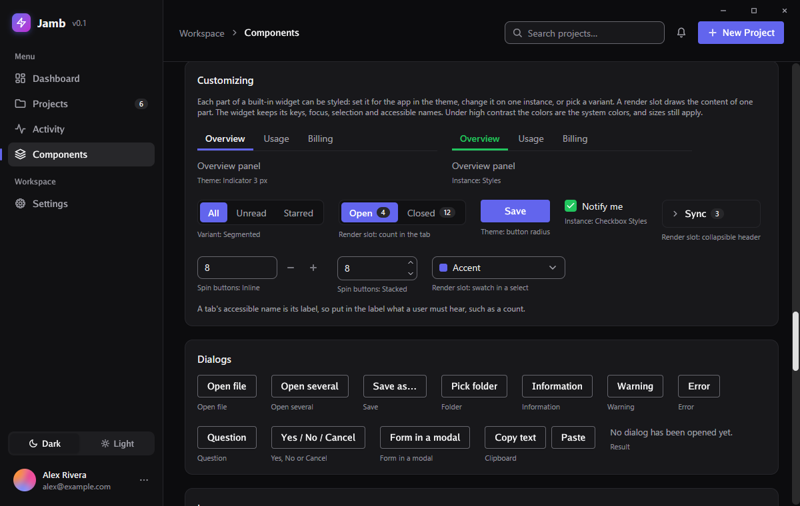

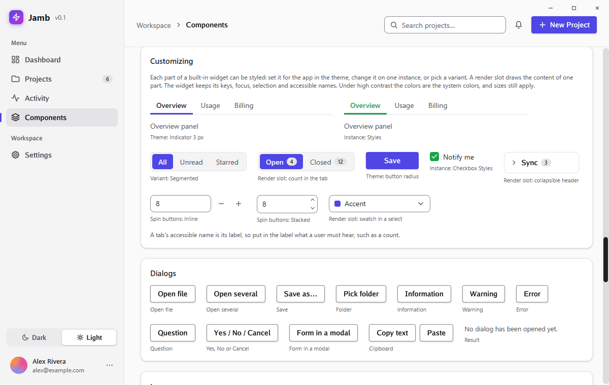

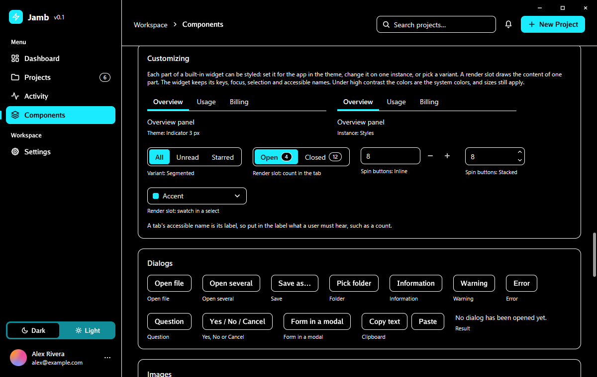

- The Settings page (Ctrl+5) groups its settings in tabs: Appearance, with switches
  and a slider for the UI zoom from 80% to 150% (which changes the whole interface);
  Notifications; and Keyboard shortcuts.
- **New Project** opens a modal form with a name and a description. Create adds
  the project, selects it and shows the Projects page. It is disabled until the
  name has text. Cancel, Escape and a press on the backdrop close the form
  without adding a project.
- The Components page's **Dialogs** section opens each native dialog and shows
  what it returned, by file name only, never by folder. Its Clipboard buttons
  copy and paste plain text, and **Form in a modal** opens a modal form.

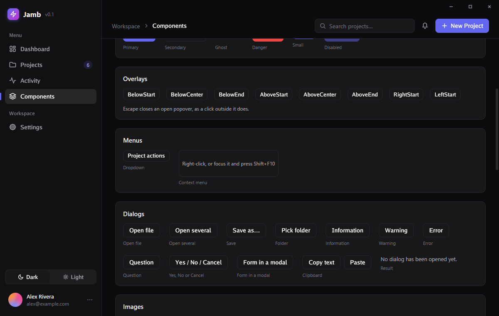

- Keyboard: Ctrl+1 to Ctrl+5 open the Dashboard, Projects, Activity, Components
  and Settings pages, Ctrl+K moves focus to the search field, and Ctrl+Shift+L
  toggles the theme.

## The notes app

`examples/notes/` is a second, text-heavy application built only from the public
API. It exists to find API gaps; it found three, which became framework
features: focus handles, `AutoFocus`, and `FocusWithin`.

- Notes live in a JSON file in the user config directory, `jamb-notes/notes.json`
  (override with `JAMB_NOTES_FILE`).
- The sidebar and the editor are a `ui.Split` with a pixel position. The sidebar's
  width is saved in `settings.json` next to the notes file 400 ms after the divider
  stops moving (and as the window closes), with the zoom, and it is restored on the
  next start. The directory was called `goui-notes` before
  the rename; the app moves it to `jamb-notes` on first start, so existing notes,
  settings and keymap carry over. A background goroutine saves 400 ms after typing
  stops and reports progress through a signal.
- Every note field is a signal, so typing re-renders only that note's list
  entry, the word count and the editor, never the whole list.
- Shortcuts: Ctrl+N (new note, title focused), Ctrl+F (search; Enter opens
  the first match), Alt+Up/Down (previous/next note), Ctrl+Shift+P (command
  palette: type to filter, Up/Down to choose, Enter runs, Escape closes),
  Ctrl+K Ctrl+T (toggle theme). Enter in a title moves to its body. Escape
  closes the palette and returns focus to the note you were in, and a command
  run from the palette acts on that note.
- `keymap.json` next to the notes file overrides the shortcuts, in the format
  described under "Keymap files". It is applied when you save it, while the
  app runs. Its problems are printed to stderr and shown in the status bar.
- Tab reaches the tag chips and the note rows near the viewport (see the
  limitations), and shows a focus ring on the focused one. Enter opens a note (as a click does)
  and toggles a tag chip's filter.
- Ctrl+= / Ctrl+- / Ctrl+0 zoom in, out and reset. They are the actions
  `ZoomIn`, `ZoomOut` and `ZoomReset`, so the View menu shows them. The level is
  remembered in `settings.json` next to the notes file and shown in the status bar
  when it isn't 100% (click it to reset).
- A menu bar above the notes has File (New note, Import..., Export note...,
  Exit), Edit (undo, redo, cut, copy, paste, select all), and View (toggle theme,
  zoom, command palette). Each item with a key shows that key. Alt by itself
  focuses the bar. Right-click a note in the list for Pin or Unpin, and Delete.
- **Import...** opens the native file dialog with `*.md` and `*.txt` offered and
  several files allowed. The files chosen go through the same import as a drop,
  and the status line reports the count. **Export note...** saves the selected
  note: the file is plain text when the chosen name ends in `.txt`, and Markdown,
  with the title as a heading, otherwise. The dialog offers the title as the
  name. The status line names the file, not its folder.
- Delete in the editor asks for confirmation inline, with Cancel and Delete
  buttons. It does not use a message box, so the notes app shows no native
  dialog for it.
- The seeded "Languages" note shows ten scripts, ligatures and emoji.
- With a search query, matches (case-insensitive) are highlighted in each
  listed note's title and snippet.
- Tags: pills under the title (Enter adds a tag, x removes it) and filter
  chips in the sidebar that wrap onto more lines.
- Drag and drop: drag a note from the sidebar list onto a tag chip to add
  that tag. The chip lights up while the note is over it. Drop `.txt` or
  `.md` files (up to 1 MB) on the window to import each as a note titled with
  its file name; the last one is selected, and the status bar says how many
  were imported and skipped.

### Agent test

To test goal #10 (APIs coding agents can use), a fresh agent got only the
README and the notes app. Its task was to add tags: storage, the editor
pills, the sidebar filter, tests and a screenshot check.

**Result:** it finished in about 4 edit/compile cycles. Its first build
compiled with zero errors, and it never read framework source.

**What changed because of its friction log:**

| Friction | Fix |
|---|---|
| No flex-wrap; had to guess text widths to wrap chips | `.Wrap()` |
| Tests located elements by parsing `Dump` text | `rt.Find`, `rt.ClickKey`, `rt.Type`, `rt.Press` |
| Text fields were anonymous in `Dump` | Keys and field contents now shown |
| No compact text field; unclear what `Style` affects | `TextInput.Small()`, documented `Style` |
| No component-local state | `ui.Local` |
| Icons hard to discover; no tag icon | `icons.All`, icon list, 24 new icons |
| Unclear whether signal values can be mutated | Documented: replace, don't mutate |

The agent's chip-wrapping and test workarounds were then replaced with
these features (`examples/notes/views/tags.go`, `tags_test.go`).

## Milestone status

| Milestone | Status |
|---|---|
| 0: native window, GPU surface, rectangle, text | ✅ |
| 1: Element, Div, Text, style object, tree, row/column layout | ✅ |
| 2: hit testing, hover, buttons, click handlers, signals, redraw scheduling | ✅ (counter and dynamic project cards in the demo) |
| 3: grow/shrink, align, justify, gap, margins, percentages, clipping, vertical and horizontal scrolling | ✅ |
| 4: rounded corners, borders, shadows, icons, images, hover transitions, dark/light themes | ✅ |
| 5: profiling | ✅, see [BENCHMARKS.md](BENCHMARKS.md) |
| Dev runner (`jamb dev`): watch, rebuild only on change, restart, keep window geometry | ✅ (development state is not preserved yet) |
| Multiple windows and custom title bars (Windows) | ✅ see [Windows](#windows) and [Custom title bars](#custom-title-bars) |

## Known limitations and next steps

- **Tree view.** A tree builds only its visible rows, so its accessibility tree is
  flat: the items are siblings under the tree, with `Level` and their position in
  their set, not nested as UI Automation's content view describes. A tree that has
  never been drawn builds only its first row; an assistive technology that expands
  an item out of view should scroll the tree into view first. A tree selects one
  node, and it does not report its open state to the app. Animated expansion and a
  sliding tab indicator are not implemented (both are optional; reduced motion
  needs no change for them).
- **Disabled controls.** In the normal themes a disabled control is dimmed with
  `Opacity` (0.5), as before. WCAG 1.4.3 exempts inactive components from the
  contrast ratio, so the dimmed text is not held to 4.5:1. Under high contrast a
  disabled control is drawn in GrayText (outline and text) and is not dimmed, as
  Microsoft's guidance asks, and that GrayText is kept at 4.5:1 or more on the window.
- **Large text in single-line fields.** A single-line text field scrolls its text
  horizontally when the text is wider than the field, as any input does. At 225%
  the notes title can be longer than its field.
- **Repeating animations at rest.** A repeating `Animate` (the demo's Motion bars)
  keeps the frame loop running at the display's rate, as it must while it moves. Only
  the animated elements repaint; the rest of the page is not rebuilt. Stopping
  repeating animations that are off screen is not done.
- **Focus.** Tab reaches only the rows of a virtualized list (`ListOf`)
  that are built, which are the rows near the viewport; rows beyond them
  are reached by scrolling and then Tab. Tab reveals vertically only,
  not horizontally. A borderless text field has no focus indicator of its
  own, since it has no frame to style. After a click on a `TabStop(false)`
  element, Tab starts from the first element of the order and Shift+Tab
  from the last.
- **Overlays.** They animate in and out only when they set `Enter` and `Exit`
  (tooltips and the notes palette do). Escape closes an overlay only when it
  has an `OnClickOutside`; any other overlay handles Escape itself, with
  `OnAction` and a binding or in `OnKeyDown`.
- **Key bindings.** A handler can't pass the key on to the next binding.
  The keymap file's watch is per directory, so other files that change there
  (such as the notes file on each save) cause a cheap re-read of keymap.json,
  which is ignored when its bytes are unchanged. Binding layers are only
  partly like GPUI's (its base, default and user keymaps): the file's layer is
  replaced in place, and otherwise the order in which bindings are added
  decides between them.
- **Platforms.** Only the Windows adapter exists. macOS (Cocoa + Metal) and
  Linux (Wayland/X11 + Vulkan or GL) adapters plug in behind
  `platform.Window` and `render.Renderer`. Since there is no cgo today,
  macOS will need either a small cgo shim or purego-style Objective-C calls.
- **Windows, multiple windows and custom title bars.** Checked on Windows 11
  with real mouse input: the caption buttons (hover, press, maximize and
  restore), double-clicking the title bar, the hit-test answers for the title
  bar, its buttons, the left border and a corner, and the maximized geometry
  (content inside the work area).
  Checked with scripted input: opening a window from a click, sharing a star
  between two windows, closing a window while the app keeps running, and
  closing the last one. The Snap Layouts flyout was checked by hand on Windows
  11 and works, provided the top DWM frame margin stays 0 (see `applyCustomFrame`
  in `internal/platform/windows/chrome.go`). Not checked automatically, so check
  these by hand: dragging the title bar to move the window and to snap it to an
  edge, Win+ arrows, the drop shadow and the rounded corners.
  Images and glyph textures are shared per device and stay resident after
  the window that used them closes. A lost GPU device is rebuilt
  automatically; see [GPU device loss](#gpu-device-loss) for what was checked
  and what was not.
- **Text.** Shaping, bidi display, fallback, selection, clipboard and undo
  work. Still missing:
  - **IME.** Composition text appears in the system's window at the caret,
    not inline in the field.
  - **Paragraph direction.** It is always left-to-right, so an Arabic-only
    paragraph is right-to-left inside but left-aligned. Arrow keys move in
    logical order through mixed-direction text.
  - **Emoji.** Drawn monochrome.
  - **Rendering.** On Windows, glyph masks come from DirectWrite (hinted
    vertically: crossbars and x-height/cap-height edges land on whole pixels
    while stems keep their subpixel position). When the user has ClearType
    on (`SystemParametersInfo` font smoothing of type ClearType), glyphs are
    rasterized as ClearType RGB coverage (BGR panels are honored) into a
    second atlas and drawn with dual-source blending, with an alpha
    correction in the shader driven by the user's DirectWrite gamma,
    contrast and ClearType level. The correction was fitted against
    `IDWriteBitmapRenderTarget` output (`TestClearTypeReference`, about 2.5
    levels mean difference on inked pixels). Grayscale anti-aliasing with
    the contrast-enhancing shader is used when ClearType is off, when the
    device lacks dual-source blending, for icons, and for fonts without a
    file path or on other platforms (the pure-Go rasterizer is unhinted and
    slightly softer). Subpixel text assumes an opaque swap chain and
    pixel-scale drawing, which holds for every window jamb creates.
    `JAMB_TEXT_AA=gray` forces grayscale. Fitted at the default gamma 1.8
    and contrast 0.5; other tuner settings scale the correction rather
    than being fitted.
  - **Spell checking.** Missing. Rich text is display-only; text areas stay single-style.
  - **Shaping cost.** About 0.4 ms per 1,000 characters. It's cached per
    paragraph, so typing in a long note re-shapes only the edited paragraph
    (about 0.1 ms per keystroke at 11,000 characters).
- **Untested paths.** Non-100% DPI is covered by a headless test
  (`TestScaleProducesPhysicalPixels`) but not on real hardware.
  Multi-monitor `WM_DPICHANGED` has not been exercised either.
- **Paint cost is per visible node.** Paint and hit testing skip off-screen
  subtrees (see the frame pipeline), so a long scroll list costs about its
  visible rows: repainting 10,000 nodes with 73 on screen takes about 0.06 ms.
  A tree whose nodes are all on screen still pays the per-node cost, and a
  container with 10,000 children runs a visibility test on each of them. The
  node itself is about 1 KB; the compact per-node paint struct is the next
  step (see BENCHMARKS.md). `ui.UniformList` and `ui.ListOf` avoid the
  per-child cost for long lists by building only the rows in view. A `ListOf`
  has three caveats: the scrollbar thumb is sized from estimated heights until
  rows have been seen; a slice changed in place is not detected (build a new
  one); and a row whose height changes while it is not built keeps its old
  height until it is built again.
- **No race-detector run.** Go's `-race` needs cgo, and neither of this
  machine's C toolchains could build it (MSYS2 GCC 16 fails on
  `runtime/cgo`; Zig's MinGW lacks `synchronization.lib`). The signal and
  instance locking is covered by a concurrent stress test instead.
- **Styling.** Border widths are layout, so they don't ease with `Transition`,
  and all sides share one color. Clipping to a rounded shape is exact for one
  rounded container; a nested one keeps only its own corners, and hit testing
  uses the rectangle (see Borders and rounded clipping). Colors, opacity,
  offset and scale ease with `Transition`. Layout
  properties (sizes, padding and so on) animate only through `ui.Animate`,
  which re-lays out each frame. There are no springs yet, no rotation, and
  scale is not hit-tested.
- **Events.** Bubbling only; there's no capture phase.
- **Drag and drop.** Files dragged in from outside the app get no drag
  feedback: `Over`, `Move` and `Leave` do not run, because OLE drag feedback
  for external drags is not implemented. Nothing can be dragged out of the
  app, and OS drops have no drag image. Cursor kinds are unchanged; a drag
  uses the existing not-allowed cursor. File drops arrive through Win32
  `WM_DROPFILES`, which tests can't produce (the drop handle is only valid
  in the process Explorer gives it to); `JAMB_SCRIPT`'s `drop` step covers
  everything after it. Windows refuses drops from Explorer into an app
  running as administrator.
- **Startup.** The ~180 ms startup floor is Direct3D driver initialization.
  The framework's own startup cost is about 20 ms.
- **Menus.** Alt+letter mnemonics are not implemented. A menu stays open when a
  key binding moves focus elsewhere. A press outside, Escape or Tab closes it.
  Focus loss does not close menus, because a click on the trigger of a focusable
  dropdown would then reopen it. The submenu delay is a timer, not a triangle.
  The menu bar's labels are not in the Tab order. The roles are in place for
  UI Automation, which is not wired.
- **Dialogs and clipboard.** Native dialogs run on Windows only. Message boxes
  use `MessageBoxW`, not `TaskDialog`. `TaskDialog` needs the common-controls
  version 6 manifest, which `jamb package` adds to a packaged app but a `go run`
  build does not have, so the switch (with a `MessageBoxW` fallback) is future
  work. The clipboard is plain text only: images and
  HTML are not supported. On Windows 11 the file, folder and message box dialogs
  were driven through UI Automation and window messages. They opened owned by
  their window, returned their results, and canceled correctly, and the window
  stayed disabled and kept drawing while a dialog was open. Not checked: dialogs
  in other languages, and high-contrast themes.
- **Packaging.** Windows only (see [Packaging](#packaging)). Not done: Store
  submission (the MSIX is uploaded by hand), a machine-wide installer, file
  associations and capabilities beyond `runFullTrust`, localized resources, the
  wide and splash logos and target-size logos of the MSIX, and automatic updates.
  The installer has been run only on Windows 11, and its upgrade over an older
  version has not been tested. The arm64 build is compiled but has not been run.
  The MSIX install steps are for a person to run; the SDK tools check the
  package's structure.
- **Accessibility.** Phases A, B and C, and the automated parts of phase E, of
  [docs/accessibility.md](docs/accessibility.md) are in place on Windows: the access tree, names and roles, bounds and focus,
  Invoke, Toggle, ExpandCollapse, SelectionItem and Selection, Value, Scroll and
  ScrollItem, Text for text fields and text areas (with the system caret for
  magnifiers), Window for dialogs, focus, menu, property-changed, text-changed
  and notification events, headings and label relations, the dump and the
  development warnings. Open from phase B: a dialog's window opened event is not
  seen by a .NET client (a dialog is announced by its focus, IsDialog and
  IsModal; see [docs/accessibility.md](docs/accessibility.md)), and virtualized
  rows that are not built cannot be found or realized (see the design's phase B
  open items). Open from phase C: IME composition, the Text pattern for static
  and rich text, annotations and embedded objects (see the design's phase C open
  items). The caption
  buttons (Minimize, Maximize, Close) have their roles and names, but their
  invoke path has not been checked live. Building the tree for the demo's
  dashboard takes about 18 µs, measured with a benchmark; the cost grows with
  the tree. A UI Automation client that walks the whole tree over and over makes
  the process's private memory rise about 0.05 MB per walk of the demo's 46 nodes;
  the same walk against Windows Notepad grows at the same rate per element, so it
  is UI Automation's own per-client state, not a jamb leak (see
  [docs/accessibility.md](docs/accessibility.md)). A client that walks past the window's close gets `E_UNEXPECTED`
  from UI Automation. The Axe.Windows rules (AxeWindowsCLI, the engine of
  Accessibility Insights) report no errors in the examples' 18 scanned states, and
  the live checks in `scripts/a11y-check.ps1` pass. Not yet checked with NVDA or
  Narrator: that pass is for a person, with
  [docs/accessibility-testing.md](docs/accessibility-testing.md). Two placeholder
  actions need a decision: the demo's Notifications bell and its sample buttons
  announce a message when pressed. The dev script step `idle` did not return after
  the Components page was scrolled three times (`wait` works); it was not
  investigated.
- **Not attempted (non-goals).** Tray,
  CSS grid, and the optional utility-class shorthand
  (`.Class("flex col gap-2")`). The shorthand was skipped in favor of typed
  styles.

## License

jamb is licensed under the Apache License, Version 2.0. See [LICENSE](LICENSE)
and [NOTICE](NOTICE).
