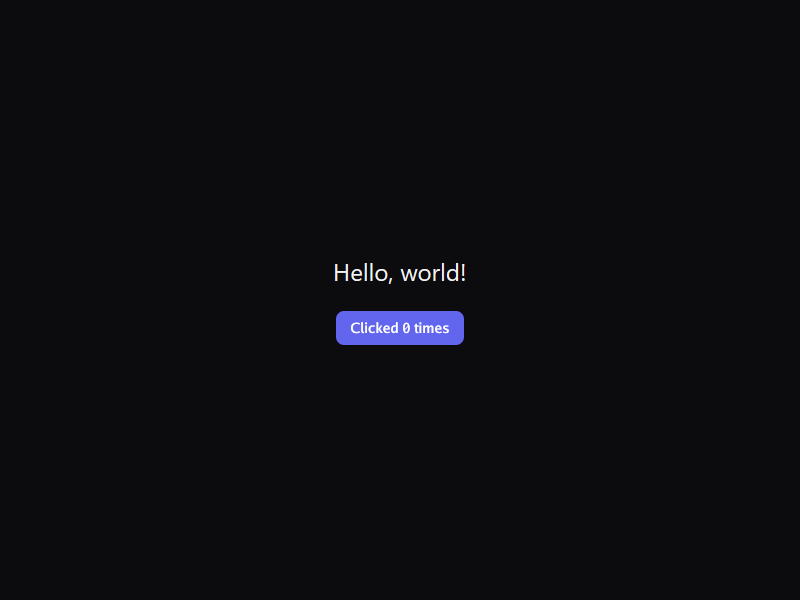
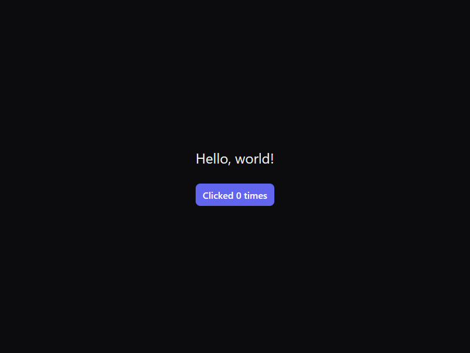

# jamb and GPUI: hello-world comparison

This document compares two builds of the same small app on one Windows machine: jamb (Go) and GPUI (Rust, the UI framework from Zed). The app is a window with a centered greeting and a button that counts its clicks. It measures project size, binary size, build times, startup, idle CPU and memory, and the CPU cost of pointer movement and window resizing. [Components: jamb and GPUI Kit](#components-jamb-and-gpui-kit) compares jamb's widgets, their options and the framework features around them with GPUI Kit's, the component library for GPUI from Longbridge (named gpui-component until September 2026).

Measured with `scripts/compare-gpui.ps1`, three runs per measurement, in two passes on 2026-10-12 (see [Measurement passes](#measurement-passes)). Results are shown as median [minimum–maximum].

## Summary

- **Startup.** jamb paints its first frame sooner. On a warm launch (the executable has been started before), jamb painted at 266 ms and GPUI at 387 ms. On the first launch of a new copy of the executable, which Windows Defender scans before it runs, jamb painted at 496 ms and GPUI at 611 ms.
- **Binary size.** jamb's stripped release binary is 8.41 MB at commit `f13b6c5` (7.18 MB in the second pass, before the features added since). GPUI's release binary is 9.21 MB, and 15.28 MB for the same app built with gpui-component, now GPUI Kit, at its August 2026 revision (see [Binary size, updated](#binary-size-updated)).
- **Build time.** Incremental builds take 2 s for jamb and 4 s (release) or 6 s (debug) for GPUI. A clean build from an empty cache took about 9 s for jamb, and 138 s (release) or 100 s (debug) for GPUI.
- **Idle CPU.** jamb used 0.29% of one core while idle and focused (median), with about 185 context switches per second. GPUI used 1.85%, with about 530 per second.
- **Memory.** GPUI uses slightly less: 75.3 MB private bytes and 52.5 MB working set, against jamb's 78.2 MB and 58.8 MB. jamb uses less GPU memory (13.8 MB dedicated, against 17.5 MB).
- **Project size.** jamb's app is one 28-line file and uses 76.6 MB of third-party module source. GPUI's app is one 68-line file and resolves 673 packages (about 840 MB of source), with a 1.24 GB release target directory.
- **Toolchain.** jamb needs only the Go toolchain. The app builds with `CGO_ENABLED=0`. GPUI needs Rust 1.95.0, the MSVC linker and the Windows SDK, and its build scripts compile C and assembly helpers.
- **Interaction.** During pointer movement, jamb used 2.2% of a core against GPUI's 3.4%. During programmatic resizing, jamb used 11.5% against GPUI's 18.8% (first pass; see [Measurement passes](#measurement-passes)).

## Setup

| Item | Value |
|---|---|
| Machine | Desktop PC, 12 logical processors, discrete GPU, 32 GB RAM, Windows 11 |
| Display scale | 100% (the 800 x 600 window had an 800 x 600 client area) |
| jamb | Go go1.27.1 windows/amd64; `examples/hello` is its own module in `go.work`. Commits per pass: see [Measurement passes](#measurement-passes) |
| GPUI | `gpui` and `gpui_platform` 0.2.2 from `https://github.com/zed-industries/zed` at revision `cc053a4a6fa2fd0e8793201ed9099466af1be0b1` (the revision of the gpui-testing project), feature `font-kit` |
| GPUI toolchain | Rust and Cargo 1.95.0 (pinned by `rust-toolchain.toml`), built with `--locked` |
| GPUI lockfile | `Cargo.lock` copied from gpui-testing; cargo pruned it to 673 packages for this app |
| jamb builds | Release: `go build -trimpath -ldflags "-s -w"` (size) and `-s -w -H windowsgui` (timed and run, see Method). Default: `go build` |
| GPUI builds | Release: `cargo build --release`, the default release profile, as most Rust apps ship. Debug: `cargo build` |
| Machine load | Other applications were running during the measurements (the machine was not dedicated to the test) |

The two apps look the same. Both windows are 800 x 600, titled "Hello", with a `#0c0c0e` background, "Hello, world!" at 24 px in the system UI font, and a button in jamb's primary-button colors (accent `#6265ed`, hover `#5b5ee7`, 8 px radius, medium weight). Segoe UI has no Medium face; both frameworks draw medium-weight text with Segoe UI Semibold. The button's padding differs slightly: jamb's button is a little smaller than GPUI's. Both apps were clicked twice in a QA run; both showed "Clicked 2 times".





## Measurement passes

The measurements come from two passes of the script on the same machine.

| Pass | jamb code | What it measured |
|---|---|---|
| First | Commit `db7d858` plus the then-uncommitted `examples/hello` | Clean build times, build output sizes, GPUI's size-profile binary (footnote below), pointer movement and resizing |
| Second | Commit `06e5936` | Everything else: project size, binary sizes, incremental builds, startup, idle CPU, memory and GPU memory, the screenshots |

The second pass ran with `-SkipInteraction`, because the pointer and resize phases move the real cursor. Between the passes, jamb's startup memory, binary size and font matching changed (see [Changes between the passes](#changes-between-the-passes)). None of those changes touch the input or resize path, so the first pass's interaction figures are kept, labeled as such.

During the second pass, Medium text resolved to Segoe UI Regular, under an intermediate version of the font-weight rule. The final rule resolves it to Semibold. The app loads Regular and Semibold at startup either way, so the startup and memory figures are unaffected. The jamb screenshot was captured again with the final rule.

## Method

- **Source size.** Files and lines in the app's own source. Framework size for jamb is the non-test `.go` files of every jamb package in the dependency graph of `examples/hello` (`go list -deps`). For GPUI, the sizes are the crate directories of every package in `Cargo.lock` (from `cargo metadata --locked`), not the whole caches. The zed checkout is a monorepo, so only the crate directories are counted.
- **Dependency sources.** Go: module directories in GOMODCACHE for the build list (`go list -m all`, with `GOWORK=off` so the list is hello's own), and separately for the modules its packages use. Rust: registry crate directories and git crate directories.
- **Builds.** By default the script builds with the normal Go build cache and gpui-hello's own `target` folder, so only its first run compiles GPUI from scratch. With `-IncludeCleanBuilds`, each build runs three times with an empty, temporary cache or target directory, and that directory's size is recorded (the first pass did this).
- **Build retries.** A failed build is retried once and recorded in the results, because the MSVC linker occasionally fails on a file that an antivirus is still scanning. The second pass needed no retries.
- **Toolchain sizes.** The GOROOT directory for Go. The `1.95.0-x86_64-pc-windows-msvc` toolchain directory for Rust. The MSVC and Windows SDK installs are not measured.
- **Binary size.** The produced `.exe`. Rust release builds keep debug information in a separate `.pdb`, which is not included.
- **Clean build time.** Dependencies already downloaded; empty build cache or target directory; wall-clock time of the build command. Three runs each.
- **Incremental build time.** On a warm cache, the app's main file is changed in two ways, each rebuilt once: a new text literal ("Hello, world!" gets a run number) and then a whitespace-only change (extra trailing newlines). The original file is restored byte for byte afterwards. Three runs each.
- **First build on a new machine (one run, first pass).** `go mod download` into a temporary GOMODCACHE (`GOWORK=off`), and `cargo fetch --locked` into a temporary CARGO_HOME (which clones the zed repository). Both caches were deleted afterwards.
- **Startup.** For each run, the executable is copied to a new temporary folder. The copy is launched once ("first launch": Windows Defender scans a file it has not seen before it runs), then five more times from the same file ("warm launch", as on every later start). For each launch, the script polls for a visible top-level window owned by the process and titled "Hello" (about 5 ms resolution), then captures its client area with `PrintWindow` (`PW_RENDERFULLCONTENT`) until it shows more than one colour. A window filled with only its background colour does not count as painted. Times are measured from the process launch call. The warm figures pool the fifteen warm launches.
- **Idle CPU and context switches.** The last warm launch of each run stays open. After an 8 s settle, the app's `TotalProcessorTime` and the sum of `ContextSwitchesPersec` (raw counter `Win32_PerfRawData_PerfProc_Thread` for the process) are read before and after 60 s. Measured with the app focused, then after the taskbar was given focus (the app stays visible).
- **Memory.** Private bytes, working set, thread count and handle count at the end of the unfocused idle sample. GPU dedicated and shared memory come from the `GPU Process Memory` counters for the process.
- **Pointer movement (first pass).** For 10 s, the real mouse cursor moves in a Lissajous path over the app's client area, roughly every 16 ms, with no clicks. The cursor is returned to its original position afterwards.
- **Resizing (first pass).** For 10 s, the app window is resized programmatically (`SetWindowPos`) between about 560 x 420 and 1040 x 780 logical pixels, roughly every 16 ms. This is not a user drag.
- **Focus.** The app is brought to the front with a quick Alt key press, which Windows needs before it accepts a focus change from a background process. The script records whether the app was focused and unfocused as intended. All runs did.
- **Timer resolution.** Sampling uses `Thread.Sleep`, which has roughly 15 ms resolution on this machine by default, so startup values are accurate to about 15 ms.

## Results

### Project size

| Metric | jamb (Go) | GPUI (Rust) |
|---|---|---|
| App source | 1 file (`main.go`), 28 lines | 1 file (`src/main.rs`), 68 lines |
| App manifests | `go.mod`, `go.sum` | `Cargo.toml`, `Cargo.lock`, `rust-toolchain.toml` |
| Framework source used | 17 jamb packages, 119 non-test files, 40,386 lines, 1.28 MB | Not applicable (GPUI's source is counted with its dependencies) |
| Third-party sources used | 4 modules, 76.6 MB (used by the app's packages) | Registry sources in `Cargo.lock`: 647 crates, 815.0 MB (all platforms) |
| Git-sourced crates | None | 25 crates, 24.6 MB (22 from zed at `cc053a4`; forks of wasm_thread, font-kit and scap) |
| Build list (Go) | 5 modules downloaded (237.7 MB), 3 go.mod-only | Not applicable |
| Dependency count | 45 non-standard packages in the app's graph (jamb's packages, the app's own and third-party); 4 third-party modules used | 673 packages in `Cargo.lock` (647 registry, 25 git, 1 local) |
| Build output after a release build (first pass) | GOCACHE 84.1 MB (cold) | `target/` 1,243.8 MB |
| Build output after a debug build (first pass) | GOCACHE 84.2 MB (cold, default flags) | `target/` 2,484.4 MB |
| Toolchain install | Go GOROOT 235.5 MB | Rust 1.95.0 toolchain 571.3 MB (plus MSVC and Windows SDK, not measured) |
| Download on a new machine (one run, first pass) | 5 s, 94 MB in GOMODCACHE | 177 s, 1,794 MB in CARGO_HOME (includes the zed clone) |

### Binary size

| Build | Size |
|---|---|
| jamb, `go build -trimpath -ldflags "-s -w"` | 7.18 MB |
| jamb, `-s -w -H windowsgui` (the run and screenshot build) | 7.18 MB |
| jamb, default `go build` | 10.13 MB |
| GPUI, `cargo build --release` (`.pdb` not included) | 9.21 MB |
| GPUI, debug (`cargo build`) | 24.39 MB |

GPUI can be built smaller with a size-optimized profile (`opt-level = "z"`, fat LTO, `codegen-units = 1`, `panic = "abort"`, `strip = true`): 4.31 MB in the first pass, at a clean build time of about 238 s. Its runtime figures in that pass were close to the release build's, with a smaller working set (55.4 MB against 60.2 MB). This comparison uses the default release profile, which is what most Rust applications ship.

### Binary size, updated

Measured on 2026-10-14, one build each, on the same machine. The other figures in this document are from the passes above and were not measured again.

| Build | Size |
|---|---|
| jamb hello, second pass (`06e5936`) | 7.18 MB |
| jamb hello, `ff9b98a` (after the clipboard, IME, color emoji, Canvas, SVG and tier-2 widget work) | 7.74 MB |
| jamb hello, `f13b6c5` (after the themes, translations, dock, inspector and other tier-3 work) | 8.41 MB |
| GPUI hello (`gpui` at `cc053a4`, release) | 9.21 MB |
| gpui-component's `hello_world` example (gpui-component 0.5.2 at `f2f0f56`, 2026-08-12, the same `gpui` revision, release) | 15.28 MB |

All jamb builds are `go build -trimpath -ldflags "-s -w -H windowsgui"`, and both Rust builds are `cargo build --release` with the default profile. gpui-component's `hello_world` is the same kind of app as the others: a centered greeting and a primary button. It shows what linking gpui-component adds to a GPUI app, about 6 MB.

The project was renamed GPUI Kit in v0.6.0 (2026-09-03), and its `hello_world` example now depends on the `gpui-kit` crate and on the `gpui-pre` 0.3.9 snapshot of GPUI rather than a zed git revision. The 15.28 MB figure is from before the rename and was not measured again; GPUI Kit's binary size today may differ.

A hello app uses only part of jamb, and the Go linker drops the rest. Larger apps:

| Build | Size |
|---|---|
| jamb demo (`examples/demo`: every widget, charts, the code editor with the Go grammar, the dock) | 15.99 MB |
| jamb notes (`examples/notes`) | 8.80 MB |
| A gpui-component (pre-rename) application on the same machine: a database workbench with a tree-sitter SQL editor, a database driver and TLS | 26.3 MB |

gpui-component's own gallery app was not built: its dependencies were not in the local Cargo cache, and downloading them would have added about 1 GB. The database workbench is not the same app as the jamb demo, and its driver and TLS add to its size, so it is an indication, not a like-for-like comparison.

In the jamb demo, the code editor's part of the binary, by symbol size: wazero, the WebAssembly runtime that runs tree-sitter, about 1.1 MB, plus about 0.2 MB of standard-library packages it brings in; the editor itself about 0.5 MB; and the Go grammar 0.36 MB. These sizes were measured when the editor highlighted with tree-sitter. Since 2026-10-19 it uses @pierre/highlights instead, whose one module of 0.17 MB holds all 76 languages, in place of the grammars (see BENCHMARKS.md); the figures above were not measured again. Each also adds to Go's runtime tables, which grow with the amount of code. An app that does not import `codeedit` links none of it.

### Build times (seconds; three runs; dependencies already downloaded)

| Build | Median [min–max] |
|---|---|
| jamb incremental, release, text change | 2.05 [2.02–2.05] |
| jamb incremental, release, whitespace change | 2.03 [2.03–2.04] |
| jamb incremental, default, text change | 2.06 [2.03–2.08] |
| jamb incremental, default, whitespace change | 2.03 [2.03–2.04] |
| GPUI incremental, release, text change | 4.06 [4.05–6.24] |
| GPUI incremental, release, whitespace change | 4.07 [4.06–6.19] |
| GPUI incremental, debug, text change | 6.07 [6.07–6.09] |
| GPUI incremental, debug, whitespace change | 6.06 [6.05–7.04] |
| jamb clean release (`-trimpath -ldflags "-s -w -H windowsgui"`, cold GOCACHE; first pass) | 9.1 [9.1–12.2] |
| jamb clean default (`go build`, cold GOCACHE; first pass) | 9.1 [9.1–10.1] |
| GPUI clean release (`cargo build --release`, empty target; first pass) | 137.7 [136.7–139.3] |
| GPUI clean debug (`cargo build`, empty target; first pass) | 100.3 [97.2–101.2] |

### Runtime (three runs each)

| Metric | jamb | GPUI release |
|---|---|---|
| Startup, warm launch, window visible | 236 ms [234–291] | 343 ms [328–1,134] |
| Startup, warm launch, first painted frame | 266 ms [250–314] | 387 ms [369–1,212] |
| Startup, first launch of a new file, window visible | 471 ms [469–592] | 572 ms [492–1,310] |
| Startup, first launch of a new file, first painted frame | 496 ms [494–628] | 611 ms [536–1,359] |
| Idle CPU, focused (60 s) | 0.29% [0.18–0.65] | 1.85% [1.72–2.73] |
| Idle context switches/s, focused | 185 [154–239] | 527 [519–641] |
| Idle CPU, unfocused (60 s) | 0.16% [0.13–0.21] | 1.67% [1.64–2.58] |
| Idle context switches/s, unfocused | 163 [158–196] | 566 [498–644] |
| Private bytes | 78.2 MB [77.9–78.3] | 75.3 MB [73.8–75.3] |
| Working set | 58.8 MB [58.6–59.3] | 52.5 MB [52.5–53.1] |
| Threads | 36 [35–38] | 30 |
| Handles | 475 [468–487] | 486 [486–488] |
| GPU dedicated memory | 13.8 MB | 17.5 MB [17.5–19.5] |
| GPU shared memory | 0.6 MB [0.6–1.4] | 0.4 MB [0.1–0.4] |
| Pointer movement, CPU (10 s; first pass) | 2.18% [1.25–3.59] | 3.43% [2.50–4.21] |
| Pointer movement, context switches/s (first pass) | 712 [649–725] | 881 [751–936] |
| Resizing, CPU (10 s; first pass) | 11.52% [9.37–11.99] | 18.84% [13.26–19.83] |
| Resizing, context switches/s (first pass) | 2,411 [2,325–2,529] | 1,820 [1,818–2,110] |

CPU values are percent of one logical core. The GPU memory figures include the Direct3D driver's allocations for the process, which the app does not control. GPUI's third run was slow throughout (warm launches up to 1.2 s), which accounts for the high maxima; its first two runs were close to the medians.

### Changes between the passes

The first pass showed GPUI ahead on startup, memory and binary size. Investigating those results led to these changes in jamb:

| Metric | First pass | Second pass |
|---|---|---|
| Private bytes | 100.7 MB | 78.2 MB |
| Working set | 78.1 MB | 58.8 MB |
| GPU dedicated / shared memory | 18.6 / 6.2 MB | 13.8 / 0.6 MB |
| Stripped binary | 8.45 MB | 7.18 MB |
| Startup, first painted frame | 750 ms (new file every launch) | 266 ms warm, 496 ms new file |

- **Memory.** Glyph atlases start at 256 x 256 instead of 1024 x 1024 and grow as needed (the ClearType atlas alone was 4 MB on the CPU and again on the GPU). System font files are memory-mapped instead of copied onto the Go heap. Startup no longer parses the Bold face, which no built-in widget draws.
- **Binary size.** Windows builds embed one Go fallback font instead of nine. Segoe UI and Consolas ship with every supported Windows version, so the other eight were never used.
- **Startup.** Most of the first pass's startup gap was the method. That pass launched a new copy of the executable every time, so every launch included a Windows Defender scan. In the second pass, the first launch of a new file added about 230 ms for both apps. The script now reports first launches and warm launches separately. jamb's new-file figure also dropped from 750 ms to 496 ms between the passes. The smaller binary and the earlier device creation account for part of that; the rest was not isolated. jamb now creates its Direct3D device at the same time as the window, which saves about 10 ms. Creating the device takes about 180 ms inside the graphics driver.
- **Font weights.** Before the change, medium-weight text in jamb was drawn in the embedded Go Medium font instead of Segoe UI. It now uses Segoe UI Semibold, as GPUI does.

## Caveats

- **GPUI's dependency tree is larger than a hello world needs.** The 673 packages include text shaping, accessibility, font, image and platform crates that this app does not use directly. `Cargo.lock` lists packages for every platform (for example, `freetype-sys` is locked but is not built for Windows), so the registry and git sizes overstate what a Windows build compiles.
- **Platform scope differs.** jamb is Windows-only today. GPUI targets macOS, Linux and Windows, and GPUI Kit adds WebAssembly, iOS and Android hosting. jamb's Linux and macOS platform packages are placeholders (per [architecture.md](architecture.md)), so the example was only compiled for them (`GOOS=linux` and `GOOS=darwin GOARCH=arm64`), not run. Cross-compiling GPUI from Windows was not tested, because it would need the rustup target and its system libraries.
- **GPUI on Windows.** This comparison measures GPUI's Windows backend on this machine and nothing else. It does not assess that backend's maturity or stability.
- **Driver threads.** The Direct3D driver's threads run in the app's process. Process CPU time and context switches include them, and they could not be separated.
- **Startup method.** Times include process creation and the script's polling, and are measured from the launch call. jamb's own trace (`JAMB_TRACE=1`) puts its first frame about 195 ms after process start on this machine; the external warm figure (266 ms) adds process creation and polling. First-launch times depend on the antivirus and its settings.
- **Synthetic input.** The pointer and resize phases move the real cursor and resize the app's window for a few seconds each. Each app's cursor position was restored afterwards by the script. The Alt key press that the script uses to bring the app to the front is also synthetic.
- **Focus and occlusion.** The unfocused sample gives focus to the taskbar. The app stays visible, but a window that is not visible at all could behave differently.
- **Measurement noise.** The machine was not idle: other applications were running. The sample size is three runs (fifteen warm launches for startup).
- **Button look.** The button colors and radius match jamb's primary button (GPUI's `rounded_lg` is 8 px), but the padding is not identical (see Setup). The text is GPUI's default system font, which is also what jamb uses on Windows.
- **Build flags.** The jamb run and screenshot binary uses `-H windowsgui`, so no console window appears. A console-subsystem build launched from Explorer or `Start-Process` also opens a console window, which adds several hundred milliseconds to startup. GPUI's release build uses the `windows_subsystem` attribute for the same reason.

## Toolchain requirements

| | jamb (Go) | GPUI (Rust) |
|---|---|---|
| Install | Go 1.27 or later (one installer) | rustup, then Rust 1.95.0 (pinned); the first build also needs the MSVC linker from Visual Studio 2022 C++ build tools and the Windows SDK |
| C compiler or cgo | Not needed; the example has no `import "C"` and builds with `CGO_ENABLED=0` | Needed on Windows: the dependency graph includes `cc` build scripts (for example `psm`/`stacker`, which compile small C and assembly pieces) and `embed-resource`, which calls the MSVC resource compiler |
| Network on first build | `go mod download` of about 94 MB | About 1.8 GB, including a clone of the zed repository |
| Build steps | `go build` (one command) | `cargo build` (one command) |
| Cross-compiling from Windows | Compiles for linux/amd64 and darwin/arm64 (compile only, see Caveats) | Not tested |

## Components: jamb and GPUI Kit

jamb's predefined themes and some of its translated strings come from gpui-component (see `NOTICE`). The project is now [GPUI Kit](https://gpui-kit.com/) ([longbridge/gpui-kit](https://github.com/longbridge/gpui-kit); the old repository URL redirects there). This section compares the two component sets, the options each component offers, and the framework features around them. It was checked on 2026-10-20 against GPUI Kit v0.8.0 (released 2026-10-19; its `main` branch had six bug fixes since, with no API changes) and jamb at `dba3577`. Both sides were compared by reading their public source: GPUI Kit's builder methods, state types and events, and jamb's exported methods. Nothing was built or run, so the tables compare what the APIs offer, not quality, performance or behaviour in use.

### What changed upstream

- **Rename and crates (v0.6.0, 2026-09-03).** Apps now depend on one crate, `gpui-kit`, which re-exports GPUI and these layers: `gpui-base` (unstyled behaviour and state), `gpui-component` (the styled components, still published under that name, now in `crates/component`), and `gpui-kit-assets` (icons, replacing `gpui-component-assets`). `gpui-shell` is a JavaScript runtime for GPUI apps built on QuickJS, still a preview.
- **GPUI dependency.** GPUI Kit pins a published GPUI snapshot, `gpui-pre` 0.3.9 (v0.8.0), instead of following the zed repository. An optional alternative backend, GPUI Fast, came in v0.7.3.
- **Platforms.** macOS, Windows, Linux (X11 and Wayland) and WebAssembly, with iOS and Android hosting since v0.6.2. Accessibility comes from AccessKit through GPUI.
- **Renamed APIs (v0.6.0).** `Table` became `DataTable` (a new, declarative `Table` took its name), `Divider` became `Separator`, and `InputState` is single-line only, with `TextareaState` and `EditorState` split out. The Dock API was redesigned.
- **Themes.** The theme files are the same JSON format and schema as before. Since `f2f0f56`, `matrix.json` was removed upstream, and the schema gained `chart.bullish`, `chart.bearish` and `chart.grid` and lost `tiles.background`. jamb's copies in `third_party/gpui-component-themes` are from v0.8.0, except Matrix, which jamb keeps from `f2f0f56`. jamb's charts take their colors from its own tokens, so the new chart keys are not converted.
- **Locales.** The strings moved from `crates/ui/locales/ui.yml` to `crates/component/locales/ui.yml`. `NOTICE` cites the old path at the commit it was taken from, which is still accurate for that commit.

### Coverage

GPUI Kit's component page lists 69 components in four groups. The jamb column names the closest jamb widget; "None" means jamb has no equivalent.

| GPUI Kit | jamb |
|---|---|
| **Basic** | |
| Accordion, Alert, Avatar, Badge, Button, Checkbox, Collapsible, Icon, Image, Kbd, Pagination, Rating, Skeleton, Slider, Stepper, Switch, Tag, Toggle, Tooltip | Same names (`Tooltip` is a method on most widgets; `ToggleGroup` is a joined row of toggles) |
| Radio | `RadioGroup` |
| Progress, Spinner | `ProgressBar`, `ProgressRing` |
| DropdownButton (a button with a separate menu trigger) | `SplitButton` |
| TextView | `markdown.View` (Markdown only) and `Text.Selectable` |
| Label | `Text` (no separate label widget) |
| Attachment, Bubble, Marker, Message, MessageScroller, Questionnaire | None (chat and survey components, added in v0.6.0 and v0.7.0) |
| **Form** | |
| Input, Textarea, NumberInput, Select, Combobox, ColorPicker, DatePicker | `TextInput`, `TextArea`, `NumberInput`, `Select`, `Combobox`, `ColorPicker`, `DatePicker` and `DateRangePicker` |
| TimeField | `TimePicker` |
| Editor | `codeedit.Editor` |
| Form | `NewForm`, `Field` and the validators |
| OtpInput | `OTPInput` |
| Speech | None |
| **Layout** | |
| Dialog, Sheet, Notification | `Modal`, `Drawer`, `Toaster` (and `app.Notify` for system notifications) |
| Popover, Sidebar | Same names |
| Resizable, Scrollable | `Split` and `Pane`, `Div` with `ScrollX` and `ScrollY` |
| Root, Theme | The app window, `ui.Theme` |
| DescriptionList, GroupBox | Same names |
| StatusBar, Toolbar | Same names |
| **Advanced** | |
| Dock, Tabs, Tree | Same names |
| DataTable | `DataGrid` |
| List, VirtualList | `ListOf`, `UniformList` (both virtualized) |
| Menu | `DropdownMenu`, `MenuBar`, `Div.ContextMenu` |
| Chart | `charts`: line, area, bar, scatter, pie, donut, radar, candlestick and Sankey |
| Calendar | `Calendar`, `CalendarRange` |
| Command | `CommandPalette` |
| Carousel | Same name |
| Diff, Settings | None |

In total, 9 of the 69 listed components have no jamb equivalent, six of them the chat and survey components.

The component page also links AlertDialog, Clipboard, Empty, Focus Trap, HoverCard, Input Group, Plot, Shimmer, Table and TitleBar from its sidebar. jamb has `Empty`, `HoverCard`, `Canvas` for custom plots and `TitleBarButtons`. It has no in-app alert dialog (only the native `dialog.MessageBox`), no copy-to-clipboard button (it has clipboard access), no public focus trap (`Modal` and `Drawer` trap focus internally), no input group, no shimmer text and no declarative table (a grid `Div` with `AccessGrid` comes closest).

GPUI Kit's source has more than the component page lists: `ButtonGroup`, a standalone `Link`, `Breadcrumb`, `AppMenuBar` and `NativeMenu`, a searchable list engine, `History` and `UndoHistory`, and an indeterminate checkbox and a range slider in `gpui-base`. jamb's `Breadcrumbs`, `MenuBar`, `CheckboxTri` and `RangeSlider` correspond to some of these. What jamb has and GPUI Kit does not is mostly Windows integration: the tray (`NewTray`), jump lists, taskbar progress and badges, single instance, native file and message dialogs (`dialog`), and a title bar with Windows 11 caption buttons and Snap Layouts.

### Options within components

Each row lists options that one side has and the other lacks; options both have are left out.

**Basic**

| Component | GPUI Kit has, jamb lacks | jamb has, GPUI Kit lacks |
|---|---|---|
| Button | `loading` state; Info, Success, Warning, Link, Text and custom variants; outline, rounded, compact and extra-small; a selected state; a dropdown caret; tooltips with a shortcut and placement; `ButtonGroup` with multiple selection | `AccessChecked` (toggle-button role); per-part, per-variant styles |
| Tooltip | Rich content, shortcut display, placement, delay per widget | None (text only, fixed 500 ms delay) |
| Slider | Vertical, reversed, logarithmic scale, an event on release | `Format` for the value text, labels; `RangeSlider.MinGap` |
| Toggle, ToggleGroup | Multi-select group; segmented and outline looks | Typed single value with `Validate`, per-option `Disabled`, icon-only |
| Progress, Spinner | A determinate progress circle; spinner icon and color | `Min`, `Max`, `Format` and `Label` on the bar |
| Accordion, Collapsible | Bordered, per-item icons, sizes, animated open and close | `KeepMounted`, custom headers, `Disabled`, open state bound to a signal |
| Alert | Banner style, sizes | `Action` slot, `Description` |
| Avatar | `AvatarGroup` with a limit, icon placeholder, image from a URL | `Tooltip`; can be hidden from screen readers |
| Badge, Tag | Any color, outline and rounded tags, sizes, icon badges | Five badge variants, `StatusDot`, a spoken noun after the count, `Tag.OnRemove` |
| Checkbox, Radio, Switch | Sizes, child content, a standalone radio, horizontal radio layout | Typed radio values, `Validate`, per-option `Disabled`, a tri-state checkbox among the styled widgets |
| Rating | Color, sizes | Keyboard focus, `ReadOnly`, `Validate`, a slider role for screen readers |
| Kbd, Label, Image | Kbd built from an action's binding; secondary and masked labels; images from URLs with loading and fallback content | Chord sequences; `MaxLines`, `Truncate`, `HighlightMatches`; `Alt`, `Radius`, animated GIF, tinted `SVG` |
| Stepper, Pagination, Breadcrumbs | Disabled steps, pages and crumbs | Step descriptions and arrow-key navigation; `Breadcrumbs.MaxItems` with an overflow menu |
| TextView | HTML, selection across the whole view, streaming text, plugins, range highlights | Task-list toggles (`OnTaskToggle`); jamb selects within one block |

**Form**

| Component | GPUI Kit has, jamb lacks | jamb has, GPUI Kit lacks |
|---|---|---|
| TextInput | Masks applied while typing (`999-AA`, numbers with separators); keystrokes rejected by pattern; loading state; text alignment; autofill and autocorrect hints; inline token events; a context menu | Validators that show error messages; image paste; masked text kept off the clipboard; label and description links |
| TextArea | Auto-grow between a minimum and maximum number of rows | `Validate`, leading and trailing slots, image paste |
| Code editor | Completion, hover, code-action, go-to-definition and document-color providers; diagnostics; semantic tokens; soft wrap; whitespace and indent guides; indent rules per language | Add next occurrence, toggle comment, go to line, bracket matching, find with case, whole-word and regex options |
| NumberInput | Prefix and suffix, a dynamic step, thousands separators | `Precision`, `Align`, optional spin buttons, `Validate` |
| Select | Search in the list, grouped options, a clear button, menu size limits, empty-state content | Type-ahead, custom option and value rendering, `Validate`, disabled options |
| Combobox | A fixed-list picker with multi-select and a footer | Free-text autocomplete with async suggestions, debounce and a minimum length |
| ColorPicker | Hover preview, a featured palette, HSL sliders, app-defined tabs | Alpha as an option |
| DatePicker, Calendar | Presets, date and time in one picker, several months side by side, month and year views, custom formats | Typed entry in the locale's format, `Min`, `Max`, `Validate` |
| TimeField / TimePicker | Segmented editing, seconds, an hour-cycle override | A list at a minute step, `Min`, `Max`, `Validate` |
| Form | Layout: horizontal labels, label width, columns and column spans | Submission and validation: `OnSubmit`, `OnSubmitAsync`, `Reset`, an error summary, required fields |
| OTPInput | None | Alphanumeric codes, `Validate` |
| InputGroup | Addons above or below the field, group buttons with loading, group-wide invalid and disabled states | None (jamb has leading and trailing slots on one field) |

**Layout and overlays**

| Component | GPUI Kit has, jamb lacks | jamb has, GPUI Kit lacks |
|---|---|---|
| Dialog / Modal | A close button, no-backdrop mode, an Escape switch, built-in OK and Cancel, a description slot, entrance animations, opening from anywhere, AlertDialog | A default button on Enter, `InitialFocus`, focus restored on close, height capped to the window with a scrolling body |
| Sheet / Drawer | Resizable, non-modal, a backdrop-click switch | A default button, initial focus, minimum and maximum sizes |
| Notification / Toast | Title, icon and custom content; click and close events; replace or remove by ID; placement per toast; one call for in-app and system | F6 moves focus into toasts; announced by severity; timers pause on hover and focus; system toasts with images, up to five actions and activation arguments |
| Popover, HoverCard | Controlled open state, an arrow, offset, a right-click trigger, open-change events | An accessible name, 13 placements, hover cards that open on keyboard focus |
| Sidebar | Nested submenus, item context menus and suffixes, the right side, off-canvas and animated collapse | Selection bound to a signal, arrow-key navigation, badges read by screen readers, disabled items |
| Resizable / Split | Panels added, removed and reset at run time; hidden and fixed panels; custom handles | Keyboard resizing, collapsible panes, percent sizes, sizes bound to a signal for saving |
| Scrolling | Scrollbar modes (on scroll, on hover, always), a scroll handle for any area, a horizontal virtual list | `ListOf` with rows of any height that keeps its anchor, chat-style bottom anchoring, `OnAtEnd` |
| Theme | JSON themes loaded at run time and reloaded from a watched folder; about 135 color tokens plus radius, spacing, shadow, font and motion tokens | A high-contrast theme from the Windows system colors, light and dark that follow Windows live, theme styles per widget |
| GroupBox, DescriptionList, Toolbar | A group-box footer and borderless variant; item spans and label width; toolbar groups, a disabled toolbar, one size for all items | A group-box description; toolbar separators |
| TitleBar, FocusTrap | A title-bar container that pads for each platform; `.focus_trap()` on any element | Windows 11 caption buttons with Snap Layouts, native resize borders |
| Settings | A settings component: pages, groups and items with search keywords, reset, and built-in field types | None |

**Advanced**

| Component | GPUI Kit has, jamb lacks | jamb has, GPUI Kit lacks |
|---|---|---|
| DataTable / DataGrid | Pinned columns, column reorder, cell and column selection, a context menu, load more, header groups, row headers, virtualized columns, scrolling to a row or column | Multiple-row selection, inline cell editing with custom editors, interactive cells, density, a sort comparer per column, keyboard column resizing |
| Dock | Collapsible side docks with toggle and size, zoom, lock, per-panel state saved through a registry, panel toolbar buttons and tab menus, lifecycle hooks | Panels torn off into floating windows, keyboard panel moves, layout operations as plain values |
| Tabs | Pill, outline and folder variants; overflow by scrolling or a menu; prefix and suffix on the bar and each tab; label truncation | Reordering, reselect events, built-in panels kept mounted, tab popups, custom tab rendering |
| Tree | Disabled items, context menus, expand and collapse events, selecting or revealing an item from code | Children loaded on demand, type-ahead, custom row rendering |
| List | Search, sections with headers and footers, selection with confirm and cancel, load more, empty and loading states | Rows of any height without given sizes, chat-style bottom anchoring |
| Menu | Native menus drawn by the OS, links, custom element items, scrollable menus with size limits | Radio items, type-ahead, Shift+F10 and the Menu key, Alt to focus the menu bar |
| Charts | Reference lines, custom tooltips, step curves, bar labels and gradients, pie padding and labels with leader lines, public scale and shape primitives | Scatter, several series in line and bar charts, horizontal bars, legends that hide series, time axes and axis titles, keyboard navigation with announcements, a data-table view, downsampling, high-contrast hatching |
| Command palette | Groups, icons, keywords, async results, header and footer, embedding outside a modal | Lists the actions available where focus was, with their shortcuts, runs them there and restores focus; highlights matches |
| Carousel | Vertical axis; drag, swipe and wheel; separate controls | Auto-play with a pause button, `Disabled` |
| Diff | A read-only diff view: split or unified, changed words highlighted, syntax highlighting, merge conflicts, annotations | None |

### Framework features

| Area | GPUI Kit | jamb |
|---|---|---|
| Platforms | macOS, Windows, Linux; WebAssembly (described as a showcase) and iOS (experimental) | Windows only |
| Theming | JSON files, hot reload, many design tokens | Go values (2 built in, 37 converted); follows the Windows light, dark, high-contrast and text-size settings |
| Translations | YAML through rust-i18n, also for app strings | Typed `ui.Strings`, chosen from the Windows display language |
| Actions and keybindings | Typed actions and context predicates; the app supplies any user keymap file | Typed actions and contexts; a built-in JSON keymap file with hot reload |
| Focus | Focus handles, tab order, a focus trap for any element | Focus handles, tab order, focus-visible and focus-within styles; traps only in `Modal` and `Drawer` |
| Animation | Transitions, springs, keyframes, sequences, presence, stagger, motion tokens | Transitions, enter and exit animations, easing functions; reduced motion honoured |
| Icons | 101 icons, plus the Lucide set (about 1,800) on request | 58 icons and an `SVG` element |
| Text selection | Across the text elements of a window; touch selection | Within one text element |
| Undo history | Public `History` and `UndoHistory` types | Inside text fields and the code editor only |
| Unstyled layer | `gpui-base`: about 40 primitives with behaviour and no styles | None; widgets are styled, with per-part styles and render slots |
| Window kinds | Popup, floating and other kinds; transparency and blur | Normal windows, with fullscreen and a custom title bar |
| WebView | Experimental, through Wry | None |
| Packaging | Guides for DMG, Inno Setup and DEB | `jamb package`: zip, installer, MSIX and signing |
| Testing | Queries by ID, label and role; pointer steps; an IME helper; offscreen rendering | A virtual clock; queries by key, name and role; rendered text and drawn styles; accessibility warnings |
| Dev tools | An inspector with live style editing; an in-window FPS panel | An inspector in its own window that shows where each style value came from; `JAMB_TRACE` |
| Accessibility | AccessKit on every platform | A native UI Automation provider with Text, Grid, Value and Selection patterns, checked with Axe.Windows |

### Summary of the gaps

Where GPUI Kit offers more:

- **Platforms.** jamb runs on Windows only.
- **Data-heavy widgets.** `DataGrid` has no pinned or reorderable columns, cell selection or load more. Tabs do not overflow, lists have no built-in search or sections, and trees cannot be opened from code.
- **Text input and editing.** Input masks, and the code editor's language-server hooks (completion, hover, diagnostics) and soft wrap.
- **Theming and motion.** Runtime JSON themes with hot reload and a larger token set; springs, keyframes and staggered animation.
- **Dialogs and overlays.** An alert dialog, close buttons, non-modal dialogs and sheets, and notifications with titles and IDs.
- **An unstyled layer** for apps with their own design system.

Where jamb offers more:

- **Accessibility on Windows.** UI Automation patterns, keyboard support across widgets, and the system's high-contrast and text-size settings.
- **Forms.** Form-level submission and validation, and `Validate` on every field.
- **Grid editing.** Inline cell editing and multiple-row selection.
- **Windows integration.** The tray, jump lists, the taskbar, single instance and system notifications with actions.
- **Shipping.** Packaging, installers and signing from the CLI.
- **Charts.** More chart types and series, legends and keyboard navigation.

## Open items

- **jamb's idle CPU.** `BENCHMARKS.md` reports zero CPU over 10 s for the demo. This hello app used 0.16–0.29% of a core over 60 s (about 160–185 context switches per second). Most of the wake-ups come from the graphics driver's own thread, which runs in every Direct3D 11 process (see `BENCHMARKS.md`).
- **The remaining memory gap.** jamb uses about 3 MB more private bytes and 6 MB more working set than GPUI. Most of the difference is the Go runtime's own memory and go-text, the shaping library, which parses each font file's outlines when the font loads. Removing the latter would need changes in go-text.
- **GPUI idle wake-ups.** GPUI used about 2% of a core and about 530 context switches per second while idle. The cause was not investigated.

## Reproducing

```
powershell -ExecutionPolicy Bypass -File scripts\compare-gpui.ps1 -OutFile results.json
```

The script expects the jamb repository (default: its parent folder) and the gpui-hello project next to it (`-GpuiRoot` to change). `-Runs`, `-WarmLaunches`, `-IdleSeconds`, `-SettleSeconds` and `-MoveSeconds` set the lengths; `-SkipGo`, `-SkipRust`, `-SkipInteraction`, `-IncludeCleanBuilds` and `-IncludeDownload` select parts. With a warm gpui-hello `target` folder, the default run takes about 20 minutes, most of it the two 60-second idle samples per app and run. The first run also compiles GPUI (about 4 minutes), and `-IncludeCleanBuilds` adds about 25 minutes. The script edits only `examples/hello/main.go` and gpui-hello's `src\main.rs`, and restores each byte for byte. It writes to temporary folders, gpui-hello's `target` folder and `docs/screenshots`, and it removes its temporary folders and processes when it exits.
